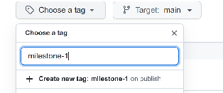
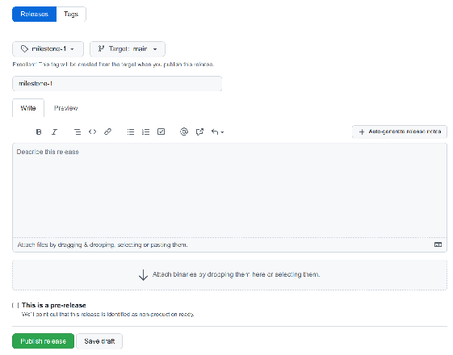
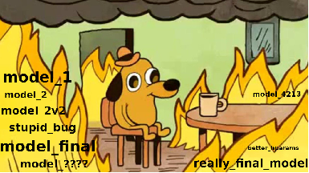
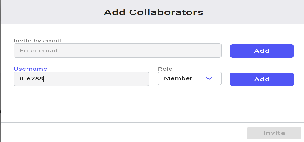
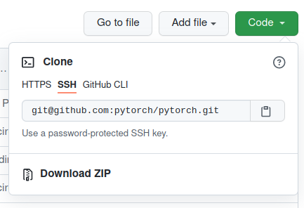
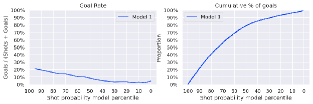
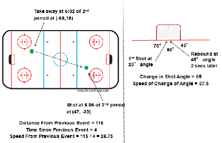
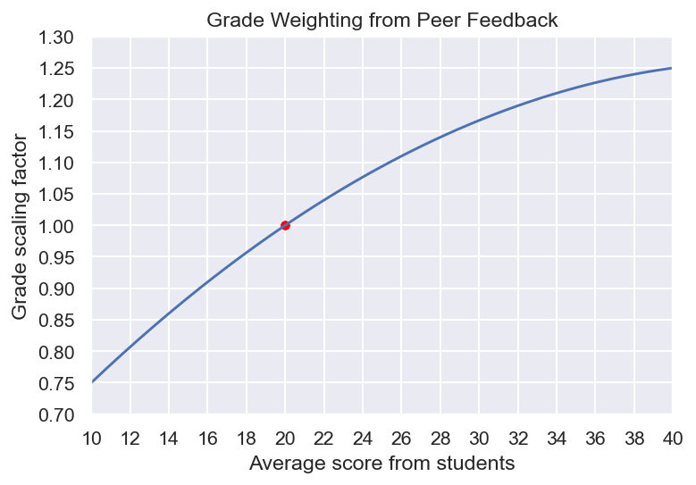
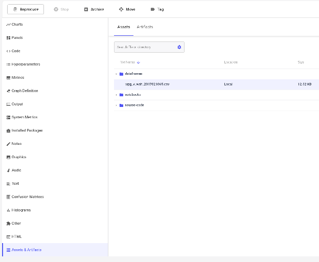

# IFT 6758 Project: Milestone 2

Released: TODO October 2026  
Due date: TODO November 2026, 23:59

**Important: Before beginning work on milestone 2, publish a release for milestone 1 by following the instructions [here](https://docs.github.com/en/repositories/releasing-projects-on-github/managing-releases-in-a-repository), and make sure the IFT6758 TA github account ([`@Jay-D13`](https://github.com/Jay-D13)) has been added to your repo. You do not need to add anything in the description, or upload any binaries. Use `milestone-1` as both the tag and release title, e.g.:**





The first milestone gave you some experience with data wrangling, exploratory data analysis, and creating visualisations. Now, we’ll get our hands dirty with feature engineering, feature selection, and statistical modelling. You will continue to build on the play-by-play data acquired from the [NHL stats API](https://gitlab.com/dword4/nhlapi/-/blob/master/new-api.md), and tackle the problem of predicting the probability that a shot is a goal. You will experiment with a number of different models and features, and produce some visualisations to gauge the effectiveness of your model. You will be using [Comet](https://www.comet.com/) to keep track of your experiments with your group. You will once again present your work in a blog post format, adding another post to your existing blog that you have submitted for milestone 1\.

- [A note on Plagiarism](#a-note-on-plagiarism)
- [Learning Objectives](#learning-objectives)
- [NHL Background: Expected Goals (xG)](#nhl-background-expected-goals-xg)
- [Experiment Tracking](#experiment-tracking)
  - [Comet Setup](#comet-setup)
- [Deliverables](#deliverables)
  - [Submission Details](#submission-details)
- [Tasks and Questions](#tasks-and-questions)
  - [0\. Blog Post](#0-blog-post)
  - [1\. Experiment Tracking (10%)](#1-experiment-tracking-10)
  - [2\. Feature Engineering I (10%)](#2-feature-engineering-i-10)
  - [3\. Baseline Models (15%)](#3-baseline-models-15)
  - [4\. Feature Engineering II (15% \+ bonus 5%)](#4-feature-engineering-ii-15--bonus-5)
  - [5\. Advanced Models (20%)](#5-advanced-models-20)
  - [6\. Give it your best shot\! (20%)](#6-give-it-your-best-shot-20)
  - [7\. Evaluate on test set (10%)](#7-evaluate-on-test-set-10)
  - [8\. Tabular Foundation Models (TODO%)](#8-tabular-foundation-models-todo)
- [Group Evaluations](#group-evaluations)
  - [How scores impact your grade](#how-scores-impact-your-grade)
- [Useful References](#useful-references)
- [Appendix](#appendix)

## A note on Plagiarism

Using code/templates from online resources is acceptable and it is common in data science, but be clear to cite exactly where you took code from when necessary. A simple one line snippet which covers some simple syntax from a StackOverflow post or package documentation probably doesn’t warrant citation, but copying a function which does a bunch of logic that creates your figure does. We trust that you can use your best judgement in these cases, but if you have any doubts you can always just cite something to be safe. We will run some plagiarism detection on your code and deliverables, and it is better to be safe than sorry by citing your references. Disclose any AI assistance (e.g. LLM-generated code); your team remains responsible for explaining and validating all submitted code.

Integrity is an important expectation of this course project and any suspected cases will be pursued in accordance with Université de Montréal’s very [strict policy](https://integrite.umontreal.ca/reglements/les-reglements-expliques/). The full text of the university-wide regulations can be found [here](https://secretariatgeneral.umontreal.ca/public/secretariatgeneral/documents/doc_officiels/reglements/enseignement/ens30_12-reglement-disciplinaire-plagiat-fraude-etudiants-cycles-superieurs.pdf). It is the *responsibility of the team* to ensure that this is followed rigorously and action can be taken on individuals or the entire team depending on the case.

## Learning Objectives

* **Feature Engineering**  
  * Create and select features for use in downstream models  
  * Appropriately encode/transform features which are not directly usable in ML models  
* **Statistical Modelling & Machine Learning**  
  * Experiment with commonly used classifiers and different combinations of features to try and produce a good xG classifier  
  * Gain an understanding of commonly used metrics such as ROC curves and AUC  
  * Produce figures to justify your findings  
* **Tabular Foundation Models**  
  * Understand how a pretrained foundation model can make predictions on a new table through in-context learning, without any training or fine-tuning  
  * Compare a tabular foundation model (TabFM) against a trained gradient-boosted model (XGBoost) in terms of predictive performance, calibration, and compute cost  
* **Reproducibility and Experiment tracking**  
  * Employ good practices with experiment tracking 

## NHL Background: Expected Goals (xG)

A common question when evaluating sports is “how well did a team play?”, or “how well did a particular player perform?”. To answer such questions, we need some sort of metric or statistic that captures the quality of a team/player’s performance. An obvious metric could be to consider the number of goals or points, but the problem is that goals are rare and ‘noisy’ events, which do not account for other factors such as goalie performance. Shots are another option, but there is no notion of the quality of the shot; i.e. was it from a high-danger area, or was it taken far away from the net? 

As a result, simply looking at an aggregate count of shots or goals could be misleading. In an attempt to work past these issues, analysts have turned to statistical modelling techniques to append the notion of “shot quality” to each shot taken. **Expected Goals (xG) estimates the quality of a shot by calculating the likelihood that this shot would have resulted in a goal, based on a variety of factors (features) such as position, shot type, prior events, etc.** This attempts to model how experienced viewers watching a game can reasonably gauge how good the quality of a shot is, based on a variety of factors such as the state of the play, how close the shot was taken, etc. 

From the perspective of data science, we can intuitively model this as a **binary classification** task, where each shot has a label indicating whether or not it resulted in a goal. Each shot can have a variety of features ranging from simple ones such as distance and angle from the net, to more complicated ones such as game state, previous events, shot types, etc. It is important to note that while a classifier outputs a binary label \[0, 1\] to indicate whether or not a shot is predicted to be a goal, this is actually not very useful to us. We’re more interested in the **raw probabilities** that the classifier produces, which (we hope) is an appropriate proxy for the “shot quality”. Analysts can then aggregate shots weighed by the shot quality in an attempt to gauge team or individual performance (though this is not in the scope of this milestone). Furthermore, a shot that is assigned a high likelihood yet did not result in a goal (or vice-versa) may not actually be misclassified. This may be a bit counter intuitive, but remember we are trying to estimate the **shot quality** in an attempt to estimate the overall number of high quality scoring chances. 

## Experiment Tracking

<!-- NOTE: Comet is kept for this year. Consider switching to W&B or MLflow in a future offering (more widely used in research/industry). -->

  
A common situation we find ourselves in when running many experiments is losing track of the model history associated with particular models. There are many tools out there to help with this issue, such as [MLflow](https://mlflow.org/), [Weights and Biases](https://wandb.ai/site), [Comet](https://www.comet.com/), among others. For the purposes of this course, we will be using [Comet](https://www.comet.com/) because it’s simple to use, and has a free tier for academic use. The other offerings are quite comparable, so this choice was largely arbitrary. 

Comet (and many of the other offerings) are online services which provide functionality such as model history tracking, experiment/metadata tracking, artifact stores, and model registries. At a high level, this provides a centralised place to store all of your experiment metadata such as configurations, hyperparameters, dataset hashes, and saved models. These services typically provide a very simple Python SDK which allows you to easily log information to their cloud servers. At a high level, you generally define an *experiment* object, which will group all associated data that you may have logged, such as hyperparameters, model metrics/losses, assets, images, etc. Here’s a simple example to give you a flavour of what experiment tracking looks like:

```python
# Import comet_ml at the top of your file, before sklearn!
from comet_ml import Experiment
import os

# Create an experiment with your api key
exp = Experiment(
    api_key=os.environ.get("COMET_API_KEY"),  # don't hardcode!!
    project_name="milestone_2",
    workspace="<YOUR_WORKSPACE>",
)

# ... Do data science ...

exp.log_metrics({"auc": auc, "acc": acc, "loss": loss})
```

For detailed information, Comet provides many quickstart guides that will be useful; these can be found in their [documentation pages](https://www.comet.com/docs/v2/). They have dedicated examples for [scikit-learn](https://www.comet.com/docs/v2/integrations/ml-frameworks/scikit-learn/), [XGBoost](https://www.comet.com/docs/v2/integrations/ml-frameworks/xgboost/), [PyTorch](https://www.comet.com/docs/v2/integrations/ml-frameworks/pytorch/), among others. 

### Comet Setup

Here’s a quick checklist to get started using Comet: 

1. (All team members) Create an account with your ***academic email*** via [this link](https://www.comet.com/academics).  
   1. Ensure you claim your free academic tier via the above.  
2. Designate one team member to host the workspace for your project. This team member will add the IFT6758 TA Comet account (**`TODO`**) to the Comet workspace, as well as the rest of their team members. This can be found by going into the workspace settings and clicking on **+ Collaborators**. You should see the following prompt:  
     
     
3. Begin using the workspace to log all your experiment metadata, and save/register models  
4. Reproducibility profit\![^1]

**An important note:** to write to a Comet workspace, you will need to specify an **api\_key**, which is unique to your Comet account. **DO NOT** hard-code this into your python file; you may accidentally commit this to your git repo, which means that anybody can now write to this workspace. A common pattern to programmatically handle secrets is to save your API key to an environment variable, which can be safely stored on your machine, and then access it programmatically though Python via the os package. For example, if your team all agrees to store your private keys in the `COMET_API_KEY` environment variable on each of your computers, you could retrieve it safely via:

```python
my_key = os.environ.get("COMET_API_KEY")
```

For this milestone, you will be asked to use Comet to track your experiments. We will not be very picky about how exactly everything is formatted within your Comet workspace, but we will be looking to make sure that experiments leading to a relevant model (i.e. this model resulted in figures in the blog post) can be found in your Comet project. We will highlight requirements in the questions section where we expect to see links to experiment entries. 

## Deliverables

Template Repos to work off of:

- [Blog post template](https://github.com/milarobotlearningcourse/data_science_blog)  
- [Project template](https://github.com/milarobotlearningcourse/data_science_project)

You must submit **BOTH**: 

1. Blog post style report on a **new post** (you may keep or omit the post for MS1)[^2]  
2. Your team’s codebase **that is reproducible** 

As before, instead of a traditional report written in LaTeX, you will be asked to submit a blog post which will contain discussion points and figures. Create **a new post/entry** for Milestone 2; you can choose to keep or omit the original post from milestone 1\. As a reminder, although we will not be deploying these pages to the public, [it is very simple to use github pages to publish your content.](https://docs.github.com/en/pages/setting-up-a-github-pages-site-with-jekyll) You’re more than welcome to do this at the end of the course\!

### Submission Details

To submit your project, you must:

- [ ] Publish your final milestone submission to the **master** or **main** branch   
      (You must do this first before creating the release and downloading the ZIPs\!)  
- [ ] Create a release similar to what you did for milestone 1, but with the **`milestone-2`** tag.   
- [ ] Submit a ZIP of your blog post to [gradescope](TODO)  
- [ ] Submit a ZIP of your codebase to [gradescope](TODO)  
- [ ] Add the IFT6758 TA github account ([`@Jay-D13`](https://github.com/Jay-D13)) to your git repo as a *viewer*, if you have not done so already (or are using a new repo).  
- [ ] Add the IFT6758 TA Comet account (**`TODO`**) to your Comet workspace (workspace settings \> **+ Collaborators**)

**Note**: Only one person per team needs to submit the project to Gradescope.  
To submit a ZIP of your repository, you can download it via the Github UI:  
  
Remember that this method does not download the whole git repo, just the **branch that you are currently on**. Make sure all of your code is in the release that you made before downloading the ZIPs, and that the zip has the release tag in the filename.

## Tasks and Questions

The tasks required for milestone 2 are outlined here. The overall description of what is required is described at the beginning of each task. The **Questions** section of each task will outline content that is required in the blog post. This may either be interpretation questions, or you may have to produce figures or images to include in the blog post. We try to write most of the things that are required in the report in **bold**, but make sure you answer everything asked of you in each question. We do not expect long responses for the questions, in most cases a few sentences will suffice. 

### 0\. Blog Post

Once again, create another blog post using the provided template containing all of the required figures, answers, and discussion mentioned in the previous section. You will not need to actually deploy the blogpost so that it’s publicly accessible, but instructions will be provided for how to do this if you would like to show off your awesome project on your resume after the course is done\! 

### 1\. Experiment Tracking (10%)

As described above, you will be using Comet to track your experiments. Follow the [instructions to set up Comet](#comet-setup) for your project. Once set-up, use Comet to track your experiments. It may take a bit of time to come up with a workflow that makes sense for your team, so feel free to play around with different ways of organising your experiment logs and don’t be afraid of generating lots of “garbage”. The purpose of this section is to get you exposed to the idea of experiment tracking/logging, and it may feel a bit cumbersome at first if you've never done it before. **One suggestion is to stay away from using Jupyter notebooks for running your model experiments**. Notebooks are great for prototyping and visualising things, but they’re not great for running programmatically. Furthermore, Comet plays much more nicely with proper Python scripts rather than interactive notebooks. Admittedly it may feel a bit overkill for this particular use-case, but it is good to get some experience with better practices before going on to work a data science job in industry or continuing on with your research. 

The marks assigned to this section are based on satisfying the requirements associated with experiment tracking throughout the entire milestone. You are free to choose how you format your experiment logs, but bear in mind the point of using this tool is to facilitate reproducibility. This means that there should be enough information to know how a particular model was created. In subsequent tasks, we will explicitly ask for a link to the experiment run corresponding to certain parts of your blog post.  

Throughout the milestone, you will also be asked to save models for testing on a final holdout dataset. To facilitate this, you will make use of the [model registry feature](https://www.comet.com/docs/v2/guides/model-registry/using-model-registry/) to save and register your models. You can use the [`experiment.log_model()`](https://www.comet.com/docs/v2/guides/experiment-management/log-data/models/) API provided by Comet to save and retrieve models from your workspace. This will usually require you to first save your model to disk before passing the path to the saved model to this function: you can find details on saving scikit-learn models [here](https://scikit-learn.org/stable/model_persistence.html), and XGBoost models [here](https://xgboost.readthedocs.io/en/stable/tutorials/saving_model.html). Be sure to read the relevant documentation of whatever library you are using for a particular task.

**Questions**

- None. In subsequent tasks, you will be asked to reference experiment entries in your Comet workspace which are tied to the models that produced specific figures.

### 2\. Feature Engineering I (10%)

Using the functionality you created for *Milestone 1*, acquire all of the *raw* play-by-play data for the 2016/17 season all the way to the 2023/24 season (inclusive). Note that the tidied data that you created will be useful for the baseline models, but you will be creating more features that will require the full raw data in [Part 4](#4-feature-engineering-ii-15--bonus-5). 

Set aside all of the 2023/24 data as your final *test* set. You should not touch this until you reach the end of this milestone. You will use the **2016/17 \- 2022/23** *regular season* data to create your training and validation sets. By the end of this milestone, you will have built up all the framework you need to process new data, so it should be trivial to process your test data once you have finished all of the necessary feature engineering. Until [Part 7](#7-evaluate-on-test-set-10), **any reference to the “dataset” will exclusively refer to the 2016/17 \- 2022/23 data**. 

**Questions**

1. Using your training dataset create a tidied dataset for each shot (`shot-on-goal`) and goal (`goal`) event, with the following columns (you can name them however you want):  
   - **Distance from net**  
   - **Angle from net**  
   - **Is goal** (0 or 1\)  
   - **Empty Net** (0 or 1\). You can derive this from the `situationCode` you used in *Milestone 1* (the goalie digit of the defending team is 0 when its net is empty). As in milestone 1, keep values that cannot be determined as missing rather than treating them as 0, and report the number of affected events.

   You can approximate the net as a single point (i.e. you don’t need to account for the width of the net when computing the distance or angle). You should be able to create this easily using the functionality you implemented for tidying data in *Milestone 1*, as you will only need the (x, y) coordinates for each shot/goal event. **Create and include the following figures in your blogpost and briefly discuss your observations (few sentences):**

   - A histogram of shot counts (goals and no-goals separated), binned by distance  
   - A histogram of shot counts (goals and no-goals separated), binned by angle  
   - A 2D histogram where one axis is the distance and the other is the angle. You do not need to separate goals and no-goals.  
     - *Hint: check out [jointplots](https://seaborn.pydata.org/generated/seaborn.jointplot.html).* 

   As always, make sure all of your axes are labeled correctly, and you make the appropriate choice of axis scale.

2. Now, create two more figures relating the goal rate, i.e. \#goals / (\#no\_goals \+ \#goals), to the distance, and goal rate to the angle of the shot. **Include these figures in your blogpost and briefly discuss your observations.** 

3. Finally, let’s do some quick checks to see if our data makes sense. Unfortunately we don’t have time to do automated anomaly detection, but we can use our “domain knowledge” for some quick sanity checks\! The domain knowledge is that “*it is incredibly rare to score a non-empty net goal on the opposing team from within your defensive zone*”[^3]. Knowing this, **create another histogram,** this time of goals only, binned by distance, and separate empty net and non-empty net events. **Include this figure in your blogpost and discuss your observations**. Can you find any events that have incorrect features (e.g. wrong x/y coordinates)? If yes, prove that one event has incorrect features.  
   - *Hint: the [NHL gamecenter](https://www.nhl.com/gamecenter/mtl-vs-sea/2021/10/26/2021020096) usually has video clips of goals for every game.*

### 3\. Baseline Models (15%)

You will now use the distance and angle features you’ve produced in the previous section to produce a few simple models to get a feel for what you can expect as baseline performance, before digging deeper into more complicated features and models in the subsequent section. Don’t bother spending much time tuning your models, the point of this is to develop some baseline intuition on the problem.  

**Questions**

1. Using your dataset (remember, don’t touch the test set\!), create a training and validation split however you feel is appropriate. Using only the distance feature, train a [Logistic Regression](https://scikit-learn.org/stable/modules/generated/sklearn.linear_model.LogisticRegression.html) classifier with the completely default settings, i.e.:   
     
   ```python
   clf = LogisticRegression()
   clf.fit(X, y)
   ```
     
   Evaluate the accuracy (i.e. correctly predicted / total) of your model on the validation set. What do you notice? Look at the predictions and discuss your findings. What could be a potential issue? **Include these discussions in your blog post.**  
     
2. Based on your findings in Q1, we should explore other ways of evaluating our model. The first thing to note is that we are not actually interested in the binary prediction of whether a shot is a goal or not \- we are interested in the probability that the model assigns to it (recall that we’re interested in the notion of ***expected goals***). Scikit-learn provides this to you via the [`predict_proba(...)`](https://scikit-learn.org/stable/modules/generated/sklearn.linear_model.LogisticRegression.html#sklearn.linear_model.LogisticRegression.predict_proba) method; make sure you take the probabilities of the class that you care about\! You will produce **four** figures (one curve per model per plot) to probe our model’s performance. Make sure you are using the probabilities obtained on the validation set:  
   1. [Receiver Operating Characteristic (ROC) curves](https://scikit-learn.org/stable/auto_examples/model_selection/plot_roc.html) and the [AUC metric](https://scikit-learn.org/stable/modules/generated/sklearn.metrics.auc.html) of the ROC curve. Include a random classifier baseline (see the random baseline defined in Q3).  
   2. The goal rate (\#goals / (\#no\_goals \+ \#goals)) as a function of the shot probability model percentile, i.e. if a value is the 70th percentile, it is above 70% of the data.   
   3. The cumulative proportion of goals (not shots) as a function of the shot probability model percentile.  
   4. The [reliability diagram](https://scikit-learn.org/stable/modules/calibration.html) (calibration curve). Scikit-learn provides functionality to create a reliability diagram in a few lines of code; check out the [CalibrationDisplay](https://scikit-learn.org/stable/modules/generated/sklearn.calibration.CalibrationDisplay.html) API (specifically the `.from_estimator()` or `.from_predictions()` methods) for more information.

   An example of what is expected for (b) and (c) are shown in Figure 1\. Do not include all of these in your blog post yet, as you will add a few more curves in the next section. 

     
   *Figure 1: Goal rate and cumulative proportion of goals, as a function of the shot probability model percentile.* 

3. Now train two more Logistic Regression classifiers using the same setup as above, but this time on the angle feature, and then both distance and angle. Produce the same four figures as described in the previous question for each model. Including the random baseline, you should have a total of 4 lines on each figure:   
   - Logistic Regression, trained on distance only (already done above)  
   - Logistic Regression, trained on angle only  
   - Logistic Regression, trained on both distance and angle  
   - Random baseline: rather than training a classifier, the predicted probability is sampled from a uniform distribution, i.e. $\tilde{y}_i \sim U(0,1)$  

   **Include these four figures (each with four curves) in your blogpost.** In a few sentences, **discuss your interpretation of these results.**   
    
4. Next to the figures, **include links to the three experiment entries in your Comet projects that produced these three models. Save the three models to the three experiments on Comet (see [logging models](https://www.comet.com/docs/v2/guides/experiment-management/log-data/models/))** and register them with some informative tags, as you will need them for the final section. 

### 4\. Feature Engineering II (15% \+ bonus 5%)

Now that we have some baseline results, we can kick it up a notch with some more features. You will include a number of features that are already available in your previously tidied dataset from *milestone 1*, as well as add new functionality which includes information from other features.

**Questions**  
*Note that you can give these features whatever informative name that you would like.*

1. From the already tidied data, include the following features:  
   * **Game seconds**  
   * **Game period**  
   * **Coordinates** (x,y, separate columns)  
   * **Shot distance**  
   * **Shot angle**  
   * **Shot type**

2. Now, to each shot, add information from the previous events. Note that this could be any event, not just shots. This means you will likely have to update your code which produced the tidied data to now also look at other event types. As a reminder, each element of the `plays` list in the play-by-play response has its event type in `typeDescKey` (e.g. `faceoff`, `hit`, `takeaway`, `blocked-shot`, `penalty`, etc.); the [API references](#useful-references) can help you figure out the rest.

   To each shot, add the following information from the immediately preceding event as four new features:

   * **Last event type**  
   * **Coordinates of the last event** (x, y, separate columns)  
   * **Time from the last event** (seconds)  
   * **Distance from the last event**

3. With this new information, we will create a few more features which try to quantify a few more interesting things about the state of the play. Create the following three features:  
   * **Rebound** (bool): True if the last event was also a shot on goal (`shot-on-goal`), otherwise False  
   * **Change in shot angle**; only include if the shot is a rebound, otherwise 0\.  
   * “**Speed**”: defined as the *distance from the previous event*, divided by the *time* since the previous event.   

     
   *Figure 2: **Speed** and **Change of Angle** features, taken from [moneypuck.com](https://moneypuck.com/about.htm).*  
    
4. ***(Bonus 5%)*** As a bonus, compute a few features regarding the power-play situation. Include:  
   * **Time since the power-play started** (seconds), reset this to 0 when the power-play expires.   
     * Note that there are 2 minute [*minor*](https://en.wikipedia.org/wiki/Penalty_(ice_hockey)#Minor_penalty), 4 minute [*double minor*](https://en.wikipedia.org/wiki/Penalty_(ice_hockey)#Minor_penalty), and 5 minute [*major*](https://en.wikipedia.org/wiki/Penalty_(ice_hockey)#Major_penalty) penalties. Read the [NHL rulebook](https://www.nhl.com/info/hockey-operations/rulebook) to understand how each penalty expires.  
     * Power-plays can stack, i.e. if the penalized team takes another penalty, they will be down 2 players until the penalty expires, then down 1 until the second expires. In this case, don’t reset the timer; simply keep counting until all penalties expire.  
   * **Number of friendly non-goalie skaters on the ice**  
   * **Number of opposing non-goalie skaters on the ice**

   Recall from *Milestone 1* that the skater counts can be read directly from the `situationCode`, but nothing in the API tells you *how long* a power play has been going on. To compute the timer, you will have to keep track of each penalty event (`typeDescKey == "penalty"`; the penalty type and its length in minutes are in `details.typeCode` and `details.duration`) and figure out when each penalty expires. Using the same penalty tracking, **reconstruct the two skater count features without using the `situationCode`**, then compare your reconstruction against the `situationCode`: **report the percentage of shots where they agree, and discuss the main causes of disagreement.** 

5. Comet provides some functionality to track datasets, either as raw artifacts that you manually save, or automatically uploading DataFrame/tables for you. It also has some nice functionality to compute dataset hashes, allowing you to verify if you’re training on the same data as others. You can find more info about this functionality in their [documentation](https://www.comet.com/docs/v2/api-and-sdk/python-sdk/reference/Experiment/#comet_ml.Experiment.log_dataframe_profile). You are not required to use this feature for the majority of your project (you can if you’d like\!). However, for the purposes of this section, we will be asking you to submit a small subset (one specific game) of your final dataframe with all of your final features. Filter your dataset to the [Winnipeg vs Washington game on March 12, 2018](https://www.nhl.com/gamecenter/wpg-vs-wsh/2018/03/12/2017021065). This game has the game ID `2017021065`. **Upload the filtered DataFrame with all of the features that you created as a CSV using the [`log_dataframe_profile(...)`](https://www.comet.com/docs/v2/api-and-sdk/python-sdk/reference/Experiment/#comet_ml.Experiment.log_dataframe_profile) method; keep the name as** `'wpg_v_wsh_2017021065'`**.** Here’s example code for uploading the dataset:

   ```python
   experiment = Experiment(
       api_key=os.environ.get("COMET_API_KEY"),
       project_name="feature_engineering_data",
       workspace="<YOUR_WORKSPACE>",
   )

   experiment.log_dataframe_profile(
       subset_df,
       name="wpg_v_wsh_2017021065",  # keep this name
       dataframe_format="csv",  # ensure you set this flag!
   )
   ```

   **In your blogpost, add a list of all of the features that you created for this section. List each feature by both the column name in your dataframe AND a simple human-readable explanation** (i.e. game\_sec: Total number of seconds elapsed in the game). **If you created any novel features, briefly describe what they are. Add a link to the experiment which stores the filtered DataFrame artifact for the specified game.** Note that there should only be one DataFrame logged with this name. See the [appendix](#appendix) for an example of what we are looking for.

### 5\. Advanced Models (20%)

Now that we have many features to work with, let's see if this puts us ahead of our simple logistic regression models in part 3\. We will be focusing on [XGBoost](https://xgboost.readthedocs.io/en/stable/python/python_intro.html) models for this section; you will have free reign to try whatever you would like in the next section.  

**Questions**  
For each of the following questions, the same four figures as in part 3 will be used as quantitative metrics:

* ROC/AUC  
* Goal rate vs probability percentile  
* Cumulative proportion of goals vs probability percentile  
* Reliability curve

Where a question asks you to record model metrics, add a corresponding curve to each of these four figures. Note that these are four new figures, i.e. you do not need to overlay the curves on the same figures you produced for part 3\.

1. Train an XGBoost classifier using the same dataset using only the distance and angle features (similar to part 3). Don’t worry about hyperparameter tuning yet, this will just serve as a comparison to the baseline before we add more features. **Add the corresponding curves to the four figures in your blog post. Briefly (few sentences) discuss your training/validation setup, and compare the results to the Logistic Regression baseline.** **Include a link to the relevant Comet entry for this experiment,** but you do not need to log this model to the model registry.

2. Now, train an XGBoost classifier using all of the features you created in [Part 4](#4-feature-engineering-ii-15--bonus-5) and do some hyperparameter tuning to try to find the best performing model with all of these features. **In your blog post, discuss your hyperparameter tuning setup, and include figures to substantiate your choice of hyperparameters**. For example, you could select appropriate metrics and do a grid search with cross validation. **Once tuned, include curves corresponding to the best model to the four figures in your blog post, and briefly compare the results to the XGBoost baseline.** **Include a link to the relevant Comet entry for this experiment, and log this model to the model registry.**

3. Finally, explore using some feature selection techniques to see if you can simplify your input features. A number of features carry correlated information, so you can try to see if some of them are redundant. You can try some of the feature selection techniques discussed in class; many of these are [implemented for you by scikit-learn](https://scikit-learn.org/stable/modules/feature_selection.html). You could also use a library like [SHAP](https://github.com/shap/shap) to try to interpret what feature your model relies on the most. **Discuss the feature selection strategies that you tried, and what was the most optimal set of features that you came up with. Include some figures to substantiate your claims.** Once you’ve found the optimal set of features via hyperparameter tuning/cross validation, if the feature set is different than what was used for Q2 of this section, **include curves corresponding to the best model to the four figures in your blog post, and briefly compare the results to the XGBoost baseline. Include a link to the relevant Comet entry for this experiment, and log this model to the model registry.**

### 6\. Give it your best shot\! (20%)

Now it's your turn to come up with the best model you can for predicting expected goals\! For this section you are free to try any sort of models that you’d like. Here are some potential things you can try (you’re encouraged to try your own ideas\!): 

* Different model types such as neural networks, decision trees, clustering, etc.  
* More advanced feature selection strategies  
* More thoughtful splitting of the training data   
  * For example, motivated by the fact that teams often start completely healthy but then lose players to injury as the season progresses, you could omit the first 20 games per team, or select the training/validation sets by alternating games.  
* Hyperparameter tuning, cross validation strategies  
* Regularisation  
* Explore more novel metrics for this task

Don’t spend too much time trying to make this part perfect. The goal here is to try a wide variety of things rather than trying to hyper-optimise a single approach. To get full marks, we expect to see at least 3-4 different things attempted.

**Questions**

1. **In your blog post, discuss the various techniques and methods you tried. Include the same four figures as in [Part 3](#3-baseline-models-15)** (ROC/AUC curve, goal rate vs probability percentile, cumulative proportion of goals vs probability percentile, and the reliability curve). Quantitative metrics are only required for a few set of experiments, so you only need to include a few curves on each plot (e.g. things that you found interesting, or models that performed particularly well). **Make sure to include and highlight what you consider your best ‘final’ model**. For methods that weren’t too successful or interesting, you can just include them as short qualitative discussion.

2. Next to the figures, **include links to the experiment entry in your Comet projects that you included quantitative metrics for** (around 3-4)**. Log the models to the experiments on Comet (see [logging models](https://www.comet.com/docs/v2/guides/experiment-management/log-data/models/))** and register them with some informative tags. 

### 7\. Evaluate on test set (10%)

Finally, when you’ve finished creating and saving the models from sections 3, 5, and 6, evaluate these models on the holdout test set you set aside in [part 2](#2-feature-engineering-i-10). Because you saved your final models in the Comet model registry, you can now pull all of these models and evaluate them programmatically; this can be done using the [Python API](https://www.comet.com/docs/v2/api-and-sdk/python-sdk/reference/API/#comet_ml.API.download_registry_model).

Note: once you evaluate your models on the test set, you should be *done*. You should never go back and fine-tune your models to maximise your scores on the test set. You will not lose marks if your models perform worse on the test set\!

**Questions**  
For each the following questions, you will need to evaluate a total of five models:

* The three logistic regression models you saved in [part 3](#3-baseline-models-15)  
* The best XGBoost model you saved in [part 5](#5-advanced-models-20)  
* Your best overall model that you saved in [part 6](#6-give-it-your-best-shot-20)

and produce the same four figures as in part 3 (single figure for each, with 5 curves):

* ROC/AUC  
* Goal rate vs probability percentile  
* Cumulative proportion of goals vs probability percentile  
* Reliability curve

Note that you’re more than welcome to evaluate more than the five specified above if you’d like\! We only require that you evaluate the 5 specified models in order to get full marks. For the two questions below we expect 3-5 sentences each, but you’re welcome to go over this if you have interesting things to discuss. 

1. Test your 5 models on the untouched 2023/24 regular season dataset. **In your blogpost, include the four figures described above. Discuss your results and observations on the test set. Do your models perform as well on the test set as you did on your validation set when building your models? Do any models perform better or worse than you expected?**

2. Test your 5 models on the untouched 2023/24 playoff games. **In your blogpost, include the four figures described above. Discuss your results and observations on this test set. Are there any differences to the regular season test set or do you get similar ‘generalisation’ performance?**

### 8\. Tabular Foundation Models (TODO%)

> [!NOTE]
> **TODO:** draft, still being finalised.

Large language models (LLMs) have been shown to excel at zero-shot classification tasks \[1\]. Zero-shot classification is the task of predicting a label for a class that was not seen during model training \[2\]. In LLMs, this is done through in-context learning, whereby examples are provided to the model as part of the input during inference time. In this case, the model parameters do not need to be updated for a new task.

TabFM \[3\] is a model that is specifically designed for zero-shot classification and regression over tabular datasets. It applies the same in-context learning idea to tables: the labelled rows you give the model are its context, and it predicts new rows in a single forward pass, without updating its weights.

In this question, we’ll explore the use of TabFM leveraging the dataset from [Part 4](#4-feature-engineering-ii-15--bonus-5). The model is about 7 GB; we expect you to run it on a Google Colab T4 GPU, but you are free to run it locally if your hardware can handle it. To set up TabFM, you can follow the steps below.

```python
# Install TabFM dependencies
%pip install "tabfm[pytorch]==1.0.1" "typeguard>=4.0.1" scikit-learn

# Import TabFM
from tabfm import TabFMClassifier, tabfm_v1_0_0_pytorch as tabfm_v1_0_0

# Load the model. The model is about 7GB and may take some time.
model = tabfm_v1_0_0.load(model_type="classification")

# Instantiate the TabFM Classifier
clf = TabFMClassifier(model=model)
```

TabFM is compatible with the scikit-learn API. In the case of `fit`, the model caches the table as context. There is no actual model training.

```python
clf.fit(X_train, y_train)
```

To run the model over a set of inputs, you can call `predict` or `predict_proba`:

```python
preds = clf.predict(X_test)
probs = clf.predict_proba(X_test)
```

**Questions**

1. Fit a `TabFMClassifier` on the training set and run a `predict_proba` on the held out test set. Track the time it takes for the model to fit vs. predict (you can use `time.perf_counter()`). Compare this to the time it takes to perform similar operations with the XGBoost classifier. Discuss the implications in your report.

2. Produce the same four figures as in [Part 7](#7-evaluate-on-test-set-10) for the `TabFMClassifier` and include a discussion of the results and observations on the test set.

**Sources**

\[1\] [Brown et al., *Language Models are Few-Shot Learners*, NeurIPS 2020](https://arxiv.org/abs/2005.14165)  
\[2\] [Hugging Face: Zero-Shot Classification](https://huggingface.co/tasks/zero-shot-classification)  
\[3\] [Google Research: Introducing TabFM, a zero-shot foundation model for tabular data](https://research.google/blog/introducing-tabfm-a-zero-shot-foundation-model-for-tabular-data/)

## Group Evaluations

In addition to the grading described above, for each milestone you will be asked to score with how much you think everyone contributed to this milestone, and provide constructive feedback to your teammates, based on their strengths and potential areas of improvement. Students who do not contribute much will likely earn a poor grade, and in extreme cases might be removed from the group and asked to complete the projects individually. 

For a team of size **N**, everyone in the team will have **N x 20** points to allocate between everyone in your group (including yourself). You will then assign everyone a score between **10 – 40**, where **10** corresponds to “half effort”, and **40** corresponds to “double effort” (**you cannot assign points outside of this range\!**). In an ideal situation, everyone will contribute to the project equally and thus everyone will assign 20 points to every teammate. However, in the case where some people contributed less than others, you could assign them less points and give those points to who you think contributed more. Extreme cases will result in an instructor following up with the team to resolve any potential difficulties. This could include auditing git history in your repositories. *Any attempts to game the system will be handled manually and unfavourably\!*

In addition to the score, you will also **give short feedback to your peers**, on both areas of strengths and potential areas of improvement. This feedback will be given privately and anonymously to each student. You can give feedback along several different axes, such as their **teamwork** (communication, reliability) and **technical work** (how much they contributed and the quality of their work/code). If you give a score below 20, you must give constructive feedback on areas that they can improve. 

### How scores impact your grade

* **x** is the average score for a student (excluding their own score), clamped between 10 ("half effort") and 40 ("double effort").  
* A student's score on the milestone will be multiplied by the following weighting factor[^4]:

**Scaling**(**x**) \= 0.41667 \+ 0.0375**x** \- 0.00041667**x**²

* This system was adopted from [Brian Fraser (SFU)](https://opencoursehub.cs.sfu.ca/bfraser/grav-cms/cmpt276/project), which in turn is based on the [work of Bill Gardner](http://www.cs.ubc.ca/wccce/Program03/papers/Gardner-Group/Gardner-Group.htm).



Your final mark will then be scaled by this final scaling factor. As an example, we show a non-ideal case where the workload was not fairly distributed across the group. Take a group of 4 people (**A**, **B**, **C**, and **D**) where the final project score was 95% and everyone gave **person A** 20 points. Their grade would not be affected (recall that you exclude your own score): 

**Scaling**((**20** \+ **20** \+ **20**) / 3\) \= 1 \* 95% \= 95%

However for this same group, if **person B** did not contribute as much, their final grade may suffer: 

**Scaling**((**15** \+ **14** \+ **15**) / 3\) \= 0.88 \* 95% \= 83.3%

Perhaps **person C** & **D** picked up the slack, and their scores reflect this \- their final grades may be bumped up as a result. This example is summarised in the table below. 

In general we do not expect teams to have any issues. We hope that by laying out a clear method for evaluating each other and how this may directly affect your grade, people are incentivised to cooperate and contribute equally to the project. In the event of any conflict or concerns with the group, we encourage you to try to resolve it as quickly as possible. If you require the support of the instructors to resolve any issues or concerns, please contact us as early as possible to resolve it.

| Table 1: Sample group evaluations for a team of 4, which scored 95% on the milestone. |  |  |  |  |
| :---- | :---: | :---: | :---: | :---: |
| (down) person who gave a score | (across) Person assigned a score |  |  |  |
|  | **A** | **B** | **C** | **D** |
| **A** | 20 | 15 | 21 | 24 |
| **B** | 20 | 15 | 22 | 23 |
| **C** | 20 | 14 | 22 | 24 |
| **D** | 20 | 15 | 21 | 24 |
| **Multiplier** | 1.0 | 0.88 | 1.03 | 1.07 |
| **Final Score** | 95% | 83.3% | 97.6% | 101.7**%** |

## Useful References

**Course content**

* [IFT6758 Hockey Primer](https://docs.google.com/document/d/1CP4dbReUdLMwtmnU8_lEQDawrh5LkbDuGDM9Sqza6ZA/edit?usp=sharing)  
* [IFT6758 Blog post template](https://github.com/milarobotlearningcourse/data_science_blog)  
* [IFT6758 Project template](https://github.com/milarobotlearningcourse/data_science_project)

**API documentation**

* [Zmalski's  NHL API Reference](https://github.com/Zmalski/NHL-API-Reference) \- incomplete documentation on the **new API**  
* [dword4's NHL API Doc](https://gitlab.com/dword4/nhlapi/-/blob/master/new-api.md) \- another incomplete reference for the **new** **API**  
* [Unofficial (old) NHL API Doc](https://gitlab.com/dword4/nhlapi/) \- **old API** \- this no longer works, however some of the formatting of things such as game ID are still valid

**Libraries**

* [Pandas](https://pandas.pydata.org/docs/index.html)  
  * [Cut](https://pandas.pydata.org/docs/reference/api/pandas.cut.html) (useful for binning)  
  * [Pivot](https://pandas.pydata.org/docs/reference/api/pandas.DataFrame.pivot.html)  
  * [Groupby (split-apply-combine)](https://pandas.pydata.org/docs/user_guide/groupby.html)  
* [Scikit-learn](https://scikit-learn.org/stable/)  
  * [User Guide](https://scikit-learn.org/stable/user_guide.html) (lots of background about different models)  
  * [ROC curve](https://scikit-learn.org/stable/modules/generated/sklearn.metrics.roc_curve.html)  
  * [Area Under Curve](https://scikit-learn.org/stable/modules/generated/sklearn.metrics.auc.html)  
  * [Calibration Curves](https://scikit-learn.org/stable/modules/calibration.html)  
  * [Feature Selection](https://scikit-learn.org/stable/modules/feature_selection.html)  
* [XGBoost](https://xgboost.readthedocs.io/en/stable/python/python_intro.html)  
* [Seaborn](https://seaborn.pydata.org/introduction.html)  
  * [JointPlot](https://seaborn.pydata.org/generated/seaborn.jointplot.html)  
* [SHAP](https://github.com/shap/shap) (A useful tool for model explainability)  
* [Comet Python SDK](https://www.comet.com/docs/v2/guides/getting-started/quickstart/)

**Miscellaneous**

* [Cookiecutter Data Science](https://drivendata.github.io/cookiecutter-data-science/) \- A useful tool to help template your git repos

## Appendix



An example of what we will be looking for in the experiment that you link for [part 4](#4-feature-engineering-ii-15--bonus-5). Ensure that **only a single DataFrame exists** with the specified name in the experiment run that you link, and ensure that it is in a **CSV format**. 

[^1]:  Okay it's not that easy, but experiment tracking is a good step in this direction.

[^2]:  Because the difficulty of the advanced visualisations in milestone 1 may have resulted in extremely large figures (in terms of memory), you are free to omit the advanced visualisations from your original blog post, if you choose to submit your blog including both posts.   

[^3]:  Technically, goals from outside the offensive zone are generally very unlikely, but for the sake of brevity, focus on non-empty net goals on the opposing team taken from within your team’s defensive zone.

[^4]:  *The coefficients are obtained by fitting the quadratic   y(x) \= a**x**² \+ b**x** \+ c   to the points **x**\=10 → weight=0.75; **x**\=20 → weight=1.0; **x**\=40 → weight=1.25.*
