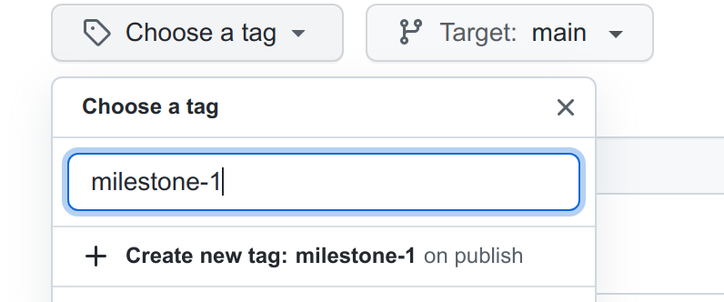
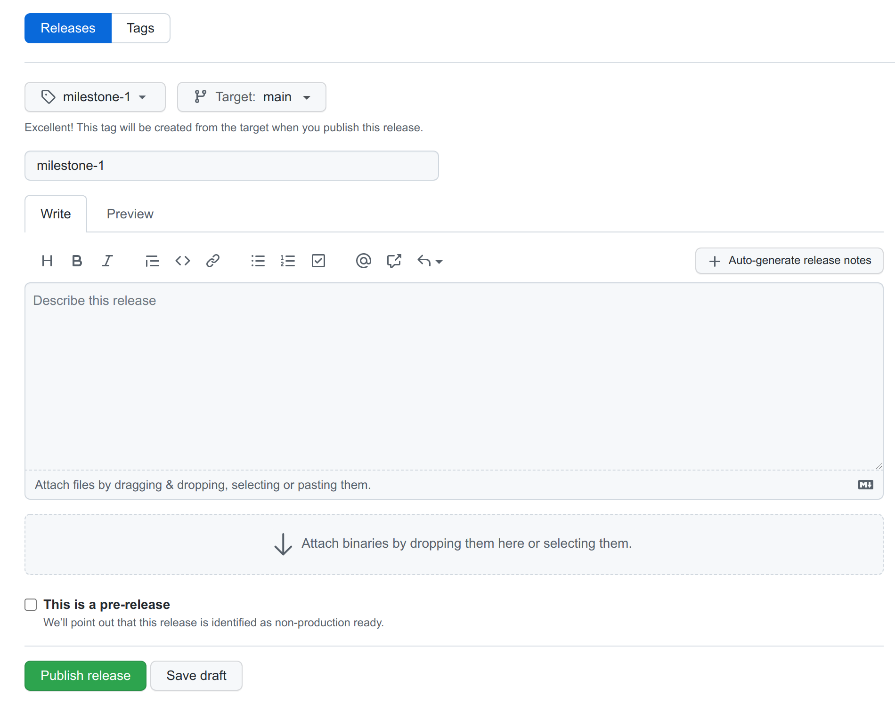
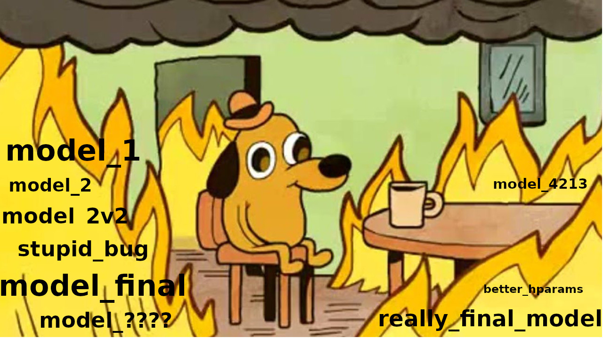
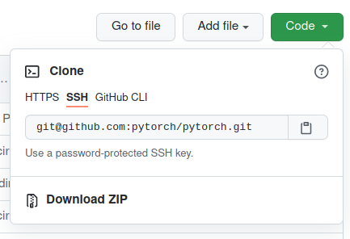
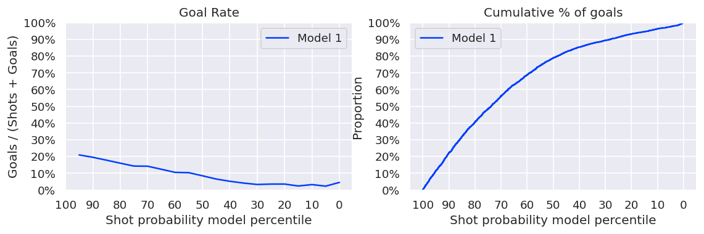
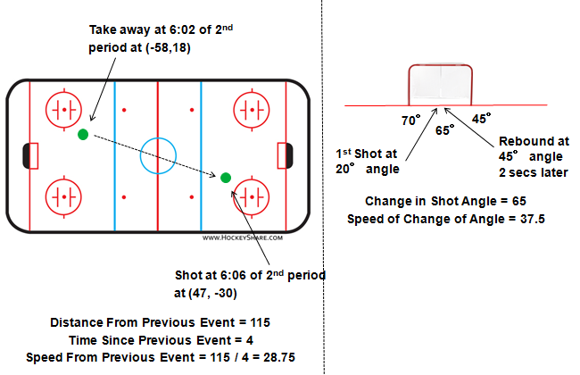
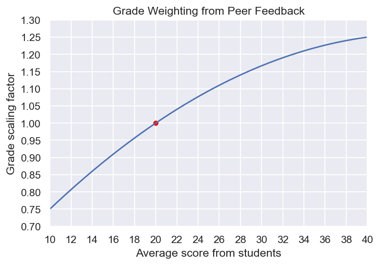

# Projet IFT 6758 : Étape 2

Sortie : 2 novembre 2026  
Date limite : 2 décembre 2026, 23 h 59  
Dernière mise à jour : 2 novembre 2026

**Important : Avant de commencer à travailler sur l'étape 2, publiez une version de l'étape 1 en suivant les instructions [ici](https://docs.github.com/en/repositories/releasing-projects-on-github/managing-releases-in-a-repository) et ajoutez [@Jay-D13](https://github.com/Jay-D13) en tant que collaborateur github. Vous n'avez pas besoin d'ajouter quoi que ce soit dans la description ou de téléverser des binaires. Utilisez milestone-1 à la fois comme tag et titre de version *release*, par exemple :**

****



La première étape vous a permis d'acquérir de l'expérience dans la gestion des données, l'analyse exploratoire des données et la création de visualisations. Maintenant, nous allons nous salir les mains avec l'ingénierie des caractéristiques, la sélection des caractéristiques et la modélisation statistique. Vous continuerez à vous appuyer sur les données de jeu acquises à partir de l'[API de statistiques de la LNH](https://gitlab.com/dword4/nhlapi/-/blob/master/new-api.md) et à résoudre le problème de la prédiction de la probabilité qu'un tir *(shot)* soit un but *(goal)*. Vous essayerez un certain nombre de modèles et de caractéristiques différentes et produirez des visualisations pour évaluer l'efficacité de vos modèles. Vous utiliserez [Wandb](https://wandb.ai/site/) pour suivre vos expériences avec votre groupe. Vous présenterez à nouveau votre travail dans un format d'article de blog, en ajoutant un autre article à votre blog existant que vous avez soumis pour l'étape 1.

- [Une note sur le plagiat](#une-note-sur-le-plagiat)
- [Objectifs d'apprentissage](#objectifs-dapprentissage)
- [Contexte LNH : Buts espérés (xG)](#contexte-lnh--buts-espérés-xg)
- [Suivi des expériences](#suivi-des-expériences)
  - [Configuration de Wandb](#configuration-de-wandb)
- [Livrables](#livrables)
  - [Détails de la soumission](#détails-de-la-soumission)
- [Tâches et questions](#tâches-et-questions)
  - [0. Article de blog](#0-article-de-blog)
  - [1. Suivi des expériences (5%)](#1-suivi-des-expériences-5)
  - [2. Ingénierie des caractéristiques I (10%)](#2-ingénierie-des-caractéristiques-i-10)
  - [3. Modèles de base (10%)](#3-modèles-de-base-10)
  - [4. Ingénierie des caractéristiques II (15% + bonus 5%)](#4-ingénierie-des-caractéristiques-ii-15--bonus-5)
  - [5. Modèles avancés (15%)](#5-modèles-avancés-15)
  - [6. Faites de votre mieux! (15%)](#6-faites-de-votre-mieux-15)
  - [7. Évaluer sur l'ensemble de test (10%)](#7-évaluer-sur-lensemble-de-test-10)
  - [8. Modèles de fondation tabulaires (20%)](#8-modèles-de-fondation-tabulaires-20)
- [Évaluations de groupe](#évaluations-de-groupe)
  - [Comment les scores influencent votre note](#comment-les-scores-influencent-votre-note)
- [Références utiles](#références-utiles)

## Une note sur le plagiat

L'utilisation de code/modèles provenant de ressources en ligne est acceptable et courante en science des données, mais soyez clair pour citer exactement d'où vous avez pris le code lorsque nécessaire. Un simple extrait d'une ligne qui couvre une syntaxe simple provenant d'un article StackOverflow ou de la documentation d'un package ne justifie probablement pas une citation, mais copier une fonction qui effectue un tas de logique pour créer votre figure, oui. Nous vous faisons confiance pour utiliser votre meilleur jugement dans ces cas, mais si vous avez des doutes, vous pouvez toujours citer la source pour être sûr. Nous effectuerons une détection de plagiat sur votre code et vos livrables, et il vaut mieux prévenir que guérir en citant vos références. Déclarez toute aide provenant de l'IA (p. ex. du code généré par un LLM) ; votre équipe demeure responsable d'expliquer et de valider tout le code soumis.

L'intégrité est une attente importante de ce projet de cours et tout cas suspect sera poursuivi conformément à la [politique très stricte](https://integrite.umontreal.ca/reglements/les-reglements-expliques/) de l'Université de Montréal. Le texte complet des règlements à l'échelle de l'université peut être trouvé [ici](https://secretariatgeneral.umontreal.ca/public/secretariatgeneral/documents/doc_officiels/reglements/enseignement/ens30_12-reglement-disciplinaire-plagiat-fraude-etudiants-cycles-superieurs.pdf). Il est de la *responsabilité de l'équipe* de s'assurer que cela est suivi rigoureusement et des actions peuvent être prises sur des individus ou sur l'ensemble de l'équipe selon les cas.

## Objectifs d'apprentissage

* **Ingénierie des caractéristiques**  
  * Créer et sélectionner des caractéristiques à utiliser dans les modèles en aval  
  * Encoder/transformer de manière appropriée les caractéristiques qui ne sont pas directement utilisables dans les modèles ML  
* **Modélisation statistique et apprentissage automatique**  
  * Expérimenter avec des classificateurs couramment utilisés et différentes combinaisons de caractéristiques pour essayer de produire un bon classificateur xG  
  * Acquérir une compréhension des métriques couramment utilisées telles que les courbes ROC et l'AUC  
  * Produire des figures pour justifier vos résultats  
* **Modèles de fondation tabulaires**  
  * Comprendre comment un modèle de fondation préentraîné peut faire des prédictions sur une nouvelle table grâce à l'apprentissage en contexte (*in-context learning*), sans aucun entraînement ni ajustement fin  
  * Comparer un modèle de fondation tabulaire (TabFM) à un modèle de gradient boosting entraîné (XGBoost) sur le plan de la performance prédictive, de la calibration et du coût de calcul  
* **Reproductibilité et suivi des expériences**  
  * Utiliser de bonnes pratiques avec le suivi des expériences 

## Contexte LNH : Buts espérés (xG)

Une question courante lors de l'évaluation du sport est « à quel point une équipe a-t-elle bien joué? », ou « quelle est la performance d'un joueur en particulier? ». Pour répondre à de telles questions, nous avons besoin d'une sorte de mesure ou de statistique qui capture la qualité de la performance d'une équipe/d'un joueur. Une mesure évidente pourrait être de prendre en compte le nombre de buts ou de points, mais le problème est que les buts sont des événements rares et «bruyants», qui ne tiennent pas compte d'autres facteurs tels que la performance du gardien de but. Les tirs sont une autre option, mais il n'y a aucune notion de la qualité du tir; c'est-à-dire provient-il d'une zone de haut danger ou a-t-il été effectué loin du filet? 

En conséquence, le simple fait de regarder un nombre total de tirs ou de buts peut être trompeur. Pour tenter de dépasser ces problèmes, les analystes se sont tournés vers des techniques de modélisation statistique pour ajouter la notion de « qualité de tir » à chaque tir. **Les buts espérés *(expected Goals -* xG) estiment la qualité d'un tir en calculant la probabilité que ce tir aurait abouti à un but, en fonction de divers facteurs (caractéristiques) tels que la position, le type de tir, les événements antérieurs, etc.** Cela tente de modéliser comment les téléspectateurs expérimentés qui regardent un match peuvent raisonnablement évaluer la qualité d'un tir, en fonction de divers facteurs tels que l'état du jeu, la proximité du tir, etc. 

Du point de vue de la science des données, nous pouvons modéliser intuitivement cela comme une tâche de **classification binaire**, où chaque tir a une étiquette indiquant s'il a ou non abouti à un but. Chaque tir peut avoir une variété de caractéristiques allant de caractéristiques simples telles que la distance et l'angle par rapport au filet à des caractéristiques plus compliquées telles que l'état du jeu, les événements précédents, les types de tirs, etc. Il est important de noter que même si le classificateur produit une étiquette binaire [0, 1] pour indiquer si un tir est prédit ou non comme un but, cela ne nous est en fait pas très utile. Nous sommes plus intéressés par les **probabilités brutes** que le classificateur produit, qui sont (nous l'espérons) un proxy approprié pour la « qualité du tir ». Les analystes peuvent ensuite agréger les tirs pondérés par la qualité des tirs dans le but d'évaluer les performances d'une équipe ou d'un individu (bien que cela ne fasse pas partie de cette étape du projet). De plus, un tir qui a une forte probabilité mais qui n'a pas abouti à un but (ou vice-versa) peut ne pas être mal classé. Cela peut être un peu contre-intuitif, mais rappelez-vous que nous essayons d'estimer la **qualité du tir** dans le but d'estimer le nombre total de chances de marquer de haute qualité. 

## Suivi des expériences 

  
Une situation courante dans laquelle nous nous trouvons lors de l'exécution de nombreuses expériences est de perdre la trace de l'historique associé à des modèles particuliers. Il existe de nombreux outils qui tentent de résoudre ce problème, comme [MLFlow](https://mlflow.org/), [Weights and Biases](https://wandb.ai/site), [Comet](https://www.comet.com/), [neptune.ai](https://docs.neptune.ai/), entre autres. Pour les besoins de ce cours, nous utiliserons [Weights and Biases (Wandb)](https://wandb.ai/site/) car il est simple d'utilisation et gratuit pour un usage académique. Les autres offres sont assez comparables, ce choix était donc largement arbitraire. 

Wandb (et de nombreuses autres offres) sont des services en ligne qui fournissent des fonctionnalités telles que le suivi de l'historique des modèles, le suivi des expériences/métadonnées, les magasins d'artefacts et les registres de modèles. À un niveau élevé, cela fournit un endroit centralisé pour stocker toutes vos métadonnées d'expérience telles que les configurations, les hyperparamètres, les hashs de jeux de données et les modèles enregistrés. Ces services fournissent généralement un SDK Python très simple qui vous permet d'enregistrer facilement des informations sur leurs serveurs cloud. À un niveau élevé, vous définissez généralement un objet d'*expérimentation (run)*, qui regroupera toutes les données associées que vous avez peut-être enregistrées, telles que les hyperparamètres, les métriques/pertes de modèle, les actifs, les images, etc. Voici un exemple simple pour vous donner un aperçu de ce à quoi ressemble le suivi des expériences :

```python
# Import wandb at the top of your file, before sklearn!
import wandb

# Create a run (wandb reads your API key from the WANDB_API_KEY environment variable)
run = wandb.init(
    project="my-model-training-project",
    config={"epochs": 1337, "learning_rate": 3e-4},
)

# ... Do data science ...
run.log({"metric": 42})
my_model_artifact = run.log_artifact(
    "./my_model.pt",
    type="model"
)
```

Pour des informations détaillées, Wandb fournit de nombreux guides de démarrage rapide qui seront utiles ; ceux-ci peuvent être trouvés dans leurs [pages de documentation](https://docs.coreweave.com/products/wandb/quickstart). Ils ont des exemples dédiés pour [XGBoost](https://docs.coreweave.com/products/wandb/integrations/xgboost), [PyTorch](https://docs.coreweave.com/products/wandb/integrations/pytorch), [matplotlib](https://docs.coreweave.com/products/wandb/track/log/plots), entre [autres](https://docs.coreweave.com/products/wandb/integrations). 

### Configuration de Wandb

Voici une liste de contrôle rapide pour commencer à utiliser Wandb : 

1. (Tous les membres de l'équipe) Créez un compte avec votre ***courriel académique*** via [ce lien](https://wandb.ai/site/research).  
   1. Réclamez votre accès académique gratuit via [ce lien](https://forge.coreweave.com/wandb/academic_application).  
      **→ Vous avez besoin d'un compte académique pour ajouter des coéquipiers!**  
2. Désignez un membre de l'équipe pour **créer l'espace de travail** de votre projet. Ce membre de l'équipe ajoutera le compte de l'auxiliaire d'enseignement d'IFT6758 ([`jay-d13`](https://forge.coreweave.com/profile/jay-d13)) à l'espace de travail Wandb, ainsi que le reste de ses coéquipiers.  
   - Appelez l'espace de travail **`IFT3700.2026-##`**, **`IFT6758.2026-A##`** ou **`IFT6758.2026-B##`**, selon votre cours et votre section (remplacez les # par votre numéro d'équipe)  
3. Commencez à utiliser l'espace de travail pour consigner toutes les métadonnées de vos expériences et pour sauvegarder/enregistrer vos modèles  
4. Reproductibilité assurée![^1]

**Une note importante :** pour écrire dans un espace de travail *Wandb*, vous pourriez devoir spécifier une **api_key**, qui est unique à votre compte *Wandb*. **NE PAS** coder cela en dur dans votre fichier Python ; vous pourriez accidentellement la valider dans votre dépôt Git, ce qui signifie que n'importe qui pourrait alors écrire dans cet espace de travail. Une pratique courante pour gérer les secrets par programmation consiste à enregistrer votre clé API dans une variable d'environnement, qui peut être stockée en toute sécurité sur votre machine, puis à y accéder par programmation en Python via le package os. Par exemple, si tous les membres de votre équipe acceptent de stocker leur clé privée dans la variable d'environnement WANDB_API_KEY sur leur ordinateur, vous pouvez la récupérer en toute sécurité via :

```python
my_key = os.environ.get("WANDB_API_KEY")
```

Pour cette étape, il vous sera demandé d'utiliser Wandb pour suivre vos expériences. Nous ne serons pas très pointilleux sur la façon dont tout est formaté exactement dans votre espace de travail Wandb, mais nous chercherons à nous assurer que les expériences menant à un modèle pertinent (c'est-à-dire que ce modèle a abouti à des figures dans l'article de blog) peuvent être trouvées dans votre projet *Wandb*. Nous mettrons en évidence, dans la section des questions, les endroits où nous nous attendons à voir des liens vers des entrées d'expérience. 

## Livrables

Dépôts modèles (*templates*) sur lesquels travailler :

- [Modèle d'article de blog](https://github.com/milarobotlearningcourse/data_science_blog)  
- [Modèle de projet](https://github.com/milarobotlearningcourse/data_science_project)

Vous devez soumettre **LES DEUX** : 

1. Un rapport en style d'article de blog sur une **nouvelle publication** (vous pouvez conserver ou omettre la publication de l'étape 1)[^2]  
2. La base de code de votre équipe **qui est reproductible**   

Comme auparavant, au lieu d'un rapport traditionnel écrit en LaTeX, il vous sera demandé de soumettre un article de blog qui contiendra des points de discussion et des figures. Créez **une nouvelle publication/entrée** pour l'étape 2 ; vous pouvez choisir de conserver ou d'omettre la publication d'origine de l'étape 1. Pour rappel, bien que nous ne déploierons pas ces pages au public, [il est très simple d'utiliser GitHub Pages pour publier votre contenu.](https://docs.github.com/en/pages/setting-up-a-github-pages-site-with-jekyll) Vous êtes plus que bienvenus de le faire à la fin du cours!

### Détails de la soumission

Pour soumettre votre projet, vous devez :

- [ ] Publier votre soumission finale de l'étape sur la branche **master** ou **main**  
      - [ ] Créer une version similaire à ce que vous avez fait pour l'étape 1, mais avec le tag **milestone-2**.   
- [ ] Soumettre un fichier ZIP de votre article de blog sur [Gradescope]()  
- [ ] Soumettre un fichier ZIP de votre base de code sur [Gradescope]()  
- [ ] Ajouter le compte GitHub de l'auxiliaire d'enseignement d'IFT6758 ([`@Jay-D13`](https://github.com/Jay-D13)) à votre dépôt git en tant que *viewer* ou *contributor*, si vous ne l'avez pas déjà fait (ou si vous utilisez un nouveau dépôt).  
- [ ] Ajouter le compte de l'auxiliaire d'enseignement d'IFT6758 ([`jay-d13`](https://forge.coreweave.com/profile/jay-d13)) à votre espace de travail Wandb

Pour soumettre une archive ZIP de votre dépôt, vous pouvez la télécharger via l'interface de GitHub :  
  
Rappelez-vous que cette méthode ne télécharge pas tout le dépôt git, seulement la **branche sur laquelle vous vous trouvez**. Assurez-vous que tout votre code est dans la version que vous avez créée avant de télécharger les ZIP, et que le ZIP a le tag de la version dans le nom de fichier.

## Tâches et questions

Les tâches requises pour l'étape 2 sont décrites ici. La description globale de ce qui est requis est décrite au début de chaque tâche. La section **Questions** de chaque tâche décrit le contenu requis dans l'article de blog. Cela peut être soit des questions d'interprétation, soit vous devrez peut-être produire des figures ou des images à inclure dans l'article de blog. Nous essayons d'écrire la plupart des choses qui sont requises dans le rapport en **gras**, mais assurez-vous de répondre à tout ce qui vous est demandé dans chaque question. Nous n'attendons pas de longues réponses aux questions, dans la plupart des cas quelques phrases suffiront. 

### 0. Article de blog

Encore une fois, créez un autre article de blog à l'aide du modèle fourni contenant toutes les figures, réponses et discussions requises mentionnées dans la section précédente. Vous n'aurez pas besoin de déployer réellement l'article de blog pour qu'il soit accessible au public, mais des instructions seront fournies pour savoir comment procéder si vous souhaitez montrer votre projet génial sur votre CV une fois le cours terminé!

### 1. Suivi des expériences (5%) 

Comme décrit ci-dessus, vous utiliserez Wandb pour suivre vos expériences. Suivez les [instructions pour configurer Wandb](#configuration-de-wandb) pour votre projet. Une fois configuré, utilisez Wandb pour suivre vos expériences. L'élaboration d'un workflow qui a du sens pour votre équipe peut prendre un peu de temps, alors n'hésitez pas à jouer avec différentes manières d'organiser vos journaux d'expériences et n'ayez pas peur de générer beaucoup de « déchets ». Le but de cette section est de vous exposer à l'idée du suivi/enregistrement des expériences, et cela peut sembler un peu lourd au début si vous ne l'avez jamais fait auparavant. **Une suggestion est de ne pas utiliser les notebooks Jupyter pour exécuter vos expériences de modèle**. Les notebooks sont parfaits pour le prototypage et la visualisation, mais ils ne sont pas parfaits pour une exécution par programmation. De plus, Wandb fonctionne beaucoup mieux avec de vrais scripts Python qu'avec des notebooks interactifs. Certes, cela peut sembler un peu exagéré pour ce cas d'utilisation particulier, mais il est bon d'acquérir de l'expérience avec de meilleures pratiques avant de travailler dans le domaine de la science des données dans l'industrie ou de poursuivre vos recherches. 

Les notes attribuées à cette section sont basées sur la satisfaction des exigences associées au suivi des expériences tout au long de l'étape. Vous êtes libre de choisir la façon dont vous formatez vos journaux d'expériences, mais gardez à l'esprit que l'intérêt d'utiliser cet outil est de faciliter la reproductibilité. Cela signifie qu'il devrait y avoir suffisamment d'informations pour savoir comment un modèle particulier a été créé. Dans les tâches suivantes, nous demanderons explicitement un lien vers l'expérience correspondant à certaines parties de votre article de blog.  

Tout au long de l'étape, il vous sera également demandé de sauvegarder des modèles pour les tester sur un ensemble de données final mis de côté (*holdout*). Pour faciliter cela, vous utiliserez la [fonction de registre](https://docs.coreweave.com/products/registry) pour sauvegarder et enregistrer vos modèles. Vous pouvez utiliser l'API [run.log_artifact()](https://docs.coreweave.com/products/wandb/ref/python/experiments/run) fournie par Wandb pour sauvegarder et récupérer les modèles de votre espace de travail, et [run.link_artifact()](https://docs.coreweave.com/products/registry/link_version) pour les enregistrer dans le registre. Cela vous obligera généralement à enregistrer d'abord votre modèle sur le disque avant de transmettre le chemin du modèle enregistré à cette fonction : vous pouvez trouver des détails sur l'enregistrement des modèles scikit-learn [ici](https://scikit-learn.org/stable/modules/model_persistence.html) et des modèles XGBoost [ici](https://xgboost.readthedocs.io/en/stable/tutorials/saving_model.html). Assurez-vous de lire la documentation pertinente de la librairie que vous utilisez pour une tâche particulière.

**Questions**

- Aucune. Dans les tâches suivantes, il vous sera demandé de référencer des entrées d'expérience dans votre espace de travail Wandb qui sont liées aux modèles qui ont produit des figures spécifiques.

### 2. Ingénierie des caractéristiques I (10%) 

En utilisant la fonctionnalité créée pour l'*Étape 1*, acquérez toutes les données *brutes* de jeu par jeu (*play-by-play*) pour la saison 2016/17 jusqu'à la saison 2023/24 (incluse). Notez que les données ordonnées que vous avez créées seront utiles pour les modèles de base, mais vous créerez davantage de caractéristiques qui nécessiteront les données brutes complètes dans la [Partie 4](#4-ingénierie-des-caractéristiques-ii-15--bonus-5). 

Mettez de côté toutes les données 2023/24 comme ensemble final de *test*. Vous ne devez pas y toucher avant d'avoir atteint la fin de cette étape. Vous utiliserez les données **2016/17 - 2022/23** de la *saison régulière* pour créer vos ensembles d'entraînement et de validation. À la fin de cette étape, vous aurez mis en place tout le cadre dont vous avez besoin pour traiter de nouvelles données, il devrait donc être trivial de traiter vos données de test une fois que vous aurez terminé toute l'ingénierie des caractéristiques nécessaire. Jusqu'à la [Partie 7](#7-évaluer-sur-lensemble-de-test-10), **toute référence aux « données » désignera exclusivement les données 2016/17 - 2022/23**. 

**Questions**

1. En utilisant vos données d'entraînement, créez un jeu de données ordonné pour chaque événement de tir (`shot-on-goal`) et de but (`goal`), avec les colonnes suivantes (vous pouvez les nommer comme vous voulez) :  
- **Distance du filet**  
- **Angle par rapport au filet**  
- **Est un but** (0 ou 1)  
- **Filet désert** (0 ou 1). Vous pouvez dériver cette caractéristique du `situationCode` utilisé à l'*Étape 1* (le chiffre du gardien de l'équipe en défense vaut 0 lorsque son filet est désert). Comme à l'étape 1, conservez comme manquantes les valeurs qui ne peuvent pas être déterminées plutôt que de les traiter comme 0, et rapportez le nombre d'événements touchés.  

   Vous pouvez approximer le filet par un seul point (c'est-à-dire que vous n'avez pas besoin de tenir compte de la largeur du filet lors du calcul de la distance ou de l'angle). Vous devriez être capable de le créer facilement à l'aide de la fonctionnalité que vous avez implémentée pour ordonner les données à l'*Étape 1*, car vous n'aurez besoin que des coordonnées (x, y) pour chaque événement de tir ou de but. **Créez et intégrez les figures suivantes dans votre article de blog et discutez brièvement de vos observations (quelques phrases) :**  
- Un histogramme du nombre de tirs (buts et non-buts séparés), regroupés (*binned*) par distance  
- Un histogramme du nombre de tirs (buts et non-buts séparés), regroupés par angle  
- Un histogramme 2D où un axe est la distance et l'autre est l'angle. Vous n'avez pas besoin de séparer les buts et les non-buts.  
  - *Astuce : consultez les [joint plots](https://seaborn.pydata.org/generated/seaborn.jointplot.html).* 

  Comme toujours, assurez-vous que tous vos axes sont correctement étiquetés et que vous faites le bon choix d'échelle d'axe.

2. Maintenant, créez deux autres figures reliant le taux de buts, c'est-à-dire #buts / (#non_buts + #buts), à la distance et le taux de buts à l'angle du tir. **Incluez ces figures dans votre article de blog et discutez brièvement de vos observations.**  
     
3. Enfin, effectuons quelques vérifications rapides pour voir si nos données ont du sens. Malheureusement, nous n'avons pas le temps de faire une détection automatisée des anomalies, mais nous pouvons utiliser notre « connaissance du domaine » pour des vérifications rapides! La connaissance du domaine est qu'« *il est incroyablement rare de marquer un but dans un filet non désert de l'équipe adverse depuis l'intérieur de votre zone défensive[^3]* ». Sachant cela, **créez un autre histogramme,** cette fois de buts uniquement, regroupés par distance, et séparez les événements avec filet désert et avec filet non désert. **Incluez cette figure dans votre article de blog et discutez de vos observations**. Pouvez-vous trouver des événements qui ont des caractéristiques incorrectes (par exemple, de mauvaises coordonnées x/y, un mauvais type de tir, etc.)? Si oui, prouvez qu'un événement a des caractéristiques incorrectes. Si vous n'en trouvez aucun qui semble anormal, décrivez brièvement quelques événements candidats que vous avez inspectés et montrez pourquoi ils ont du sens.  
- *Astuce : le [gamecenter de la LNH](https://www.nhl.com/gamecenter/mtl-vs-phi/2024/10/27/2024020138) propose généralement des clips vidéo des buts pour chaque match.*  
- *Ne vous inquiétez pas trop si vous ne trouvez rien, présentez simplement un argument convaincant!*

### 3. Modèles de base (10%) 

Vous allez maintenant utiliser les caractéristiques de distance et d'angle que vous avez produites dans la section précédente pour produire quelques modèles simples afin d'avoir une idée de ce à quoi vous pouvez vous attendre en tant que performances de base, avant d'approfondir des caractéristiques et modèles plus complexes dans la section suivante. Ne passez pas beaucoup de temps à ajuster vos modèles, le but est de développer une intuition de base sur le problème.  

**Questions**

1. À l'aide de votre ensemble de données (rappelez-vous, ne touchez pas à l'ensemble de test!), créez une division d'entraînement et de validation comme bon vous semble. En utilisant seulement la caractéristique de distance, entraînez un classificateur [Logistic Regression](https://scikit-learn.org/stable/modules/generated/sklearn.linear_model.LogisticRegression.html) avec les paramètres complètement par défaut, c'est-à-dire :   

   ```python
   clf = LogisticRegression()
   clf.fit(X, y)
   ```

   Évaluez l'exactitude (*accuracy*) (c'est-à-dire correctement prédits / total) de votre modèle sur l'ensemble de validation. Que remarquez-vous? Regardez les prédictions et discutez de vos découvertes. Quel pourrait être un problème potentiel? **Incluez ces discussions dans votre article de blog.**  
     
2. Sur la base de vos conclusions à la question 1, nous devrions explorer d'autres façons d'évaluer notre modèle. La première chose à noter est que nous ne nous intéressons pas réellement à la prédiction binaire de savoir si un tir est un but ou non - nous nous intéressons à la probabilité que le modèle lui attribue (rappelons que nous nous intéressons à la notion de ***buts espérés***). Scikit-learn vous la fournit via la méthode [predict_proba(...)](https://scikit-learn.org/stable/modules/generated/sklearn.linear_model.LogisticRegression.html#sklearn.linear_model.LogisticRegression.predict_proba) ; assurez-vous de prendre les probabilités de la classe qui vous intéresse! Produisez **quatre** figures (une courbe par modèle par figure) pour sonder les performances de notre modèle. Assurez-vous d'utiliser les probabilités obtenues sur l'ensemble de validation :   
   1. Les courbes [*Receiver Operating Characteristic (ROC)*](https://scikit-learn.org/stable/auto_examples/model_selection/plot_roc.html) et [la métrique AUC](https://scikit-learn.org/stable/modules/generated/sklearn.metrics.auc.html) de la courbe ROC. Incluez une ligne de base de classificateur aléatoire (la ligne de base aléatoire uniforme définie à la question 3).  
   2. Le taux de buts (#buts / (#non_buts + #buts)) en fonction du centile de la probabilité de tir donnée par le modèle, c'est-à-dire que si une valeur est au 70e centile, elle est supérieure à 70% des données.   
   3. La proportion cumulée de buts (pas de tirs) en fonction du centile de la probabilité de tir donnée par le modèle.  
   4. Le [diagramme de fiabilité](https://scikit-learn.org/stable/modules/calibration.html) (courbe de calibration). Scikit-learn fournit des fonctionnalités pour créer un diagramme de fiabilité en quelques lignes de code ; consultez l'API [CalibrationDisplay](https://scikit-learn.org/stable/modules/generated/sklearn.calibration.CalibrationDisplay.html) (en particulier les méthodes .from_estimator() ou .from_predictions()) pour plus d'informations.

   Un exemple de ce qui est attendu pour (b) et (c) est illustré à la figure 1. N'incluez pas tout cela dans votre article de blog pour le moment, car vous ajouterez quelques courbes supplémentaires dans la section suivante. 

  
*Fig 1 : Taux de buts et proportion cumulée de buts.* 

3. Entraînez maintenant deux autres classificateurs de régression logistique en utilisant la même configuration que ci-dessus, mais cette fois sur la caractéristique d'angle, puis à la fois sur les caractéristiques de distance et d'angle. Produisez les quatre mêmes figures que celles décrites à la question précédente pour chaque modèle. En incluant la ligne de base aléatoire, vous devriez avoir un total de 4 lignes sur chaque figure :   
- Régression logistique, entraînée sur la distance uniquement (déjà fait ci-dessus)  
- Régression logistique, entraînée sur l'angle uniquement  
- Régression logistique, entraînée sur la distance et l'angle  
- Ligne de base aléatoire : plutôt que d'entraîner un classificateur, la probabilité prédite est échantillonnée à partir d'une distribution uniforme, c'est-à-dire $\tilde{y}_i \sim U(0,1)$  
  **Incluez ces quatre figures (chacune avec quatre courbes) dans votre article de blog.** En quelques phrases, **discutez de votre interprétation de ces résultats.**   
    
4. À côté des figures, **incluez des liens vers les trois entrées d'expérience dans vos projets Wandb qui ont produit ces trois modèles. Enregistrez les trois modèles dans les trois expériences sur Wandb (exemple [ici](https://docs.coreweave.com/products/wandb/track/log/log-models))** et ajoutez des tags informatifs, car vous en aurez besoin pour la section finale. 

### 4. Ingénierie des caractéristiques II (15% + bonus 5%) 

Maintenant que nous avons des résultats de base, nous pouvons passer à la vitesse supérieure avec quelques caractéristiques supplémentaires. Vous allez inclure un certain nombre de caractéristiques qui sont déjà disponibles dans votre jeu de données précédemment ordonné de l'*étape 1*, ainsi qu'ajouter de nouvelles fonctionnalités qui incluent des informations provenant d'autres caractéristiques.

**Questions**  
*Notez que vous pouvez donner à ces caractéristiques les noms informatifs que vous souhaitez.*

1. À partir des données déjà ordonnées, incluez les caractéristiques suivantes :  
* **Secondes de jeu** *(Game seconds)*  
* **Période de jeu** *(Game period)*  
* **Coordonnées** (x,y, colonnes séparées)  
* **Distance de tir** *(Shot distance)*  
* **Angle de tir** *(Shot angle)*  
* **Type de tir** *(Shot type)*

2. Maintenant, à chaque tir, ajoutez des informations sur les événements précédents. Notez qu'il peut s'agir de n'importe quel événement, pas seulement de tirs. Cela signifie que vous devrez probablement mettre à jour votre code qui a produit les données ordonnées pour examiner également d'autres types d'événements. Chaque élément de la liste `plays` indique son type d'événement dans `typeDescKey` (ex. `faceoff`, `hit`, `takeaway`, `blocked-shot`, `penalty`).

   À chaque tir, ajoutez les informations suivantes de l'événement immédiatement précédent sous forme de quatre nouvelles caractéristiques :

* **Type du dernier événement** *(Last event type)*  
* **Coordonnées du dernier événement** (x, y, colonnes séparées)  
* **Temps écoulé depuis le dernier événement** (secondes)   
* **Distance depuis le dernier événement** *(Distance from the last event)*  
    
3. Avec ces nouvelles informations, nous allons créer quelques caractéristiques supplémentaires qui tentent de quantifier d'autres aspects intéressants de l'état du jeu. Créez les trois caractéristiques suivantes :  
* **Rebond** (bool) : Vrai si le dernier événement était aussi un tir au but (`shot-on-goal`), sinon Faux  
* **Changement d'angle de tir** : à inclure seulement si le tir est un rebond, sinon 0.  
* « **Vitesse** » : définie comme la *distance depuis l'événement précédent*, divisée par le *temps écoulé* depuis l'événement précédent.   
    
  *Fig 2 : Les caractéristiques de **vitesse** et de **changement d'angle**, tirées de [moneypuck.com](https://moneypuck.com/index.html).*  
    
4. ***(Bonus 5%)*** En prime, calculez quelques caractéristiques concernant la situation d'avantage numérique (*power-play*). Incluez :  
* **Le temps écoulé depuis le début de l'avantage numérique** (secondes), réinitialisez-le à 0 lorsque l'avantage numérique expire.   
  * Notez qu'il existe des [pénalités](https://www.rookieroad.com/hockey-penalties-list-5589126/) de durées différentes. Lisez le [règlement de la LNH](https://www.nhl.com/info/hockey-operations/rulebook) pour comprendre comment chaque pénalité expire.  
  * Les avantages numériques peuvent s'empiler, c'est-à-dire que si l'équipe pénalisée subit une autre pénalité, elle joue à 2 joueurs de moins jusqu'à l'expiration de la pénalité, puis à 1 joueur de moins jusqu'à l'expiration de la seconde. Dans ce cas, ne réinitialisez pas la minuterie ; continuez simplement à compter jusqu'à ce que toutes les pénalités expirent.  
* **Nombre de patineurs (hors gardien) de l'équipe qui tire sur la glace**  
* **Nombre de patineurs (hors gardien) de l'équipe adverse sur la glace**

  Ce sera un peu délicat, car vous devrez suivre chaque pénalité et déterminer quand elle expire pour réinitialiser le nombre de joueurs sur la glace ainsi que le temps écoulé depuis le début de l'avantage numérique. Vous avez accès à une liste de tous les événements de pénalité par index dans les données brutes :

  `https://api-web.nhle.com/v1/gamecenter/{GAME_ID}/play-by-play`

  \> plays

  \> "typeDescKey": "penalty"

  Le type de la pénalité et sa durée en minutes se trouvent dans `details.typeCode` et `details.duration`. Rappelez-vous de l'*Étape 1* que le nombre de patineurs peut aussi être lu directement à partir du `situationCode`. **Calculez les deux caractéristiques de nombre de patineurs à partir de votre suivi des pénalités (sans utiliser le `situationCode`)**, puis comparez-les au `situationCode` : **rapportez le pourcentage de tirs où ils concordent et discutez des principales causes de désaccord.**

5. Wandb fournit certaines fonctionnalités pour suivre les ensembles de données, soit en tant qu'artefacts bruts que vous enregistrez manuellement, soit en téléversant automatiquement des DataFrame/tables pour vous. Il dispose également de fonctionnalités intéressantes pour calculer les hashs de jeux de données, vous permettant de vérifier si vous vous entraînez sur les mêmes données que les autres. Vous pouvez trouver plus d'informations sur cette fonctionnalité dans leur [documentation](https://docs.coreweave.com/products/wandb/tables/tables-walkthrough). Vous n'êtes pas obligé d'utiliser cette fonctionnalité pour la majorité de votre projet (vous pouvez si vous le souhaitez!). Cependant, aux fins de cette section, nous vous demandons de soumettre un petit sous-ensemble (un match spécifique) de votre DataFrame final avec toutes vos caractéristiques finales. Filtrez votre ensemble de données sur le [match Winnipeg vs Washington du 12 mars 2018](https://www.nhl.com/gamecenter/wpg-vs-wsh/2018/03/12/2017021065). Ce match a l'identifiant "2017021065". **Téléversez le DataFrame filtré avec toutes les caractéristiques que vous avez créées en tant que CSV à l'aide de la classe [Table(...)](https://docs.coreweave.com/products/wandb/ref/python/data-types/table) ; gardez le nom** 'wpg_v_wsh_2017021065'**.** Voici un exemple de code pour téléverser le jeu de données :

   ```python
   import wandb

   run = wandb.init(project="my_project")

   # create a wandb Artifact for each meaningful step
   artifact = wandb.Artifact(
       "wpg_v_wsh_2017021065",
       type="dataset"
   )

   # add data
   my_table = wandb.Table(dataframe=df)
   artifact.add(my_table, "wpg_v_wsh_2017021065")
   run.log_artifact(artifact)
   ```

   **Dans votre article de blog, ajoutez une liste de toutes les caractéristiques que vous avez créées pour cette section. Répertoriez chaque caractéristique à la fois par le nom de la colonne dans votre DataFrame ET par une explication simple et lisible par un humain** (par exemple game_sec : nombre total de secondes écoulées dans le match). **Si vous avez créé de nouvelles caractéristiques, décrivez brièvement ce qu'elles sont. Ajoutez un lien vers l'expérience qui stocke l'artefact DataFrame filtré pour le match spécifié.** Notez qu'il ne doit y avoir qu'un seul DataFrame inscrit avec ce nom.

### 5. Modèles avancés (15%) 

Maintenant que nous avons de nombreuses caractéristiques avec lesquelles travailler, voyons si cela nous permet de dépasser nos modèles de régression logistique simples de la partie 3. Nous nous concentrerons sur les modèles [XGBoost](https://xgboost.readthedocs.io/en/stable/python/python_intro.html) pour cette section; vous aurez le champ libre pour essayer ce que vous voulez dans la section suivante.

**Questions**  
Pour chacune des questions suivantes, les quatre mêmes figures que dans la partie 3 seront utilisées comme mesures quantitatives :

* ROC/AUC  
* Taux de buts vs centile de probabilité  
* Proportion cumulée de buts vs centile de probabilité  
* Courbe de fiabilité

Lorsqu'une question vous demande d'enregistrer les métriques du modèle, ajoutez une courbe correspondante à chacune de ces quatre figures. Notez qu'il s'agit de quatre nouvelles figures, c'est-à-dire que vous n'avez pas besoin de superposer les courbes sur les mêmes figures que vous avez produites pour la partie 3.

1. Entraînez un classificateur XGBoost sur le même ensemble de données en utilisant uniquement les caractéristiques de distance et d'angle (similaire à la partie 3). Ne vous inquiétez pas encore du réglage des hyperparamètres, cela servira simplement de comparaison avec la ligne de base avant d'ajouter plus de caractéristiques. **Ajoutez les courbes correspondantes aux quatre figures de votre article de blog. Discutez brièvement (quelques phrases) de votre configuration d'entraînement/validation et comparez les résultats à la ligne de base de régression logistique.** **Incluez un lien vers l'entrée Wandb appropriée pour cette expérience,** mais vous n'avez pas besoin de consigner ce modèle dans le registre des modèles.

2. Maintenant, entraînez un classificateur XGBoost en utilisant toutes les caractéristiques que vous avez créées dans la [Partie 4](#4-ingénierie-des-caractéristiques-ii-15--bonus-5) et effectuez quelques réglages d'hyperparamètres pour essayer de trouver le modèle le plus performant avec toutes ces caractéristiques. **Dans votre article de blog, discutez de votre configuration de réglage des hyperparamètres et incluez des figures pour justifier votre choix d'hyperparamètres**. Par exemple, vous pouvez sélectionner les métriques appropriées et effectuer une recherche par grille avec validation croisée. **Une fois le modèle réglé, ajoutez les courbes correspondant au meilleur modèle aux quatre figures de votre article de blog et comparez brièvement les résultats à la ligne de base XGBoost.** **Incluez un lien vers l'entrée Wandb appropriée pour cette expérience et enregistrez ce modèle dans le registre des modèles.**

3. Enfin, explorez l'utilisation de certaines techniques de sélection de caractéristiques pour voir si vous pouvez simplifier vos caractéristiques d'entrée. Un certain nombre de caractéristiques contiennent des informations corrélées ; vous pouvez donc essayer de voir si certaines d'entre elles sont redondantes. Vous pouvez essayer certaines des techniques de sélection de caractéristiques discutées en classe; beaucoup d'entre elles sont [implémentées pour vous par scikit-learn](https://scikit-learn.org/stable/modules/feature_selection.html). Vous pouvez également utiliser une librairie comme [SHAP](https://github.com/shap/shap) pour essayer d'interpréter les caractéristiques sur lesquelles votre modèle repose le plus. **Discutez des stratégies de sélection de caractéristiques que vous avez essayées et de l'ensemble de caractéristiques le plus optimal que vous avez obtenu. Incluez quelques figures pour justifier vos affirmations.** Une fois que vous avez trouvé l'ensemble optimal de caractéristiques via le réglage des hyperparamètres/validation croisée, si l'ensemble de caractéristiques est différent de celui utilisé pour la Q2 de cette section, **ajoutez les courbes correspondant au meilleur modèle aux quatre figures de votre article de blog, et comparez brièvement les résultats à la ligne de base XGBoost. Incluez un lien vers l'entrée Wandb appropriée pour cette expérience et enregistrez ce modèle dans le registre des modèles.**

### 6. Faites de votre mieux! (15%) 

C'est maintenant à votre tour de trouver le meilleur modèle possible pour prédire les buts espérés! Pour cette section, vous êtes libre d'essayer toutes sortes de modèles que vous souhaitez. Voici quelques pistes que vous pouvez essayer (nous vous encourageons à essayer vos propres idées!) : 

* Différents types de modèles tels que les réseaux de neurones, les arbres de décision, le clustering, etc.  
* Des stratégies de sélection de caractéristiques plus avancées  
* Une division plus réfléchie des données d'entraînement   
  * Par exemple, motivé par le fait que les équipes commencent souvent en parfaite santé mais perdent ensuite des joueurs sur blessure au fil de la saison, vous pouvez omettre les 20 premiers matchs par équipe ou sélectionner les ensembles d'entraînement/validation en alternant les matchs.  
* Ajustement des hyperparamètres, stratégies de validation croisée  
* Régularisation  
* Explorez de nouvelles métriques pour cette tâche

Ne passez pas trop de temps à essayer de rendre cette partie parfaite. Le but ici est d'essayer une grande variété de choses plutôt que d'essayer d'hyper-optimiser une seule approche. Pour obtenir la note maximale, nous nous attendons à voir au moins 3 à 4 tentatives différentes.

**Questions**

1. **Dans votre article de blog, discutez des différentes techniques et méthodes que vous avez essayées. Incluez les quatre mêmes figures que dans la [Partie 3](#3-modèles-de-base-10)** (courbe ROC/AUC, taux de buts par rapport au centile de probabilité, proportion cumulée de buts par rapport au centile de probabilité et courbe de fiabilité). Les mesures quantitatives ne sont nécessaires que pour quelques ensembles d'expériences, vous n'avez donc besoin d'inclure que quelques courbes sur chaque figure (par exemple, des choses que vous avez trouvées intéressantes ou des modèles qui ont particulièrement bien fonctionné). **Assurez-vous d'inclure et de mettre en évidence ce que vous considérez comme votre meilleur modèle « final »**. Pour les méthodes qui n'ont pas été très efficaces ou intéressantes, vous pouvez simplement les inclure sous forme de brève discussion qualitative.

2. À côté des figures, **incluez des liens vers l'entrée d'expérience dans vos projets Wandb pour lesquels vous avez inclus des métriques quantitatives** (environ 3-4)**. Enregistrez les modèles dans les expériences sur Wandb (exemple [ici](https://docs.coreweave.com/products/wandb/track/log/log-models))** et inscrivez-les avec des tags informatifs. 

### 7. Évaluer sur l'ensemble de test (10%) 

Enfin, lorsque vous avez terminé de créer et d'enregistrer les modèles des sections 3, 5 et 6, évaluez ces modèles sur l'ensemble de test que vous avez mis de côté dans la [partie 2](#2-ingénierie-des-caractéristiques-i-10). Étant donné que vous avez enregistré vos modèles finaux dans le registre de modèles Wandb, vous pouvez désormais extraire tous ces modèles et les évaluer par programmation; cela peut être fait en utilisant l'[API Python](https://docs.coreweave.com/products/registry/download_use_artifact).

Remarque : une fois que vous avez évalué vos modèles sur l'ensemble de test, vous devriez avoir *terminé*. Vous ne devriez jamais revenir en arrière et affiner vos modèles pour maximiser vos scores sur l'ensemble de test. Vous ne perdez pas de points si vos modèles fonctionnent moins bien sur l'ensemble de test!

**Questions**  
Pour chacune des questions suivantes, vous devrez évaluer un total de cinq modèles :

* Les trois modèles de régression logistique que vous avez enregistrés dans la [Partie 3](#3-modèles-de-base-10)  
* Le meilleur modèle XGBoost que vous avez enregistré dans la [Partie 5](#5-modèles-avancés-15)  
* Votre meilleur modèle global que vous avez enregistré dans la [Partie 6](#6-faites-de-votre-mieux-15)

et produisez les mêmes quatre figures que dans la partie 3 (une seule figure pour chacune, avec 5 courbes) :

* ROC/AUC  
* Taux de buts par rapport au centile de probabilité (*Goal rate vs probability percentile*)  
* Proportion cumulée de buts par rapport au centile de probabilité   
* Courbe de fiabilité (*Reliability curve*)

Notez que vous êtes plus que bienvenus d'évaluer plus que les cinq spécifiés ci-dessus si vous le souhaitez! Nous vous demandons seulement d'évaluer les 5 modèles spécifiés afin d'obtenir la note maximale. Pour les deux questions ci-dessous, nous nous attendons à 3 à 5 phrases chacune, mais vous pouvez en écrire plus si vous avez des sujets intéressants à discuter.

1. Testez vos 5 modèles sur l'ensemble de données intact de la saison régulière 2023/24. **Dans votre article de blog, incluez les quatre figures décrites ci-dessus. Discutez de vos résultats et de vos observations sur l'ensemble de test. Vos modèles fonctionnent-ils aussi bien sur l'ensemble de test que sur votre ensemble de validation lors de la construction de vos modèles? Certains modèles fonctionnent-ils mieux ou moins bien que prévu?**

2. Testez vos 5 modèles sur les matchs intacts des séries éliminatoires *(playoffs)* 2023/24. **Dans votre article de blog, incluez les quatre figures décrites ci-dessus. Discutez de vos résultats et de vos observations sur cet ensemble de test. Y a-t-il des différences par rapport à l'ensemble de test de la saison régulière ou obtenez-vous des performances de « généralisation » similaires?**

### 8. Modèles de fondation tabulaires (20%)

Les grands modèles de langage (LLM) peuvent effectuer de nouvelles tâches sans réentraînement grâce à l'apprentissage en contexte (*in-context learning*) : des exemples sont fournis dans l'entrée au moment de l'inférence, et les paramètres du modèle ne sont pas mis à jour [1]. TabFM [2] applique la même idée aux tables. Il est dit *zero-shot* parce qu'il n'y a aucun entraînement ni ajustement fin sur votre jeu de données : les lignes étiquetées que vous passez à `fit` constituent le contexte, et les prédictions proviennent d'une seule passe avant (*forward pass*).

Dans cette question, nous allons explorer l'utilisation de TabFM à partir du jeu de données de la [Partie 4](#4-ingénierie-des-caractéristiques-ii-15--bonus-5). Le modèle fait environ 7 Go ; nous nous attendons à ce que vous l'exécutiez sur un GPU T4 de Google Colab, mais vous êtes libre de l'exécuter localement si votre matériel le permet. Pour configurer TabFM, vous pouvez suivre les étapes ci-dessous.

```python
# Install TabFM dependencies
%pip install "tabfm[pytorch]==1.0.1" "typeguard>=4.0.1" scikit-learn

# Import TabFM
from tabfm import TabFMClassifier, tabfm_v1_0_0_pytorch as tabfm_v1_0_0

# Load the model. The model is about 7GB and may take some time.
model = tabfm_v1_0_0.load(model_type="classification")

# Instantiate the TabFM Classifier
clf = TabFMClassifier(
    model=model,
    max_num_rows=10_000,  # context rows per ensemble member
    n_estimators=8,  # number of ensemble members
    random_state=0,
)
```

<!-- TODO: confirm max_num_rows, n_estimators and chunk_size on a Colab T4 before release -->

Par défaut, TabFM utilise toutes les lignes d'entraînement comme contexte et 32 membres d'ensemble, ce qui est trop pour un GPU T4 avec un jeu de données de cette taille. Avec les paramètres ci-dessus, chaque membre de l'ensemble utilise son propre échantillon aléatoire de 10 000 lignes. Si vous manquez de mémoire GPU, réduisez ces valeurs.

Passez `X_train` et `X_test` sous forme de DataFrames pandas, avec les caractéristiques catégorielles comme le type de tir et le type du dernier événement en tant que chaînes de caractères. TabFM encode les colonnes de texte comme catégorielles mais traite les colonnes numériques comme des quantités ; ne passez donc pas de codes entiers pour ces caractéristiques.

TabFM est compatible avec l'API de scikit-learn. Dans le cas de `fit`, le modèle met la table en cache comme contexte. Il n'y a pas de véritable entraînement du modèle.

```python
clf.fit(X_train, y_train)
```

Pour exécuter le modèle sur un ensemble d'entrées, vous pouvez appeler `predict` ou `predict_proba`. Traitez les grands ensembles de test par morceaux pour limiter la mémoire GPU utilisée :

```python
import numpy as np

chunk_size = 5_000
probs = np.vstack([
    clf.predict_proba(X_test.iloc[i:i + chunk_size])
    for i in range(0, len(X_test), chunk_size)
])
```

**Questions**

1. Ajustez un `TabFMClassifier` sur l'ensemble d'entraînement et exécutez `predict_proba` sur l'ensemble de test de la saison régulière 2023/24, en utilisant `time.perf_counter()` pour chronométrer `fit` et `predict_proba` séparément. Faites de même pour votre meilleur modèle XGBoost de la [Partie 5](#5-modèles-avancés-15), avec les mêmes caractéristiques : chronométrez un seul `fit` final, pas la recherche d'hyperparamètres. **Présentez un petit tableau** indiquant le temps de `fit`, le temps de prédiction, le nombre de lignes d'entraînement/de contexte et le matériel utilisé pour chaque modèle. **Discutez des implications** : où se situe le coût de calcul pour chaque modèle, et lequel préféreriez-vous pour évaluer de nouveaux tirs en direct?

2. Ajoutez le `TabFMClassifier` comme sixième courbe aux quatre figures de la [Partie 7](#7-évaluer-sur-lensemble-de-test-10), sur les ensembles de test de la saison régulière et des séries éliminatoires 2023/24. **Discutez de vos résultats** : comment TabFM se compare-t-il à vos autres modèles, en particulier sur le plan de la calibration?

3. **Incluez un lien vers l'entrée Wandb appropriée pour votre exécution de TabFM,** mais vous n'avez pas besoin de consigner ce modèle dans le registre des modèles.

Ne réglez pas la taille du contexte ni le sous-échantillon sur l'ensemble de test : comme à la Partie 7, l'ensemble de test sert uniquement à l'évaluation finale.

**Sources**

[1] [Brown et al., *Language Models are Few-Shot Learners*, NeurIPS 2020](https://arxiv.org/abs/2005.14165)  
[2] [Google Research: Introducing TabFM, a zero-shot foundation model for tabular data](https://research.google/blog/introducing-tabfm-a-zero-shot-foundation-model-for-tabular-data/)

## Évaluations de groupe

En plus de la notation décrite ci-dessus, pour chaque étape, il vous sera demandé d'évaluer dans quelle mesure vous pensez que chacun a contribué à cette étape, et de fournir une rétroaction constructive à vos coéquipiers, en fonction de leurs forces et de leurs pistes d'amélioration potentielles. Les étudiants qui ne contribuent pas beaucoup obtiendront probablement une note faible, et dans les cas extrêmes, ils pourraient être retirés du groupe et devoir compléter les projets individuellement. 

Pour une équipe de taille **N**, chaque membre de l'équipe disposera de **N x 20** points à répartir entre tous les membres de votre groupe (y compris vous-même). Vous attribuerez ensuite à chacun une note entre **10 et 40**, où **10** correspond à « la moitié de l'effort », et **40** correspond au « double de l'effort » (**vous ne pouvez pas attribuer de points en dehors de cette plage!**). Dans une situation idéale, tout le monde contribue également au projet et donc tout le monde attribue 20 points à chaque coéquipier. Cependant, dans le cas où certaines personnes ont moins contribué que d'autres, vous pourriez leur attribuer moins de points et donner ces points à ceux que vous pensez avoir le plus contribué. Les cas extrêmes entraîneront un suivi de l'équipe par un instructeur pour résoudre les difficultés potentielles. Cela pourrait inclure un audit de l'historique git dans vos dépôts. *Toute tentative de manipuler le système sera traitée manuellement et défavorablement!*

En plus de la note, vous devrez également **donner une brève rétroaction à vos pairs**, à la fois sur leurs forces et sur leurs pistes d'amélioration potentielles. Cette rétroaction sera donnée en privé et de manière anonyme à chaque étudiant. Vous pouvez donner votre avis selon plusieurs axes différents, tels que leur **travail d'équipe** (communication, fiabilité) et leur **travail technique** (à quel point ils ont contribué et la qualité de leur travail/code). Si vous attribuez une note inférieure à 20, vous devez fournir une rétroaction constructive sur les points qu'ils peuvent améliorer. 

### Comment les scores influencent votre note

* **x** est la note moyenne d'un étudiant (excluant sa propre note), plafonnée entre 10 (« la moitié de l'effort ») et 40 (« le double de l'effort »).  
* La note d'un étudiant sur l'étape sera multipliée par le facteur de pondération suivant[^4] :

**Facteur**(**x**) = 0.41667 + 0.0375**x** - 0.00041667**x**²

* Ce système a été adopté de [Brian Fraser (SFU)](https://opencoursehub.cs.sfu.ca/bfraser/grav-cms/cmpt276/project), qui est lui-même basé sur les [travaux de Bill Gardner](http://www.cs.ubc.ca/wccce/Program03/papers/Gardner-Group/Gardner-Group.htm).



Votre note finale sera ensuite multipliée par ce facteur de pondération. À titre d'exemple, voici un cas non idéal où la charge de travail n'a pas été répartie équitablement dans le groupe. Prenons un groupe de 4 personnes (**A**, **B**, **C** et **D**) dont la note finale du projet était de 95 % et où tout le monde a donné 20 points à la **personne A**. Sa note ne serait pas affectée (rappelez-vous que votre propre score est exclu) :

**Facteur**((**20** + **20** + **20**) / 3) = 1 * 95% = 95%

Cependant, pour ce même groupe, si la **personne B** n'a pas autant contribué, sa note finale pourrait en souffrir :

**Facteur**((**15** + **14** + **15**) / 3) = 0.88 * 95% = 83.3%

Peut-être que les **personnes C** et **D** ont compensé, et leurs scores le reflètent - leurs notes finales pourraient ainsi être rehaussées. Cet exemple est résumé dans le tableau ci-dessous.

En général, nous ne nous attendons pas à ce que les équipes aient des problèmes. Nous espérons qu'en établissant une méthode claire pour s'évaluer mutuellement et en montrant comment cela peut directement affecter votre note, chacun sera incité à coopérer et à contribuer également au projet. En cas de conflit ou de préoccupation au sein du groupe, nous vous encourageons à essayer de le résoudre le plus rapidement possible. Si vous avez besoin du soutien des instructeurs pour résoudre un problème ou une préoccupation, veuillez nous contacter le plus tôt possible.

| Tableau 1 : Exemple d'évaluations de groupe pour une équipe de 4 ayant obtenu 95 % pour cette étape. |  |  |  |  |
| :---- | :---: | :---: | :---: | :---: |
| (vertical) Personne qui a donné le score | (horizontal) Personne à qui le score est attribué |  |  |  |
|  | **A** | **B** | **C** | **D** |
| **A** | 20 | 15 | 21 | 24 |
| **B** | 20 | 15 | 22 | 23 |
| **C** | 20 | 14 | 22 | 24 |
| **D** | 20 | 15 | 21 | 24 |
| **Facteur** | 1.0 | 0.88 | 1.03 | 1.07 |
| **Note finale** | 95% | 83.3% | 97.6% | 101.7% |

## Références utiles

* [IFT 6758 Hockey Primer](https://docs.google.com/document/d/1CP4dbReUdLMwtmnU8_lEQDawrh5LkbDuGDM9Sqza6ZA/edit?usp=sharing)  
* [Zmalski's NHL API Reference](https://github.com/Zmalski/NHL-API-Reference) - documentation incomplète de la **nouvelle API**  
* [dword4's NHL API Doc](https://gitlab.com/dword4/nhlapi/-/blob/master/new-api.md) - une autre référence incomplète pour la **nouvelle API**  
* [Documentation non officielle de l'API de la LNH (ancienne)](https://gitlab.com/dword4/nhlapi/) - **ancienne API** - ne fonctionne plus, mais certains formats, comme celui de l'identifiant de match, sont toujours valides  
* [Cookiecutter Data Science](https://drivendata.github.io/cookiecutter-data-science/) (Un outil utile pour vous aider à modéliser vos dépôts git)  
* [Pandas](https://pandas.pydata.org/docs/index.html)  
  * [Cut](https://pandas.pydata.org/docs/reference/api/pandas.cut.html?highlight=cut#pandas.cut) (utile pour le regroupement ou *binning*)  
  * [Pivot](https://pandas.pydata.org/docs/reference/api/pandas.DataFrame.pivot.html)  
  * [Groupby (split-apply-combine)](https://pandas.pydata.org/docs/user_guide/groupby.html)  
* [scikit-learn](https://scikit-learn.org/stable/)  
  * [User Guide](https://scikit-learn.org/stable/user_guide.html) (beaucoup d'informations sur les différents modèles)  
  * [ROC curve](https://scikit-learn.org/stable/modules/generated/sklearn.metrics.roc_curve.html?highlight=roc%20curve#sklearn.metrics.roc_curve) (courbe ROC)  
  * [Area Under Curve](https://scikit-learn.org/stable/modules/generated/sklearn.metrics.auc.html?highlight=auc#sklearn.metrics.auc) (aire sous la courbe)  
  * [Calibration Curves](https://scikit-learn.org/stable/modules/calibration.html) (courbes de calibration)  
  * [Feature Selection](https://scikit-learn.org/stable/modules/feature_selection.html) (sélection des caractéristiques)  
* [XGBoost](https://xgboost.readthedocs.io/en/stable/python/python_intro.html)  
* [Seaborn](https://seaborn.pydata.org/introduction.html)  
  * [JointPlot](https://seaborn.pydata.org/generated/seaborn.jointplot.html)  
* [SHAP](https://github.com/shap/shap) (Un outil utile pour l'explicabilité du modèle)  
* [Wandb Python SDK](https://docs.coreweave.com/products/wandb/ref/python)

[^1]:  D'accord, ce n'est pas si facile, mais le suivi des expériences est un bon pas dans cette direction.

[^2]:  Étant donné que la difficulté des visualisations avancées de l'étape 1 peut avoir entraîné des figures extrêmement volumineuses (en termes de mémoire), vous pouvez omettre les visualisations avancées de votre article de blog d'origine, si vous choisissez de soumettre votre blog avec les deux articles.  

[^3]:  Techniquement, les buts marqués depuis l'extérieur de la zone offensive sont généralement très improbables, mais par souci de concision, concentrez-vous sur les buts marqués dans un filet non désert de l'équipe adverse depuis votre zone défensive.

[^4]:  *Les coefficients sont obtenus en ajustant la quadratique   y(x) = a\*x^2 + bx + c   aux points y(10) = 0.75, y(20) = 1.0, et y(40) = 1.25.*
