# IFT 6758 Project: Milestone 3

Released: 25 November 2026  
Due date: 9 December 2026, 23:59 (IFT3700); 16 December 2026, 23:59 (IFT6758)  
Last updated: 24 November 2026

**Important: Before beginning work on milestone 3, publish a release for milestone 2 by following the instructions [here](https://docs.github.com/en/repositories/releasing-projects-on-github/managing-releases-in-a-repository). You do not need to add anything in the description, or upload any binaries. Use milestone-2 as both the tag and release title, eg:**

**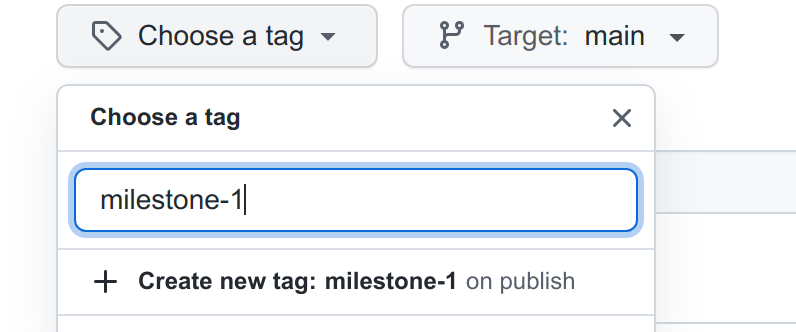**

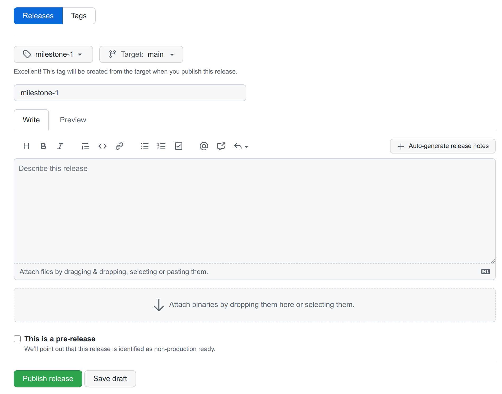  
So far, you've played with a significant portion of the data science workflow, including data wrangling, EDA, creating visualisations, feature engineering, and statistical modelling. So, we've got our models, we're done now right? Well, if you want nobody to use all of the work that you've done, yes! Otherwise, we need to have some understanding of what happens once this initial phase of the data science project is complete.

The focus for this last milestone will be data science in "production". This is in quotes because it is important to have a **disclaimer**: **this is by no means a practical guide for how to actually build robust ML systems for a business**. Instead, the purpose of this milestone is to give you some context and flavour of what types of tools and ideas might be used to deploy models into useful services for a business, albeit on a much smaller scale. Furthermore, this only focuses on the notion of [**model deployment**](https://fullstackdeeplearning.com/spring2021/lecture-11/#i-model-deployment); but does not touch on other important concepts such as [**monitoring**](https://fullstackdeeplearning.com/spring2021/lecture-11/#ii-model-monitoring)**.**

Using all of the models that you have already created (and saved into Wandb!), you will build a "Live game client", which will retrieve shot events from live (or historical) NHL games, preprocess the data into features compatible with your model, and then use a model loaded from your Wandb registry to get expected goal predictions for each shot event. 

The live game client will then be packaged into a nice interactive dashboard using [Streamlit](https://streamlit.io/), which will be put into a [Docker](https://docs.docker.com/) [container](https://www.docker.com/resources/what-container) and deployed to the cloud so that it can be used from a link.

> **IFT3700 vs IFT6758.** Both courses complete the same five parts, with the same weights. In Parts [2](#2-model-loading-15), [4](#4-docker-20) and [5](#5-deployment-20), IFT6758 serves the model through a REST API that runs in its own container; what differs is marked **IFT6758** in each of these parts.

- [A note on Plagiarism](#a-note-on-plagiarism)
- [Learning Objectives](#learning-objectives)
- [Model Deployment](#model-deployment)
  - [Dependency Management](#dependency-management)
- [Deliverables](#deliverables)
  - [Submission Details](#submission-details)
- [Tasks and Questions](#tasks-and-questions)
  - [1. Game Client (20%)](#1-game-client-20)
  - [2. Model Loading (15%)](#2-model-loading-15)
  - [3. Streamlit App (25%)](#3-streamlit-app-25)
  - [4. Docker (20%)](#4-docker-20)
  - [5. Deployment (20%)](#5-deployment-20)
  - [6. BONUS: Streamlit Additional Functionality (optional, 5%)](#6-bonus-streamlit-additional-functionality-optional-5)
- [And there you have it!](#and-there-you-have-it)
- [Group Evaluations](#group-evaluations)
  - [How scores impact your grade](#how-scores-impact-your-grade)
- [Useful References](#useful-references)

## A note on Plagiarism

Using code/templates from online resources is acceptable and it is common in data science, but be clear to cite exactly where you took code from when necessary. A simple one line snippet which covers some simple syntax from a StackOverflow post or package documentation probably doesn't warrant citation, but copying a function which does a bunch of logic that creates your figure does. We trust that you can use your best judgement in these cases, but if you have any doubts you can always just cite something to be safe. We will run some plagiarism detection on your code and deliverables, and it is better to be safe than sorry by citing your references. Disclose any AI assistance (e.g. LLM-generated code); your team remains responsible for explaining and validating all submitted code.

Integrity is an important expectation of this course project and any suspected cases will be pursued in accordance with Université de Montréal's very [strict policy](https://integrite.umontreal.ca/reglements/les-reglements-expliques/). The full text of the university-wide regulations can be found [here](https://secretariatgeneral.umontreal.ca/public/secretariatgeneral/documents/doc_officiels/reglements/enseignement/ens30_12-reglement-disciplinaire-plagiat-fraude-etudiants-cycles-superieurs.pdf). It is the *responsibility of the team* to ensure that this is followed rigorously and action can be taken on individuals or the entire team depending on the case.

## Learning Objectives

* **Model "Deployment"**  
  * Model dependency management (Docker)  
  * Deploying an app to the cloud  
  * Model as a service and REST APIs (IFT6758)  
* **"Production"/Live Workflows**  
  * Writing a live game client  
* **Interactive visualisation**  
  * Making your predictions easily accessible using Streamlit

## Model Deployment

(This primer borrows heavily from [Full Stack Deep Learning - Lecture 11](https://fullstackdeeplearning.com/spring2021/lecture-11/))

There are multiple ways to use statistical/machine learning models in production. A common one is [*Model as a Service*](https://fullstackdeeplearning.com/spring2021/lecture-11/#model-as-service), where a model is deployed as its own service; users and clients interact with the model by making requests specifically to the model service, and receiving the responses. IFT6758 will use this approach. To keep the milestone short, IFT3700 will instead use the simpler [*Model in Service*](https://fullstackdeeplearning.com/spring2021/lecture-11/#model-in-service) approach, where the app that needs the predictions loads the model itself. 

### Dependency Management

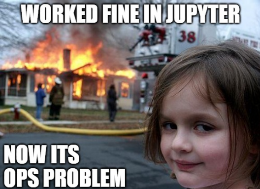

To run a model, you require the code, code dependencies, and model weights, all of which need to be available to your app. Model weights are fairly portable, but code and code dependencies can be quite a lot trickier to manage. A common solution to this problem is **containerisation**; a **container** is a single fully packaged unit of software which ideally should provide a consistent environment anywhere[^1] you may deploy it. Note that containers are not the same as virtual machines (VMs) - VMs require the hypervisor to virtualise physical hardware and typically runs multiple operating systems simultaneously. Containers on the other hand share the same host kernel, but run in isolated user-space environments. If that stuff about VMs didn't make much sense to you, that's okay - the main takeaway is that this makes them faster and more lightweight than VMs.

The most popular platform for containerisation is **Docker**, which is what we will be using for this milestone. There are a few basic concepts that you should be familiar with:

1. **Dockerfile** defines how to build an image (you will write one)  
2. **Image** is a built packaged environment (you will create one)  
3. **Container** is where images are run inside (you will run one)  
4. **Repository** hosts different versions of an image  
5. **Registry** is a set of repositories

These will be touched on more in the actual milestone task definitions. 

## Deliverables

You must submit: 

1. Your team's codebase **that is reproducible**  
2. Add the relevant IFT 6758 accounts to your github repo and Wandb workspace (if you are having trouble with this, we will deal with it on a case-by-case basis). 

There will be **no blogpost component** for this final milestone as you will be primarily evaluated on your code submission.

### Submission Details

To submit your project, you must:

- [ ] Publish your final milestone submission to the **master** or **main** branch   
      - [ ] Create a release similar to what you did for milestone 1 and 2, but with the **milestone-3** tag.   
- [ ] Submit a ZIP of your codebase to [gradescope]()  
- [ ] Add the IFT 6758 TA Github account ([`@Jay-D13`](https://github.com/Jay-D13)) to your git repo as a *viewer* or *contributor*, if you have not done so already (or are using a new repo).  
- [ ] Ensure the IFT6758 TA account ([`jay-d13`](https://forge.coreweave.com/profile/jay-d13)) is added to your Wandb workspace; this should be completed from Milestone 2 

To submit a ZIP of your repository, you can download it via the Github UI:  
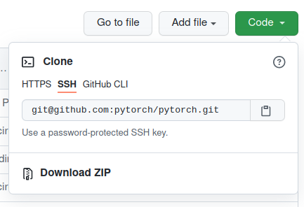

## Tasks and Questions

The tasks required for milestone 3 are outlined here. This time, you will not need to submit a blog post; you will be evaluated on your code submissions. In terms of evaluations, you will be marked in the style of code reviews for a portion of your work, and we **will be running your code** in the containerised system you will produce in Part 4.

**Keep working in your existing project repository; there is no new template for this milestone, only a few starter files in the [`release/`](release/) folder, which the parts below point to.**

### 1. Game Client (20%)

This part is a little orthogonal to the rest of the tasks, but is necessary to interface with "live" NHL games. So far, you have queried old games from bygone seasons of yore. Now, we want to put our shiny models to the test on the latest games that are happening right NOW! To do this, we need to adapt the functionality that we implemented to download game data to support a more intelligent way of pinging live games. Specifically, we want to be able to pull live game data and only process events that we haven't yet seen.

1. Get the game data for a given game_id. The goal is to only process events that you have not yet seen; if you can do this via the API you're welcome to. Otherwise, you could keep some sort of internal tracker of what events you have processed so far and then process the events that you haven't seen (i.e. produce the features required by the model, get the predictions from the model, and store the goal probabilities). Update the tracker you implemented so that the next time you ping the server, you will be able to ignore the events that you've already processed. 

To limit the complexity, we will only ask you to recover **basic features** from the data (i.e. no advanced features/models are needed).   
Specifically you must recover:

- **Distance from net**  
- **Angle from net**  
- **Is goal** (0 or 1)  
- **Empty Net** (0 or 1; you can assume NaNs are 0)  
  - For this, you can use the `situationCode` which works as follows:  
    - First digit: 	1 for goalie on ice for away team  
    - Second digit: 	Number of on ice skaters for away team  
    - Third digit:	Number of on ice skaters for home team  
    - Fourth digit: 	1 for goalie on ice for home team  
  - Combine this with `eventOwnerTeamId` to see if it was an empty net goal.

No template is provided for this client - you must come up with what you think makes the most sense. You will be using this client for Part 3 when you integrate all of these parts together. Note that you will be reusing your code for processing the events into features - all you really need to implement here is the logic to query a live game, and filter out events that you've already processed before.   
   
**Evaluation**

* Your implementation correctly queries the specific game, and filters the previously processed events correctly. You get the next batch of inputs to pass to your model.

### 2. Model Loading (15%)

> IFT3700 completes 2A. IFT6758 completes 2B instead.

#### 2A. Model Loading (IFT3700)

We'll now write the code to load our expected goal models that we created in Milestone 2 and get predictions from them. We won't yet worry about embedding this into a Docker container - right now we're just focusing on running it on our local environment. Your task is to implement the following functions:

* **predict** - predict the shot's probability of being a goal given the inputs  
  * **Input**: the input features to your model, compatible with model.predict() or model.predict_proba()  
  * **Output**: the predictions for all of the features  

* **download_registry_model** - basically wraps a similar function in the [Wandb API](https://docs.coreweave.com/products/registry/download_use_artifact) to download a model and update the currently loaded model. You should:  
  *  Check to see if the model you are querying for is already downloaded  
    * if yes, load that model and write to the log about the model change.   
    * if no, try downloading the model:   
      * if it succeeds, load that model and write to the log about the model change.   
      * If it fails, write to the log about the failure and keep the currently loaded model

Write to the log with Python's [logging](https://docs.python.org/3/library/logging.html) module, so that the messages show up in the output of your app.

**Note: because of the simplification we made to the data client (basic features only), we will only be testing the logistic regression models on distance, angle, and distance+angle models! Don't worry about the rest of the models you may have trained.**

You **should** **not** put any task specific functionality into these functions; any data preprocessing (such creating all of the features needed for your model) should be done prior to calling them. Your code should behave similarly to a SK-Learn model object. 

At this point, you can test your functions with existing training/validation data that you used in Milestone 2.

**Evaluation:**  
Code will not be run at this stage (it will be tested in Part 4). However points will be assigned to this section based on:

* Both functions (**predict** and **download_registry_model**) are implemented correctly  
* Your code can download models stored in your Wandb model registry, and swap them out on the fly *without restarting the app*. Cases where the new model does not download successfully (e.g. doesn't exist) are handled gracefully.   
* You log appropriate and informative debugging messages to the logger; you should be able to debug your app from the logs without manually going and poking in the application (and later on, in the Docker container)

**You only need to focus on the models you produced in Milestone 2 part 3, with the core set of basic features. It's fine if this is missing a bunch of your best models, the point is just build up some sort of simple system that demonstrates the core functionality.**

#### 2B. Model Service (IFT6758)

Instead of the functions of 2A, you will serve your models with the *Model as a Service* approach: the model lives in its own service, accessible through a REST API, and the rest of your code queries this service for expected goal predictions.

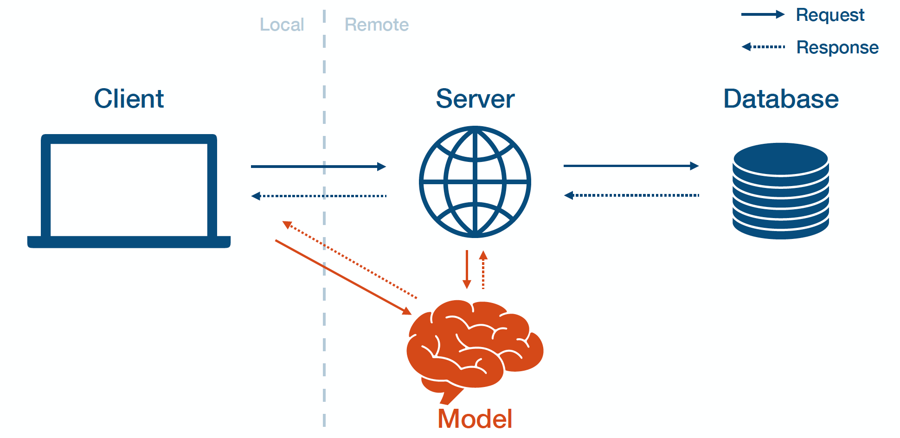

Figure 1: Model as a Service ([source](https://fullstackdeeplearning.com/spring2021/lecture-11/#model-as-service))

##### Services

Before we move on, what is a service you may ask? This can go [pretty deep](https://en.wikipedia.org/wiki/Service-oriented_architecture), but the only thing you really need to understand for this project is that it's an architectural style in software engineering which builds reusable and interoperable software components, as opposed to a single large monolithic piece of software. Basically this means that you will have many small, self-contained pieces (services) that are "black boxes" for its consumers (i.e. the consumer doesn't need to know how the service works). Services will typically (but not always) operate in their own environment with dedicated hardware, and they may also be ephemeral (i.e. dynamically stood up and torn down as usage fluctuates). 

##### Communication

There are many ways these services can interact with each other. A [REST API](https://www.sitepoint.com/rest-api/) is a way to communicate through HTTP requests; it is very common and handles small data (such as text or JSON) well, but it doesn't work as well for larger data (e.g. binaries, images, etc). Other alternatives exist such as [gRPC](https://grpc.io/), [Kafka](https://kafka.apache.org/), [ZeroMQ](https://zeromq.org/), etc., but this is more in the domain of software engineers and is not the focus of this course. For our purposes, a REST API will be sufficient but know that this is not the right tool for every task and there is **no standard solution for formatting data that goes into an ML model**. We will be using [Flask](https://flask.palletsprojects.com/en/stable/tutorial/) to build our simple prediction web application. 

##### Model Serving Flask app

We'll first create a simple Flask app to serve our expected goal models that we created in Milestone 2. We won't yet worry about embedding this application into a Docker container - right now we're just focusing on running this app on our local environment. Your first task is to create a Flask app that implements the following endpoints:

* **/predict** - predict the shot's probability of being a goal given the inputs  
  * **Input**: the input features to your model, compatible with model.predict() or model.predict_proba()  
    - *Hint: [df.to_json()](https://pandas.pydata.org/docs/reference/api/pandas.DataFrame.to_json.html)*  
  * **Output**: the predictions for all of the features  

* **/logs** - retrieve logs written from your app  

* **/download_registry_model** - basically wraps a similar function in the [Wandb API](https://docs.coreweave.com/products/registry/download_use_artifact) to download a model and update the currently loaded model. You should:  
  *  Check to see if the model you are querying for is already downloaded  
    * if yes, load that model and write to the log about the model change.   
    * if no, try downloading the model:   
      * if it succeeds, load that model and write to the log about the model change.   
      * If it fails, write to the log about the failure and keep the currently loaded model

**Note: because of the simplification we made to the data client (basic features only), we will only be testing the logistic regression models on distance, angle, and distance+angle models! Don't worry about the rest of the models you may have trained.**

In the [`release/ift6758-only/`](release/ift6758-only/) folder, you will find an **app.py** template in the serving directory; copy the `serving/` directory to the root of your repo. This has the skeleton and boilerplate for what you need to implement. You **should** **not** put any task specific functionality into your Flask app; any data preprocessing (such creating all of the features needed for your model) should be done prior to making the request to the serving app. Your app should behave similarly to a SK-Learn model object. 

To run the app, if you are in the same directory as **app.py**, you can run the app from the command line using [gunicorn](https://gunicorn.org/) (Unix) or [waitress](https://docs.pylonsproject.org/projects/waitress/en/latest/usage.html) (Unix + Windows):  

```
$ gunicorn --bind 0.0.0.0:<PORT> app:app
$ waitress-serve --listen=0.0.0.0:<PORT> app:app
```

Flask, and gunicorn or waitress, can be installed via:

```
uv add flask gunicorn
uv add flask waitress
```

At this point, you can test the app with existing training/validation data that you used in Milestone 2, and ping the app directly using the Python requests library, eg: 

```python
X = get_input_features_df()
r = requests.post(
    "http://0.0.0.0:<PORT>/predict",
    json=json.loads(X.to_json())
)
print(r.json())
```

Furthermore, once you implement the **/logs** endpoint, you will be able to view all of the logs by navigating to `http://0.0.0.0:<PORT>/logs` in your browser. 

##### Serving Client

Now that we have our SKLearn model served through a Flask app, we want a way to interact with it without having to explicitly call requests.post every time we want to submit a request. You are provided with a template file for the serving app client (`release/ift6758-only/serving_client.py`); copy it into your `ift6758` package. Implement the three methods defined in it. These functions will be very simple and straightforward to implement.

**Evaluation:**  
Code will not be run at this stage (it will be tested in Part 4). However points will be assigned to this section based on:

* All three endpoints (**/predict**, **/logs**, and **/download_registry_model**) are implemented correctly  
* The service can download models stored in your Wandb model registry, and swap them out on the fly *without restarting the app*. Cases where the new model does not download successfully (e.g. doesn't exist) are handled gracefully.   
* You log appropriate and informative debugging messages to the logger; you should be able to debug your app from the logs without manually going and poking in the application (and later on, in the Docker container)
* The three methods of the serving client (**predict(...)**, **logs()**, and **download_registry_model(...)**) are correctly implemented. The function signatures do not need to be the exact same as what is specified (i.e. you can add additional arguments if you'd like). This client must work with your Flask app when set with the correct IP and port.

**You only need to focus on the models you produced in Milestone 2 part 3, with the core set of basic features. It's fine if this is missing a bunch of your best models, the point is just build up some sort of simple system that demonstrates the core functionality.**

### 3. Streamlit App (25%)

We're almost there! While the client and model loading code you've created are cool, they are still hard to interact with for most people. The fun part is to turn them into a tool that can be used by any person with access to a computer and the internet. For that we use Streamlit.

Streamlit is a framework for building interactive web apps using just Python! It provides a large amount of functionality that is particularly useful for displaying data of different forms and providing interactive components so that users can explore this data, all without needing any HTML/CSS/JavaScript knowledge. For more on Streamlit's capabilities, see [their blog post](https://towardsdatascience.com/coding-ml-tools-like-you-code-ml-models-ddba3357eace).

#### Getting Started with Streamlit

As you've become comfortable with using Python, using Streamlit should feel quite natural. To get started, running 

```
uv add streamlit
```

inside your project should install everything you need. Then, once that's done, following the first steps mentioned [here](https://docs.streamlit.io/library/get-started/create-an-app) should have you up and running with your first app. Feel free to play around with it! While we won't be using anything too fancy for this project, it's a good idea to take a look at:

* [The main Streamlit concepts](https://docs.streamlit.io/library/get-started/main-concepts) (especially understanding how Streamlit deals with interactivity, by rerunning the script whenever some input widget changes).  
* [The API reference](https://docs.streamlit.io/library/api-reference) (to give an idea of all the pre-built components available to you from Streamlit!).

#### Functionality to Implement

Specifically, we will use your Live Game Client that you implemented in Part 1 and your model loading functions that you implemented in Part 2 to create a simple, but live dashboard for your expected goals model. You will be creating a Streamlit interactive web app that can accept a game ID as an input and then a button which triggers the Game Client's "ping game" method (or whatever you implemented). New shot events should be passed to the currently loaded model, and the goal probabilities that your model outputs should be joined as a new column to the new shot events. You will then display the sum of expected goals for each team, as a proxy for "which team is doing better" and compare it to the actual score. This is a very crude estimate of which team is doing better, but hey it's a start!

> **IFT6758:** wherever this part mentions your model loading functions or the currently loaded model, use your serving client from Part 2B: the Download model button swaps the model in your serving app, and new shot events are sent to your prediction service.

For your interactive app, you must support the following functionality:  

* **([Text input](https://docs.streamlit.io/library/api-reference/widgets/st.text_input))** Workspace, Model, Version; for specifying what model to download from the Wandb model registry. This can be 3 separate inputs.  
* **([On button click](https://docs.streamlit.io/library/api-reference/widgets/st.button))** Download model; downloads the model from Wandb using the parameters specified above and makes it the currently loaded model.  
    
* **([Text input](https://docs.streamlit.io/library/api-reference/widgets/st.text_input))** Game ID; specifies what game your tool will ping, eg **2021020329**  
* ([**On button click**](https://docs.streamlit.io/library/api-reference/widgets/st.button)) Ping game  
  * When the button is pressed, your dashboard should show the:  
    * Home and away team names  
    * Period  
    * Time left in the period  
    * Current score  
    * Sum of expected goals (xG) for the entire game so far for both teams (obtained from the game client)  
    * Difference between current score and sum of expected goals (i.e. if the home team has scored 2 goals and the sum of expected goals is 2.4, show a difference of 2.4-2=0.4). For this, [use the following](https://docs.streamlit.io/library/api-reference/data/st.metric).  
  * Some of these can be obtained by doing direct API requests to the NHL API, others will make use of the game client you created earlier  
* In addition, you must display the **dataframe of all of your features**, with the **model output probability for each event.** Make sure that your logic to filter out games is correct - there should be no duplicates, and you can't simply recalculate the goal predictions for the entire growing set of shot events! 

Once everything is done, your web app should look something like this (with the actual feature/event names)!

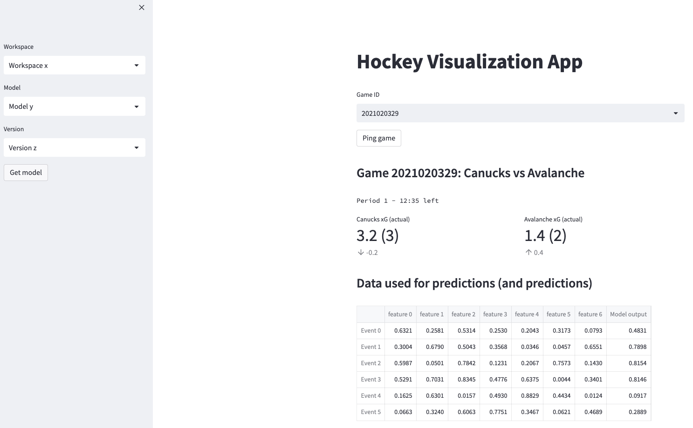

**Evaluation**

* The above functionality is correctly supported in your interactive app, i.e. no duplicate shot events, models can be swapped, etc. 

* The behaviour we're looking for is that when we click on the "ping game" button, if there are new shot events, these new shots will be filtered (so that no old shots are re-evaluated), and then passed to the currently loaded model. The outputted goal probabilities will then be joined to the feature dataframe that was submitted, and displayed as the output. The sum of expected goals over each team is then updated in the above table, in addition to the PERIOD and TIME LEFT fields at the top. 

* You should **not** be ignoring the filtering logic and simply recomputing all of the shot probabilities every time you ping the game. 

* This visualisation will be run in the next section (from the Docker environment).

### 4. Docker (20%)

Follow the [instructions here](https://docs.docker.com/get-docker/) to install Docker on your system. One thing to note is that your project already declares its dependencies in `pyproject.toml` and `uv.lock`: install them from these files in your Dockerfile instead of listing packages by hand; see uv's [Docker guide](https://docs.astral.sh/uv/guides/integration/docker/). In the [`release/`](release/) folder, you will find a **Dockerfile** and a **docker-compose.yaml** template; copy them to the root of your repo.

For this section, complete the following tasks:

* Embed the Streamlit app you built in Part 3 into a Docker container by filling in the provided **Dockerfile**. This should not be very complicated; mine was ~10 lines of actual commands.
  * The Wandb API key should be passed at RUN time via an environment variable argument - **do NOT embed into your container**
  * Containers are meant to be lightweight - **do NOT embed all of your models into the container!** Plus we can leverage the "hot swapping" functionality we implemented in Part 2.
  * You don't *need* to specify a default command for the container, but it's definitely nice to have. The command to run Streamlit is:

    ```
    streamlit run {STREAMLIT_FILE} --server.port {STREAMLIT_PORT} --server.address {STREAMLIT_IP}
    ```

* Write a build script (build.sh) with the docker command which builds the container, and a run script (run.sh) with the docker command which runs the container with appropriate arguments.

* Fill in the same docker configuration in the docker-compose.yaml file provided, so you can run the app with a single `docker compose up` instead of the longer run command. This may seem pointless in this context, but docker compose becomes very useful when you start to create systems with *many* docker services, all of which need to network with each other.

**IFT6758: second container**

Your app needs a second container, for your Flask app from Part 2B.

* Embed your Flask app into a Docker container by filling in the provided **Dockerfile.serving** (in `release/ift6758-only/`; copy it to the root of your repo). Its default command runs the serving app with gunicorn or waitress. The Wandb API key is passed to this container, which is the one that downloads the models, and not to the Streamlit container. Your build.sh and run.sh build and run this container.

* Uncomment the `serving` service in the docker-compose.yaml file provided. Networking can become sort of tricky in Docker for the uninitiated, and docker compose can make your life quite a lot easier. Specifically, docker compose does some nice name resolution stuff for you by default. You'll notice the format of your docker compose file is along the lines of:

  ```yaml
  # docker-compose.yaml
  services:
      service1:
          ...
      service2:
          ...
  ```

  Say your Streamlit app lives in **service2**, and you want to make an HTTP request to **service1**. You actually don't need to look for the container IP of **service1** - you can simply make an HTTP request to http://service1:PORT/endpoint. The name resolution is taken care of if you're using docker compose (but you do need to keep track of the port). Read this url from an environment variable that you set in your docker-compose.yaml instead of hardcoding it, because it will be different in Part 5. When you run `docker compose up`, you should see something similar to the following:

  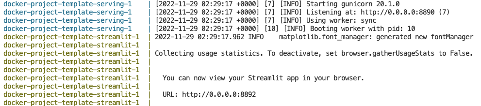

  If everything is hooked up correctly, you should be able to go to the second link and access your Streamlit app. If you ping a game, it should be able to access the serving service (if not, make sure you are using the name of the serving service and the correct port).

**Evaluation**

* We will be evaluating your visualisation by running

  ```
  $ docker compose up
  ```

  This must **build and spin up the required container**, and host the app with your interactive visualisation created in Part 3. Docker by design facilitates reproducible environments, so there is no reason for this to not run on my machine and **you will lose marks if this does not work!**

* We must be able to access and interact with your Streamlit app (i.e. we should be able to download models and ping games out of the box).

* The Wandb API key must be retrieved from the ${WANDB_API_KEY} environment variable on the local machine, **not hardcoded anywhere**.

* Your container must not contain extra model weights; you can include one "default" if you'd like.

* Your build and run commands in the build.sh and run.sh files respectively are correct (yes, they only need one simple command).
  * *The purpose of this is to expose you to the relationship between the docker CLI and docker compose.*

* **IFT6758:** `docker compose up` must **build and spin up both containers**, and the connection between the two services should work out of the box.

### 5. Deployment (20%)

This is the final part, I promise! So far, your app only runs on your own machine.

#### Deploy to the Cloud - Preamble

In the next stage, we'll take our application and deploy it to the cloud. In this section, we'll get experience working with a cloud provider (in this case, Google Cloud) in order to build and deploy applications.

Specifically, we will be working with [Google Cloud Build](https://cloud.google.com/build) to build our application as a Docker image and store it in a remote repository (called the [Google Artifact Registry](https://cloud.google.com/artifact-registry)).

Our application is a single component that will be built into a Docker image.

> **IFT6758:** your application has two components (your Streamlit app and your serving app), so you will build two Docker images and deploy them as two containers of the same Cloud Run service. What differs is marked **IFT6758** below.

We will then use [Google Cloud Run](https://cloud.google.com/run) in order to deploy the application to the web.

It will be your job to write the code and configuration files required to:
- Submit builds to Google Cloud Build
- Deploy the application to Google Cloud Run

The starter files for this part are in the [`release/`](release/) folder. Copy `deployment/`, `setup/` and `deliverables.yaml` to the root of your project repository, next to your Dockerfile from [Part 4](#4-docker-20).

##### 0. Sign Up for an account on Google Cloud

If you do not already have an account on Google Cloud, you can create one [here](https://console.cloud.google.com).

The following videos provide a walkthrough of some key concepts when working with Google Cloud:
- How to sign up for Google Cloud --  [link](https://youtu.be/ogzJovMsDIU?si=VCZ16ONz0CYvbGBV&t=40)
- How to navigate Google Cloud -- [link](https://youtu.be/27Pb5g7bEAA?si=yuuDIv_4nzJL2tLd&t=75)

##### 1. Create a Google Cloud Project

Create a Google Cloud project with the following:

- Project Name: `m3-COURSE_CODE-TEAM_ID`

- Project ID: `m3-COURSE_CODE-TEAM_ID`

Make sure to set both the project name and project ID to be the **same value**. **You cannot change the project ID afterwards. The name and ID should be case sensitive.** This should be done once per team.

Eg. If my course code is IFT6758B and my team ID is 2, then my project name would be:
`m3-ift6758b-2` and my project ID would be: `m3-ift6758b-2`.

##### 2. Install the gcloud CLI

The Google Cloud CLI (gcloud) is a "set of tools to create and manage Google Cloud resources," ([source](https://cloud.google.com/sdk/gcloud)). Using gcloud is required to interact with Google Cloud from your machine.

Instructions to install gcloud can be found [here](https://cloud.google.com/sdk/docs/install).

Once you install gcloud, use it to set your project:
```
gcloud config set project MY_PROJECT_ID
```
where `MY_PROJECT_ID` is the Project ID created in Step 1.

You can verify that you're running in the correct project by running:
```
gcloud config list
```

##### 3. Enable APIs

The following APIs must be enabled for your project:
- Artifact Registry API
- Cloud Run API
- Cloud Build API
- Secret Manager API

You can enable these APIs by running the following command:
```
gcloud services enable artifactregistry.googleapis.com run.googleapis.com cloudbuild.googleapis.com secretmanager.googleapis.com
```

##### 4. Create a Docker Repository on Artifact Registry.

A docker repository is required to store the Docker images we will build using Google Cloud Build. On Google Cloud, a docker repository is hosted on Artifact Registry.

You can create a repository on Artifact Registry by running the following command:
```
gcloud artifacts repositories create REPO_NAME \
    --repository-format=docker \
    --location=LOCATION \
    --project=PROJECT_ID
```

Make sure to set the following:
- REPO_NAME: `m3-images`
- LOCATION: `us-central1`
- PROJECT_ID: the project ID you created in Step 1.

You can verify that your repository has been created by running the following command:
```
gcloud artifacts repositories list --project=PROJECT_ID
```

##### 5. Verify Prerequisites

Before starting the implementation, make sure you have completed all the steps listed above.

To verify that your project is set up correctly, run the following command:
```
uv run python setup/check_prereq.py
```

If all the checks pass, you will see the following output:
```
All prerequisites are met. You can proceed with the assignment.
```

If you see any errors, make sure to fix them before proceeding.

#### Deploy to Cloud - Implementation

##### 1. Build your Docker Image using CloudBuild

The first step will be to create a cloudbuild YAML file, which determines the steps required to build our Docker image on Google Cloud and push it to Artifact Registry.

###### Creating a Cloud Build YAML

Build a cloudbuild YAML file using the `deployment/cloudbuild_template.yaml` file as a template. Save it as `deployment/cloudbuild.yaml`, which is the name that `deployment/submit_build_template.sh` expects.

In this file, we will be using substitutions to fill in the correct values. Substitutions are a way to pass variables into the build process.

Looking at `deployment/submit_build_template.sh`, the following substitution is available to you:
- `_IMAGE_URI`

which can be referenced as `${SUBSTITUTION_NAME}` in your YAML file.

There is also `${BUILD_ID}` which is an environment variable present in Google Cloud Build which holds the value of the current unique build identifier.

You will need to fill in the correct values to make sure this substitution is correct. See `#FILL ME IN` in the `deployment/submit_build_template.sh` file.

Follow the instructions in `deployment/cloudbuild_template.yaml` to create a cloudbuild YAML file that will build and push our Docker image.

In the CloudBuild file we build a single image.

> **IFT6758:** you build two images. Repeat the build and push steps for the image of your serving app, built from `Dockerfile.serving`, with a second substitution, `_SERVING_IMAGE_URI`; see the `IFT6758` comments in the two template files.

More information on building a Cloud Build YAML file can be found [here](https://cloud.google.com/build/docs/configuring-builds/create-basic-configuration).

###### Submitting the build to Cloud Build

Once you have created the Cloud Build file, use the `gcloud` command to submit the build to Cloud Build. You can use the `submit_build_template.sh` file to accomplish this. More documentation on `gcloud builds` can be found [here](https://cloud.google.com/sdk/gcloud/reference/builds/submit).

When you run the script, you will see the logs output to the terminal. `gcloud` will also give you a link to view the build in your web browser. You can view all your builds [here](https://console.cloud.google.com/cloud-build/builds).

###### Deliverables

For this part you should submit the following files:
- 1 Cloudbuild YAML file.
- 1 submit build script.
- `deliverables.yaml` file with the build ID for the container.

##### 2. Deploying the Container to the Web

Once we have built and pushed our Docker image, we can deploy it using the Google Cloud Run service.

All your Google Cloud Run services can be found [here](https://console.cloud.google.com/run).

###### 2a. Managing Secrets

Handling credentials securely is an important part of application development and deployment. Within Google Cloud, we can use a secrets manager to store our Wandb API key. We can then inject our secret into our service at deploy time as an environment variable.

To do this, we first need to create a secret. We can create a file that contains only the secret value. **DO NOT COMMIT THIS FILE TO SOURCE CONTROL / GITHUB**. You can delete this file after you create the secret below OR **add the file to your .gitignore**

Then we can instruct gcloud to use the contents of the file to create a secret (referenced by the name WANDB_API_KEY) in the Google Cloud Secret Manager:

```
gcloud secrets create WANDB_API_KEY --data-file="PATH_TO_SECRET"
```

where `PATH_TO_SECRET` is the absolute file path to the file you created above.

###### 2b. Deployment

In addition to working with the `gcloud` CLI, we can also deploy via the Google Cloud Console (UI).

The first step is to go to Cloud Run, located [here](https://console.cloud.google.com/run). We then want to deploy a web service from a Docker Container. Click "Deploy container"

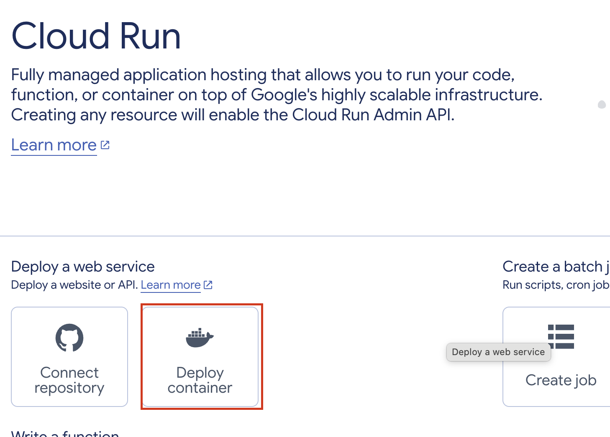

When deploying your app, you will need to know the URI of the image you want to deploy. You can find these in the Artifact Registry, located [here](https://console.cloud.google.com/artifacts). It should look something like below:

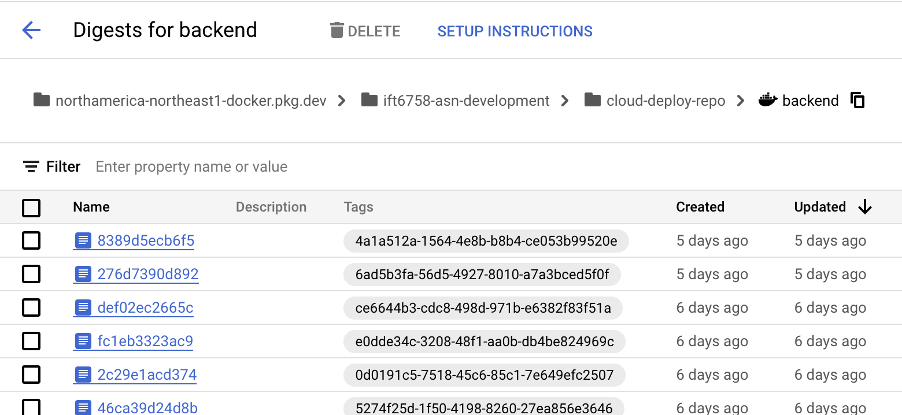

Clicking on the three dots beside the desired image, and selecting "Show pull command", you can get the full URI of the image.

A. The URI of the image will then need to go into **Container Image URL**.

B. Ensure the **Service Name** is `nhl-streamlit-app` and the **Region** is `us-central1`.

**Authentication & Authorisation**

Our app is deployed on the public internet. As such we will create additional protections to ensure only authorised users can access our app. This is done through an "Identity Aware Proxy" which checks your Email against an allowlist.

C. Under **Authentication**, ensure `Require Authentication` is set. `Identity and Access Management (IAM)` should be **unchecked** and `Identity Aware Proxy (IAP)` should be **checked**.

D. Under **Edit Policy**, you can add Google Email accounts that should have access to your app. Add the emails of your teammates and the TA email account (TBD).

**Service Scaling**

E. Ensure that `Minimum Number of Instances` is set to 0 and `Maximum Number of Instances` is set to 1.

**Containers, Networking, Security**

F. Ensure the `Container Port` matches the Streamlit Port set in your app.

G. If you did not give your Dockerfile a default command, you can enter the default command and arguments in the `Container Command` and `Container Arguments` section.

> **IFT6758:** your service has a second container. A Cloud Run service can run more than one container: one receives the requests (here, your Streamlit app), and the others, called [sidecars](https://cloud.google.com/run/docs/deploying#sidecars), run next to it. Click `Add container` and enter the URI of your serving image. Make sure your serving app listens on a port different from the `Container Port` of step F. The containers of a service reach each other at `localhost`, so in the `Variables & Secrets` tab of the Streamlit container, set the environment variable that holds the url of your model service to `http://localhost:PORT`. Do step H below in the serving container, since it is the one that downloads the models.

H. Next, we'll want to ensure our Wandb API key secret is injected into the app at runtime. To do this, we'll need to click the `Variables & Secrets` tab. Under `Secrets exposed as environment variables` we'll select `Reference a Secret` and enter in the appropriate details.

**Deploy**

Once we've done the above, we can click `Create` to deploy the application. We'll then be able to see the URL of our deployed service.

Clicking on the URL will require us to authenticate with Google Cloud. If our email is part of the allowlist, we should be able to see the application.

We'll also be able to see any logs which will be important in understanding if our service was deployed correctly.

While we did this section using the UI, it can also be done programmatically via the `gcloud` CLI, similar to how we utilised Cloud Build. A programmatic approach is often preferred to the point-and-click UI in order to minimise errors and ensure reproducibility. However, it is still good to know how to use both approaches.

Make sure to submit the URL of your service in the `deliverables.yaml`.

#### Cleanup Resources

We will provide additional instructions on Piazza which will allow you to cleanup your Google Cloud project once we are done marking.

**Evaluation**

* Your Cloud Build YAML file and your submit build script build your image with Cloud Build and push it to Artifact Registry, and your `deliverables.yaml` contains the build ID and the URL of your service.

* We must be able to open the URL of your service with the TA account, and download models and ping games as in Part 4.

* The Wandb API key must come from the Secret Manager, **not from your image or your repo**.

* **IFT6758:** your Cloud Build file builds and pushes both images, and the deployed app gets its predictions from your serving app, which runs in the second container of the same service.

### 6. BONUS: Streamlit Additional Functionality (optional, 5%)

If you take a look at Streamlit's API reference, you'll see there are a myriad of components that can be included in the web app as well as many ways to build in interactivity to the web app; the requirements we posted are just scratching the surface.

Drawing inspiration from everything you've learned/built in class thus far, add additional functionality/features/data/visualisations into your Streamlit app that would provide interesting information to hockey viewers that happen upon your app. This could be graphs you've had to make for previous milestones, aggregate team statistics, shot graphs, model output comparisons, etc. Be creative!

If aiming for the bonus, add a short paragraph somewhere in your web app using st.write describing the functionality you've added and how you included it. This section will be judged based on creativity, usefulness and technical challenge.

## And there you have it!

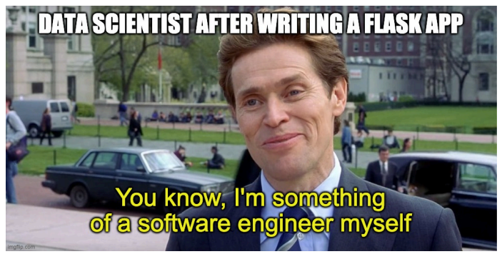

Thanks for making it through this project journey! I know it was a lot of work, but I hope you've found it fun, interesting, and rewarding. I hope you all learned something that will help you in the next step of your career, be it searching for jobs in the industry, or carrying on in research. Good luck with whatever your future holds!

## Group Evaluations

In addition to the grading described above, for each milestone you will be asked to score with how much you think everyone contributed to this milestone, and provide constructive feedback to your teammates, based on their strengths and potential areas of improvement. Students who do not contribute much will likely earn a poor grade, and in extreme cases might be removed from the group and asked to complete the projects individually. 

For a team of size **N**, everyone in the team will have **N x 20** points to allocate between everyone in your group (including yourself). You will then assign everyone a score between **10 – 40**, where **10** corresponds to "half effort", and **40** corresponds to "double effort" (**you cannot assign points outside of this range!**). In an ideal situation, everyone will contribute to the project equally and thus everyone will assign 20 points to every teammate. However, in the case where some people contributed less than others, you could assign them less points and give those points to who you think contributed more. Extreme cases will result in an instructor following up with the team to resolve any potential difficulties. This could include auditing git history in your repositories. *Any attempts to game the system will be handled manually and unfavourably!*

In addition to the score, you will also **give short feedback to your peers**, on both areas of strengths and potential areas of improvement. This feedback will be given privately and anonymously to each student. You can give feedback along several different axes, such as their **teamwork** (communication, reliability) and **technical work** (how much they contributed and the quality of their work/code). If you give a score below 20, you must give constructive feedback on areas that they can improve. 

### How scores impact your grade

* **x** is the average score for a student (excluding their own score), clamped between 10 ("half effort") and 40 ("double effort").  
* A student's score on the milestone will be multiplied by the following weighting factor[^2]:

**Scaling**(**x**) = 0.41667 + 0.0375**x** - 0.00041667**x**²

* This system was adopted from [Brian Fraser (SFU)](https://opencoursehub.cs.sfu.ca/bfraser/grav-cms/cmpt276/project), which in turn is based on the [work of Bill Gardner](http://www.cs.ubc.ca/wccce/Program03/papers/Gardner-Group/Gardner-Group.htm).

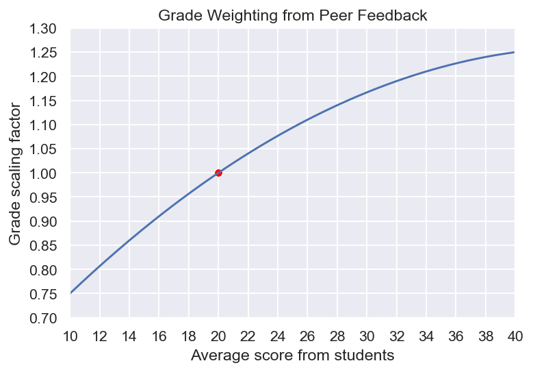

## Useful References

* [IFT 6758 Hockey Primer](https://docs.google.com/document/d/1CP4dbReUdLMwtmnU8_lEQDawrh5LkbDuGDM9Sqza6ZA/edit?usp=sharing)  
* [Zmalski's NHL API Reference](https://github.com/Zmalski/NHL-API-Reference) - incomplete documentation on the **new API**  
* [dword4's NHL API Doc](https://gitlab.com/dword4/nhlapi/-/blob/master/new-api.md) - another incomplete reference for the **new API**  
* [Wandb Python SDK](https://docs.coreweave.com/products/wandb/ref/python)  
  * [Download and use an artifact from the registry](https://docs.coreweave.com/products/registry/download_use_artifact)  
* [Flask Tutorial](https://flask.palletsprojects.com/en/stable/tutorial/) (IFT6758)  
* [Full Stack Deep Learning (Lecture 11)](https://fullstackdeeplearning.com/spring2021/lecture-11/)  
* Docker  
  * [Dockerfile best practices](https://docs.docker.com/develop/develop-images/dockerfile_best-practices/)  
* [Streamlit Getting Started Guide](https://docs.streamlit.io/library/get-started)  
* [Streamlit API Reference](https://docs.streamlit.io/library/api-reference)

[^1]:  There's some subtleties when it comes to building containers on different CPU architectures (e.g. x86 (most Intel and AMD), and ARM (originally more common in embedded devices, but now Apple has adopted ARM architecture for their entire PC line). There are ways to provide cross-compatibility between the two architectures, but naively they are incompatible. 

[^2]:  *The coefficients are obtained by fitting the quadratic   y(x) = a\*x^2 + bx + c   to the points y(10) = 0.75, y(20) = 1.0, and y(40) = 1.25.*
