# Projet IFT 6758 : Étape 3

Sortie : 25 novembre 2026  
Date limite : 9 décembre 2026, 23 h 59 (IFT3700); 16 décembre 2026, 23 h 59 (IFT6758)  
Dernière mise à jour : 24 novembre 2026

**Important: Avant de commencer à travailler sur l'étape 3, publiez une version pour l'étape 2 en suivant les instructions [ici](https://docs.github.com/en/repositories/releasing-projects-on-github/managing-releases-in-a-repository). Vous n'avez pas besoin d'ajouter quoi que ce soit dans la description, ni de télécharger des fichiers binaires. Utilisez milestone-2 à la fois comme balise et titre de version, par exemple:**

**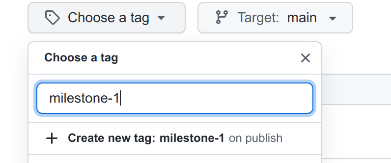**

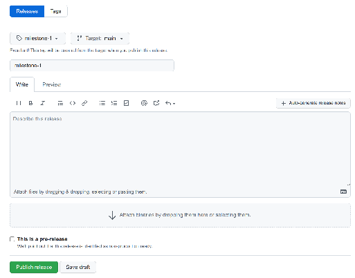  
Jusqu'à présent, vous avez interagi avec une partie importante du travail de science des données, y compris la gestion des données, l'EDA, la création de visualisations, l'ingénierie des caractéristiques et la modélisation statistique. Donc, nous avons nos modèles, nous avons terminé maintenant, n'est-ce pas? Eh bien, si vous voulez que personne n'utilise tout le travail que vous avez fait, oui! Sinon, nous devons avoir une certaine compréhension de ce qui se passe une fois cette phase initiale du projet de science des données est terminée.

Pour cette dernière étape, l'accent sera mis sur la science des données en « production ». Ceci est entre guillemets car il est important d'avoir une **clause** : **il ne s'agit en aucun cas d'un guide pratique sur la manière de créer des systèmes ML robustes pour entreprise**. Au lieu de cela, le but de cette étape est de vous donner un peu de contexte et une idée des types d'outils et d'idées qui pourraient être utilisés pour déployer des modèles comme services utiles pour une entreprise, bien qu'à une échelle beaucoup plus petite. De plus, on ne se focalise que sur la notion de [**déploiement de modèle**](https://fullstackdeeplearning.com/spring2021/lecture-11/#i-model-deployment); mais n'aborde pas d'autres concepts importants tels que le [**monitoring**](https://fullstackdeeplearning.com/spring2021/lecture-11/#ii-model-monitoring)**.**

En utilisant les modèles que vous avez déjà créés (et enregistrés dans Wandb!), vous allez créer un « client de jeu en direct », qui récupérera les événements de tir des matchs de la LNH en direct (ou historiques), prétraitera les données en caractéristiques compatibles avec votre modèle, puis utilisera un modèle chargé depuis votre registre Wandb pour obtenir les prévisions de buts espérés pour chaque événement de tir.

Le client de jeu en direct sera ensuite intégré dans un joli tableau de bord interactif à l'aide de [Streamlit](https://streamlit.io/), qui sera placé dans un [conteneur](https://www.docker.com/resources/what-container) [Docker](https://docs.docker.com/) et déployé dans le cloud pour être utilisable à partir d'un lien.

> **IFT3700 vs IFT6758.** Les deux cours réalisent les mêmes cinq parties, avec les mêmes pondérations. Dans les parties [2](#2-chargement-des-modèles-15), [4](#4-docker-20) et [5](#5-déploiement-20), IFT6758 sert le modèle via un API REST qui s'exécute dans son propre conteneur; ce qui diffère est marqué **IFT6758** dans chacune de ces parties.

- [Une note sur le plagiat](#une-note-sur-le-plagiat)
- [Objectifs d'apprentissage](#objectifs-dapprentissage)
- [Déploiement de Modèle](#déploiement-de-modèle)
  - [Gestion des dépendances](#gestion-des-dépendances)
- [Livrables](#livrables)
  - [Détails de la soumission](#détails-de-la-soumission)
- [Tâches et questions](#tâches-et-questions)
  - [1. Client de jeu (20%)](#1-client-de-jeu-20)
  - [2. Chargement des modèles (15%)](#2-chargement-des-modèles-15)
  - [3. Application Streamlit (25%)](#3-application-streamlit-25)
  - [4. Docker (20%)](#4-docker-20)
  - [5. Déploiement (20%)](#5-déploiement-20)
  - [6. BONUS : fonctionnalité supplémentaire de Streamlit (facultatif, 5%)](#6-bonus--fonctionnalité-supplémentaire-de-streamlit-facultatif-5)
- [Et voila!](#et-voila)
- [Évaluations de groupe](#évaluations-de-groupe)
  - [Comment les scores impactent votre note](#comment-les-scores-impactent-votre-note)
- [Références utiles](#références-utiles)

## Une note sur le plagiat

L'utilisation de code/modèles provenant de ressources en ligne est acceptable et courante en science des données, mais soyez clair pour citer exactement d'où vous avez pris le code lorsque nécessaire. Un simple extrait d'une ligne qui couvre une syntaxe simple provenant d'un article StackOverflow ou de la documentation d'un package ne justifie probablement pas une citation, mais copier une fonction qui effectue un tas de logique pour créer votre figure, oui. Nous vous faisons confiance pour utiliser votre meilleur jugement dans ces cas, mais si vous avez des doutes, vous pouvez toujours citer la source pour être sûr. Nous effectuerons une détection de plagiat sur votre code et vos livrables, et il vaut mieux prévenir que guérir en citant vos références. Déclarez toute aide provenant de l'IA (p. ex. du code généré par un LLM) ; votre équipe demeure responsable d'expliquer et de valider tout le code soumis.

L'intégrité est une attente importante de ce projet de cours et tout cas suspect sera poursuivi conformément à la [politique très stricte](https://integrite.umontreal.ca/reglements/les-reglements-expliques/) de l'Université de Montréal. Le texte complet des règlements à l'échelle de l'université peut être trouvé [ici](https://secretariatgeneral.umontreal.ca/public/secretariatgeneral/documents/doc_officiels/reglements/enseignement/ens30_12-reglement-disciplinaire-plagiat-fraude-etudiants-cycles-superieurs.pdf). Il est de la *responsabilité de l'équipe* de s'assurer que cela est suivi rigoureusement et des actions peuvent être prises sur des individus ou sur l'ensemble de l'équipe selon les cas.

## Objectifs d'apprentissage

* **Modèle "Déploiement"**  
  * Gestion des dépendances de modèles (Docker)  
  * Déploiement d'une application dans le cloud  
  * Modèle en tant que service et API REST (IFT6758)  
* **"Production"/Live Workflows**  
  * Écriture d'un client de jeu en direct  
* **Visualisation interactive**  
  * Rendre vos prédictions facilement accessibles à l'aide de Streamlit

## Déploiement de Modèle

(Cette introduction est inspirée en grande partie de [Full Stack Deep Learning - Lecture 11](https://fullstackdeeplearning.com/spring2021/lecture-11/))

Il existe plusieurs façons d'utiliser des modèles d'apprentissage statistique/machine en production. Une approche courante est le [*modèle comme service*](https://fullstackdeeplearning.com/spring2021/lecture-11/#model-as-service), où un modèle est déployé en tant que son propre service; les utilisateurs et les clients interagissent avec le modèle en faisant des demandes spécifiques au service de modèle et en recevant des réponses de celui-ci. IFT6758 utilisera cette approche. Pour garder l'étape courte, IFT3700 utilisera plutôt l'approche plus simple du [*modèle dans le service*](https://fullstackdeeplearning.com/spring2021/lecture-11/#model-in-service), où l'application qui a besoin des prédictions charge elle-même le modèle. 

### Gestion des dépendances

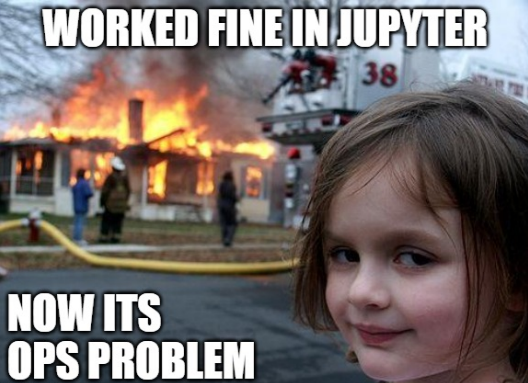

Pour exécuter un modèle, vous avez besoin du code, des dépendances de code et des coefficients du modèle, qui doivent tous être disponibles pour votre application. Les coefficients de modèle sont assez portables, mais le code et les dépendances de code peuvent être beaucoup plus difficiles à gérer. Une solution courante à ce problème est la **conteneurisation**; un **conteneur** est une seule unité de logiciel qui devrait idéalement fournir un environnement cohérent peut importe où[^1] vous le déployez. Notez que les conteneurs ne sont pas des machines virtuelles (VM) - les VM nécessitent que l'hyperviseur virtualise le hardware physique et exécutent généralement plusieurs systèmes d'exploitation simultanément. Les conteneurs, quant à eux, partagent le même host kernel mais sont exécutés dans des environnements d'espace utilisateur isolés. Si ces différences entre les machines virtuelles et les conteneurs n'ont pas beaucoup de sens pour vous, ce n'est pas grave - le principal point à retenir est que les conteneurs sont plus rapides et plus légers que les machines virtuelles.

La plate-forme la plus populaire pour la conteneurisation est **Docker**, que nous utiliserons pour cette étape. Il y a quelques concepts de base avec lesquels vous devriez être familiarisé :

1. **Dockerfile:** Fichier qui définit comment créer une image  
2. **Image:** Un environnement construit avec toutes les dépendances  
3. **Conteneur:** L'endroit où les images sont exécutées   
4. **Dépôt:** Héberge différentes versions d'une image  
5. **Registre:** Un ensemble de dépôts

Ceux-ci seront abordés plus en détail dans les définitions des tâches de cette étape. 

## Livrables

Vous devez soumettre: 

1. Le code de votre équipe **reproductible**  
2. Ajoutez les comptes IFT 6758 pertinents à votre dépôt github et à votre espace de travail Wandb (si vous rencontrez des problèmes avec cela, nous en informer par courriel comme la dernière fois). 

Il n'y aura **pas de composant de blogpost** pour cette étape finale car vous serez principalement évalué sur la soumission de votre code.

### Détails de la soumission

Pour soumettre votre projet, vous devez :

- [ ] Publier votre soumission finale de l'étape sur la branche **master** ou **main**  
      - [ ] Créer une version similaire à ce que vous avez fait pour les étapes 1 et 2, mais avec le tag **milestone-3**.   
- [ ] Soumettre un fichier ZIP de votre base de code sur [Gradescope]()  
- [ ] Ajouter le compte GitHub de l'auxiliaire d'enseignement d'IFT6758 ([`@Jay-D13`](https://github.com/Jay-D13)) à votre dépôt git en tant que *viewer* ou *contributor*, si vous ne l'avez pas déjà fait (ou si vous utilisez un nouveau dépôt).  
- [ ] Vous assurer que le compte de l'auxiliaire d'enseignement d'IFT6758 ([`jay-d13`](https://forge.coreweave.com/profile/jay-d13)) est ajouté à votre espace de travail Wandb; ceci devrait déjà être fait depuis l'étape 2

Pour soumettre un ZIP de votre dépôt, vous pouvez le télécharger via l'interface utilisateur Github :  
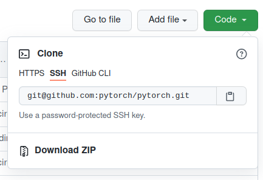

## Tâches et questions

Les tâches requises pour l'étape 3 sont décrites ici. Cette fois, vous n'aurez pas besoin de soumettre un article de blog ; vous serez évalué sur vos soumissions de code. En termes d'évaluations, vous serez noté dans le style des revues de code pour une partie de votre travail, et nous **exécuterons votre code** dans le système conteneurisé que vous produirez à la partie 4.

**Continuez à travailler dans votre dépôt de projet existant; il n'y a pas de nouveau template pour cette étape, seulement quelques fichiers de départ dans le dossier [`release/`](release/), indiqués dans les parties ci-dessous.**

### 1. Client de jeu (20%)

Cette partie est un peu orthogonale au reste des tâches, mais est nécessaire pour intéragir avec les matchs NHL «live». Jusqu'à présent, vous avez travaillé avec des vieux jeux des saisons passées. Maintenant, nous voulons mettre nos modèles brillants à l'épreuve sur des jeux en direct! Pour ce faire, nous devons adapter la fonctionnalité que nous avons implémentée pour télécharger les données de jeu afin d'implémenter une manière intelligente d'obtenir des données de jeux en direct. Plus précisément, nous voulons être en mesure d'extraire des données de jeu en direct et de ne traiter que les événements que **nous n'avons pas encore vus**.

1. Obtenez tous les évènements pour le même game_id, par exemple **2022030411** serait :

   [https://api-web.nhle.com/v1/gamecenter/2022030411/play-by-play](https://api-web.nhle.com/v1/gamecenter/2022030411/play-by-play)

   et obtenez le jeu complet en réponse. Gardez une sorte de tracker interne des événements que vous avez traités jusqu'à présent. Ensuite, traitez les événements que vous n'avez pas vus (par exemple, produisez les caractéristiques requises par le modèle, obtenez les prédictions du modèle et stockez les probabilités de but). Mettez à jour le tracker que vous avez implémenté afin que la prochaine fois que vous envoyez un ping au serveur, vous pouvez ignorer les événements que vous avez déjà traités.

Pour limiter la complexité, nous vous demanderons seulement de récupérer les **caractéristiques de base** des données (c'est-à-dire pas de fonctionnalités/modèles avancés).

Plus précisément, vous devez récupérer :

- **Distance du but**  
- **Angle par rapport au but**  
- **Est un but** (0 ou 1)  
- **Filet désert** (0 ou 1; vous pouvez assumer que les NaNs sont 0)  
  - Pour cela, vous pouvez utiliser le `situationCode` qui fonctionne comme suit:  
    - Premier chiffre: 1 pour gardien présent sur la glace de l'équipe away  
    - Deuxième chiffre: Nombre de patineurs sur la glace pour l'équipe away  
    - Troisième chiffre: Nombre de patineurs sur la glace pour l'équipe locale  
    - Quatrième chiffre: 1 pour gardien présent sur la glace de l'équipe locale  
  - Combinez ceci avec eventOwnerTeamId pour voir s'il s'agissait d'un but dans un filet désert.

Aucun template n'est fourni pour ce client - vous devez trouver une implémentation qui a le plus de sens pour vous. Vous utiliserez ce client pour la partie 3 lorsque vous intégrerez toutes ces parties ensemble. Notez que vous réutiliserez votre code pour transformer les événements en caractéristiques - tout ce que vous devez vraiment implémenter ici est la logique pour faire une demande pour un jeu en direct et filtrer les événements que vous avez déjà traités auparavant.   
   
**Évaluation**

* Votre implémentation fait une demande correctement au jeu spécifique et filtre correctement les événements traités précédemment. Vous obtenez le prochain lot d'inputs à transmettre à votre modèle.

### 2. Chargement des modèles (15%)

> IFT3700 réalise 2A. IFT6758 réalise 2B à la place.

#### 2A. Chargement des modèles (IFT3700)

Nous allons maintenant écrire le code qui charge nos modèles que nous avons créés à l'étape 2 et qui fournit leurs prédictions. Nous ne nous soucierons pas encore d'intégrer ce code dans un conteneur Docker - pour le moment, nous nous concentrons uniquement sur son exécution sur notre environnement local. Votre tâche consiste à implémenter les fonctions suivantes :

* **predict** - Prédit la probabilité que le tir soit un but compte tenu des inputs  
  * **Input**: Les caractéristiques utilisées par votre modèle, compatibles avec model.predict() ou model.predict_proba()  
  * **Sortie**: Les prédictions pour toutes les caractéristiques  

* **download_registry_model** - encapsule essentiellement la même fonction dans l'[API Wandb](https://docs.coreweave.com/products/registry/download_use_artifact) pour télécharger un modèle et mettre à jour le modèle actuellement chargé. Vous devez :  
  *  Vérifier si le modèle que vous cherchez est déjà téléchargé  
    * Si oui, chargez ce modèle et écrivez dans les logs que le modèle change  
    * Si non, essayez de télécharger le modèle :   
      * Si ça réussit, chargez ce modèle et écrivez dans les logs que le modèle change.  
      * En cas d'échec, écrivez dans les logs qu'il y a eu un échec et conservez le modèle actuellement chargé.

Écrivez dans les logs à l'aide du module [logging](https://docs.python.org/3/library/logging.html) de Python, afin que les messages apparaissent dans la sortie de votre application.

**Note : en raison de la simplification que nous avons apportée au client de données (uniquement les fonctionnalités de base), nous testerons uniquement les modèles de régression logistique sur la distance, sur l'angle et les modèles distance+angle! Ne vous inquiétez pas pour les autres modèles que vous avez entrainés.**

Vous **devriez** **ne pas** mettre de fonctionnalité spécifique à une tâche dans ces fonctions; tout prétraitement des données (comme la création de toutes les caractéristiques nécessaires à votre modèle) doit être effectué avant de les appeler. Votre code doit se comporter de la même manière qu'un objet de modèle SK-Learn. 

À ce stade, vous pouvez tester vos fonctions avec les données d'entraînement/validation existantes que vous avez utilisées à l'étape 2.

**Évaluation :**  
Le code ne sera pas exécuté à ce stade (il sera testé dans la partie 4). Cependant, des points seront attribués à cette section en fonction de :

* Les deux fonctions (**predict** et **download_registry_model**) sont correctement implémentées  
* Votre code peut télécharger des modèles stockés dans votre registre de modèles Wandb et les échanger *sans redémarrer l'application*. Les cas où le nouveau modèle n'est pas téléchargé correctement (par exemple, n'existe pas) sont traités d'une manière qui ne brise pas l'application.   
* Vous enregistrez des messages de débogage appropriés et informatifs dans les logs; vous devriez pouvoir déboguer votre application à partir des logs sans aller manuellement dans l'application (et plus tard, dans le conteneur Docker).

**Vous devez uniquement vous concentrer sur les modèles que vous avez produits à l'étape 2 partie 3, avec l'ensemble de base de caractéristiques simples. C'est correct s'il manque un tas de vos meilleurs modèles, le but est simplement de créer une sorte de système simple qui démontre la fonctionnalité de base.**

#### 2B. Service de modèle (IFT6758)

Au lieu des fonctions de 2A, vous allez servir vos modèles avec l'approche du *modèle comme service* : le modèle vit dans son propre service, accessible via un API REST, et le reste de votre code interroge ce service pour obtenir les prévisions de buts espérés.

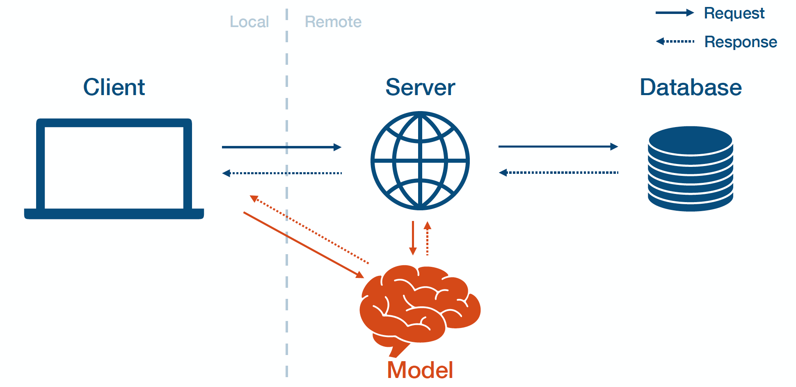

Figure 1 : Modèle comme service ([source](https://fullstackdeeplearning.com/spring2021/lecture-11/#model-as-service))

##### Services

Avant de commencer, vous vous demandez peut-être qu'est-ce qu'un service? Cette partie [pourrait être son propre cours](https://fr.wikipedia.org/wiki/Architecture_orient%C3%A9e_services), mais la seule chose que vous devez vraiment comprendre pour ce projet est qu'il s'agit d'un style architectural de génie logiciel qui construit des composantes de logiciel réutilisables et interopérables, par opposition à un seul gros logiciel monolithique. Fondamentalement, cela signifie que vous aurez de nombreux petits éléments autonomes (services) qui sont des « boîtes noires » pour leurs consommateurs (c'est-à-dire que le consommateur n'a pas besoin de savoir comment le service fonctionne). Les services fonctionnent généralement (mais pas toujours) dans leur propre environnement avec du hardware dédié, et ils peuvent également être éphémères (c'est-à-dire mis en place et supprimés dynamiquement au fur et à mesure que l'utilisation fluctue). 

##### Communication

Ces services peuvent interagir les uns avec les autres de plusieurs manières. Un [API REST](https://www.sitepoint.com/rest-api/) est un moyen de communiquer via des requêtes HTTP; cette méthode est très courante et fonctionne bien pour des petites données (comme des données textes ou JSON), mais ne fonctionne pas aussi bien pour les données plus volumineuses (par exemple, des fichiers binaires, des images, etc.). D'autres alternatives existent telles que [gRPC](https://grpc.io/), [Kafka](https://kafka.apache.org/), [ZeroMQ](https://zeromq.org/), etc., mais cela relève davantage du domaine des ingénieurs logiciels et ne fait pas partie des objectifs de ce cours. Pour nos besoins, un API REST sera suffisant mais sachez que ce n'est pas le bon outil pour chaque tâche et qu'il **n'existe pas de solution standard pour formater les données utilisées par un modèle ML**. Nous utiliserons [Flask](https://flask.palletsprojects.com/en/stable/tutorial/) pour créer notre application Web de prédiction simple. 

##### Service de prédiction Flask

Nous allons d'abord créer une application Flask simple qui fournira les prédictions de nos modèles que nous avons créés à l'étape 2. Nous ne nous soucierons pas encore d'intégrer cette application dans un conteneur Docker - pour le moment, nous nous concentrons uniquement sur l'exécution de cette application sur notre environnement local. Votre première tâche consiste à créer une application Flask qui implémente les endpoints suivants :

* **/predict** - Prédit la probabilité que le tir soit un but compte tenu des inputs  
  * **Input**: Les caractéristiques utilisées par votre modèle, compatibles avec model.predict() ou model.predict_proba()  
    - *Indice : [df.to_json()](https://pandas.pydata.org/docs/reference/api/pandas.DataFrame.to_json.html)*  
  * **Sortie**: Les prédictions pour toutes les caractéristiques  

* **/logs** - Récupère les logs écrits par votre application  

* **/download_registry_model** - encapsule essentiellement la même fonction dans l'[API Wandb](https://docs.coreweave.com/products/registry/download_use_artifact) pour télécharger un modèle et mettre à jour le modèle actuellement chargé. Vous devez :  
  *  Vérifier si le modèle que vous cherchez est déjà téléchargé  
    * Si oui, chargez ce modèle et écrivez dans les logs que le modèle change  
    * Si non, essayez de télécharger le modèle :   
      * Si ça réussit, chargez ce modèle et écrivez dans les logs que le modèle change.  
      * En cas d'échec, écrivez dans les logs qu'il y a eu un échec et conservez le modèle actuellement chargé.

**Note : en raison de la simplification que nous avons apportée au client de données (uniquement les fonctionnalités de base), nous testerons uniquement les modèles de régression logistique sur la distance, sur l'angle et les modèles distance+angle! Ne vous inquiétez pas pour les autres modèles que vous avez entrainés.**

Dans le dossier [`release/ift6758-only/`](release/ift6758-only/), vous trouverez un **app.py** dans le dossier serving; copiez le dossier `serving/` à la racine de votre dépôt. Ce fichier contient un template de la structure que vous devez implémenter. Vous **devriez** **ne pas** mettre de fonctionnalité spécifique à une tâche dans votre application Flask; tout prétraitement des données (comme la création de toutes les caractéristiques nécessaires à votre modèle) doit être effectué avant de faire une demande au service de prédiction. Votre application doit se comporter de la même manière qu'un objet de modèle SK-Learn. 

Pour exécuter l'application, si vous êtes dans le même dossier que **app.py**, vous pouvez exécuter l'application à partir de la ligne de commande en utilisant [gunicorn](https://gunicorn.org/) (Unix) ou [waitress](https://docs.pylonsproject.org/projects/waitress/en/latest/usage.html) (Unix + Windows) :  

```
$ gunicorn --bind 0.0.0.0:<PORT> app:app
$ waitress-serve --listen=0.0.0.0:<PORT> app:app
```

Flask, et gunicorn ou waitress, peuvent être installés via :

```
uv add flask gunicorn
uv add flask waitress
```

À ce stade, vous pouvez tester l'application avec les données d'entraînement/validation existantes que vous avez utilisées à l'étape 2, et envoyer un ping à l'application directement à l'aide de la bibliothèque de requêtes Python, par exemple: 

```python
X = get_input_features_df()
r = requests.post(
    "http://0.0.0.0:<PORT>/predict",
    json=json.loads(X.to_json())
)
print(r.json())
```

De plus, une fois que vous aurez implémenté **/logs**, vous pourrez voir tous les logs en accédant à `http://0.0.0.0:<PORT>/logs` dans votre navigateur. 

##### Client fournisseur

Maintenant que notre modèle SKLearn est servi via une application Flask, nous voulons un moyen d'interagir avec lui sans avoir à appeler explicitement requests.post à chaque fois que nous voulons soumettre une demande. Vous recevez un fichier template pour le client fournisseur (`release/ift6758-only/serving_client.py`); copiez-le dans votre package `ift6758`. Implémentez les trois méthodes qui y sont définies. Ces fonctions seront très simples et directes à implémenter.

**Évaluation :**  
Le code ne sera pas exécuté à ce stade (il sera testé dans la partie 4). Cependant, des points seront attribués à cette section en fonction de :

* Les trois endpoints (**/predict**, **/logs** et **/download_registry_model**) sont correctement implémentés  
* Le service peut télécharger des modèles stockés dans votre registre de modèles Wandb et les échanger *sans redémarrer l'application*. Les cas où le nouveau modèle n'est pas téléchargé correctement (par exemple, n'existe pas) sont traités d'une manière qui ne brise pas l'application.   
* Vous enregistrez des messages de débogage appropriés et informatifs dans les logs; vous devriez pouvoir déboguer votre application à partir des logs sans aller manuellement dans l'application (et plus tard, dans le conteneur Docker).
* Les trois méthodes du client fournisseur (**predict(...)**, **logs()** et **download_registry_model(...)**) sont correctement implémentées. Les signatures de fonction n'ont pas besoin d'être exactement les mêmes que celles spécifiées (c'est-à-dire que vous pouvez ajouter des arguments supplémentaires si vous le souhaitez). Ce client doit fonctionner avec votre application Flask lorsqu'il est défini avec l'adresse IP et le port corrects.

**Vous devez uniquement vous concentrer sur les modèles que vous avez produits à l'étape 2 partie 3, avec l'ensemble de base de caractéristiques simples. C'est correct s'il manque un tas de vos meilleurs modèles, le but est simplement de créer une sorte de système simple qui démontre la fonctionnalité de base.**

### 3. Application Streamlit (25%)

Nous y sommes presque! Bien que le client et le code de chargement de modèles que vous avez créés soient sympas, ils sont toujours difficiles à interagir avec pour la plupart des gens. La partie amusante est de les transformer en un outil utilisable par toute personne ayant accès à un ordinateur et à Internet. Pour cela, nous utilisons Streamlit.

Streamlit est un framework permettant de créer des applications Web interactives en utilisant uniquement Python! Il fournit une grande quantité de fonctionnalités particulièrement utiles pour afficher des données de différentes formes et fournir des composants interactifs afin que les utilisateurs puissent explorer ces données, le tout sans avoir besoin de connaissances en HTML/CSS/JavaScript. Pour en savoir plus sur les capacités de Streamlit, consultez [leur article de blog](https://towardsdatascience.com/coding-ml-tools-like-you-code-ml-models-ddba3357eace).

#### Commencer avec Streamlit

Comme vous vous êtes familiarisé avec l'utilisation de Python, l'utilisation de Streamlit devrait vous sembler assez naturelle. Pour commencer, l'exécution de 

```
uv add streamlit
```

dans votre projet devrait installer tout ce dont vous avez besoin. Ensuite, en suivant les premières étapes mentionnées [ici](https://docs.streamlit.io/library/get-started/create-an-app), vous devriez être opérationnel avec votre première application. N'hésitez pas à jouer avec! Bien que nous n'utilisons rien de très compliqué pour ce projet, c'est une bonne idée de jeter un coup d'œil à :

* [Les principaux concepts de Streamlit](https://docs.streamlit.io/library/get-started/main-concepts) (en particulier pour comprendre comment Streamlit gère l'interactivité, en réexécutant le script à chaque fois que certains widgets d'entrée changent).  
* [La référence de l'API](https://docs.streamlit.io/library/api-reference) (pour donner une idée de toutes les composantes pré-construits à votre disposition depuis Streamlit!)

#### Fonctionnalité à Implémenter

Plus précisément, nous utiliserons votre client de jeu en direct que vous avez implémenté dans la partie 1 et vos fonctions de chargement de modèles que vous avez implémentées dans la partie 2. Le but est de créer un tableau de bord simple mais en direct pour votre modèle de expected goals (xG). 

Vous allez créer une application Web interactive Streamlit qui peut accepter un ID de jeu comme entrée, puis un bouton qui déclenche la méthode "ping game" du client de jeu (ou tout autre méthode que vous avez implémenté). Les nouveaux événements de tir doivent être passés au modèle actuellement chargé, et les probabilités de buts qui sortent de votre modèle doivent être jointes en tant que nouvelle colonne aux nouveaux événements de tir. Vous afficherez ensuite la somme des buts espérés pour chaque équipe, en tant que proxy pour "quelle équipe fait mieux" et comparerez cette valeur au score réel. Il s'agit d'une estimation simple de l'équipe qui joue le mieux, mais bon, c'est un début!

> **IFT6758 :** partout où cette partie mentionne vos fonctions de chargement de modèles ou le modèle actuellement chargé, utilisez votre client fournisseur de la partie 2B : le bouton Téléchargez le modèle échange le modèle dans votre service de prédiction, et les nouveaux événements de tir sont envoyés à votre service de prédiction.

Pour votre application interactive, vous devez implémenter les fonctionnalités suivantes :  

* **([Saisie de texte](https://docs.streamlit.io/library/api-reference/widgets/st.text_input))** Espace de travail, Modèle, Version; pour spécifier le modèle à télécharger à partir du registre de modèles Wandb. Il peut s'agir de 3 entrées distinctes.  
* **([Clic sur le bouton](https://docs.streamlit.io/library/api-reference/widgets/st.button))** Téléchargez le modèle; télécharge le modèle à partir de Wandb en utilisant les paramètres spécifiés ci-dessus et en fait le modèle actuellement chargé.  
    
* **([Saisie de texte](https://docs.streamlit.io/library/api-reference/widgets/st.text_input))** Identifiant de jeu; spécifie le jeu auquel votre outil envoie une requête, par exemple **2021020329**  
* ([**Clic sur le bouton**](https://docs.streamlit.io/library/api-reference/widgets/st.button)) Requête jeu  
  * Lorsque vous appuyez sur le bouton, votre tableau de bord doit afficher :  
    * Les noms des deux équipes  
    * La période  
    * Le temps restant dans la période   
    * Le score actuel  
    * La somme des buts espérés (xG) pour le jeu entier jusqu'à présent pour les deux équipes (obtenu à partir du client du jeu)  
    * Différence entre le score actuel et la somme des buts espérés (c'est-à-dire si l'équipe à domicile a marqué 2 buts et que la somme des buts espérés est de 2,4, montrez une différence de 2,4-2=0,4). Pour cela, [utilisez les éléments suivants](https://docs.streamlit.io/library/api-reference/data/st.metric).  
  * Certaines de ces valeurs peuvent être obtenues en faisant des requêtes API directes à l'API NHL, d'autres utiliseront le client de jeu que vous avez créé précédemment  
* De plus, vous devez afficher le **dataframe de toutes vos caractéristiques**, avec la **probabilité assignée par le modèle à chaque événement**. Assurez-vous que votre logique pour filtrer les jeux est correcte - il ne devrait pas y avoir de copies, et vous ne pouvez pas simplement recalculer les prédictions d'objectifs pour l'ensemble croissant d'événements de tir! 

Une fois que tout est terminé, votre application Web devrait ressembler à ceci (avec les noms réels des fonctionnalités/événements)!

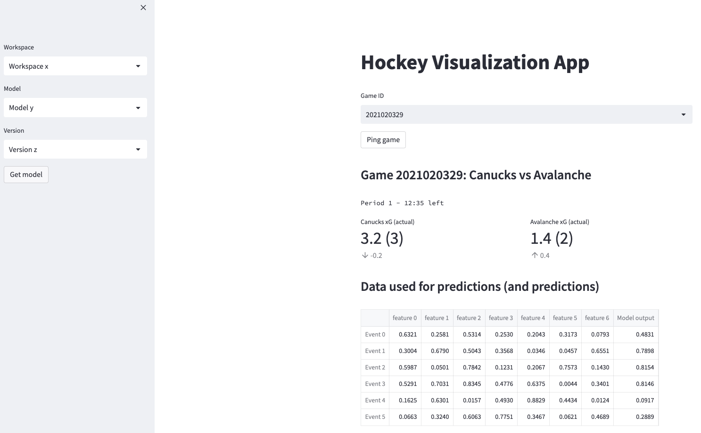

**Évaluation**

* La fonctionnalité ci-dessus est correctement supportée par votre application interactive, c'est-à-dire pas d'événements de tir en double, l'échange de modèles se fait bien, etc. 

* Le comportement que nous recherchons est que lorsque nous cliquons sur le bouton "ping game", s'il y a des nouveaux événements de tirs, ces nouveaux tirs seront filtrés (afin qu'aucun ancien tir ne soit réévalué), puis passés au modèle actuellement chargé. Les probabilités de buts générées seront ensuite jointes au DataFrame qui a été soumis et affichées en tant que output. La somme des buts espérés pour chaque équipe est ensuite mise à jour dans le tableau ci-dessus, en plus des champs PÉRIODE et TEMPS RESTANT en haut. 

* Vous ne devriez **pas** ignorer la logique de filtrage et simplement recalculer toutes les probabilités de tir à chaque fois que vous faites une requête de jeu. 

* Cette visualisation sera exécutée dans la section suivante (depuis l'environnement Docker).

### 4. Docker (20%)

Suivez les [instructions ici](https://docs.docker.com/get-docker/) pour installer Docker sur votre système. Une chose à noter est que votre projet déclare déjà ses dépendances dans `pyproject.toml` et `uv.lock` : installez-les à partir de ces fichiers dans votre Dockerfile au lieu d'énumérer les packages à la main; consultez le [guide Docker](https://docs.astral.sh/uv/guides/integration/docker/) de uv. Dans le dossier [`release/`](release/), vous trouverez un template de **Dockerfile** et de **docker-compose.yaml**; copiez-les à la racine de votre dépôt.

Pour cette section, effectuez les tâches suivantes :

* Mettez l'application Streamlit que vous avez créée dans la partie 3 dans un conteneur Docker en remplissant le **Dockerfile** fourni. Cela ne devrait pas être très compliqué; le mien était d'environ 10 lignes de commandes.
  * La clé de l'API Wandb doit être transmise au moment de l'exécution via un argument de variable d'environnement - **NE PAS l'intégrer dans votre conteneur**
  * Les conteneurs sont censés être légers - **N'intégrez PAS tous vos modèles dans le conteneur!** De plus, nous pouvons utiliser la fonctionnalité de changement de modèles que nous avons implémentée dans la partie 2.
  * Vous n'avez pas *besoin* de spécifier une commande par défaut pour le conteneur, mais c'est recommandé. La commande pour exécuter Streamlit est :

    ```
    streamlit run {STREAMLIT_FILE} --server.port {STREAMLIT_PORT} --server.address {STREAMLIT_IP}
    ```

* Écrivez un script de construction (build.sh) avec la commande docker qui construit le conteneur, et un script d'exécution (run.sh) avec la commande docker qui exécute le conteneur avec les arguments appropriés.

* Remplissez la même configuration de docker dans le fichier docker-compose.yaml fourni, afin que vous puissiez exécuter l'application avec un seul `docker compose up` au lieu de la commande d'exécution plus longue. Cela peut sembler inutile dans ce contexte, mais docker compose devient très utile lorsque vous commencez à créer des systèmes avec de *nombreux* services docker, qui doivent tous être mis en réseau les uns avec les autres.

**IFT6758 : deuxième conteneur**

Votre application a besoin d'un deuxième conteneur, pour votre application Flask de la partie 2B.

* Mettez votre application Flask dans un conteneur Docker en remplissant le **Dockerfile.serving** fourni (dans `release/ift6758-only/`; copiez-le à la racine de votre dépôt). Sa commande par défaut exécute l'application de prédiction avec gunicorn ou waitress. La clé de l'API Wandb est transmise à ce conteneur, puisque c'est lui qui télécharge les modèles, et non au conteneur Streamlit. Vos scripts build.sh et run.sh construisent et exécutent ce conteneur.

* Décommentez le service `serving` dans le fichier docker-compose.yaml fourni. La mise en réseau peut devenir assez délicate dans Docker pour les non-initiés, et docker compose peut vous faciliter la vie. Plus précisément, docker compose effectue par défaut de belles résolutions de noms. Vous remarquerez que le format de votre fichier docker-compose suit les lignes suivantes :

  ```yaml
  # docker-compose.yaml
  services:
      service1:
          ...
      service2:
          ...
  ```

  Supposons que votre application Streamlit réside dans **service2** et que vous souhaitiez envoyer une requête HTTP à **service1**. En fait, vous n'avez pas besoin de rechercher l'adresse IP du conteneur de **service1** - vous pouvez simplement envoyer une requête HTTP à http://service1:PORT/endpoint. La résolution du nom est prise en charge si vous utilisez docker compose (mais vous devez utiliser le bon port). Lisez cet url à partir d'une variable d'environnement que vous définissez dans votre docker-compose.yaml au lieu de le hardcoder, car il sera différent à la partie 5. Lorsque vous exécutez `docker compose up`, vous devriez voir quelque chose de similaire à ce qui suit :

  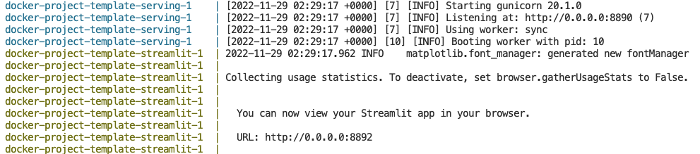

  Si tout est correctement connecté, vous devriez pouvoir accéder au deuxième lien et accéder à votre application Streamlit. Si vous envoyez un ping à un jeu, il devrait pouvoir accéder au service de prédiction (sinon, assurez-vous d'utiliser le nom du service de prédiction et le bon port).

**Évaluation**

* Nous évaluerons votre visualisation en exécutant

  ```
  $ docker compose up
  ```

  Cela doit **créer et démarrer le conteneur requis** et héberger l'application avec votre visualisation interactive créée dans la partie 3. Docker par conception facilite les environnements reproductibles, il n'y a donc pas de raison pour que cela ne fonctionne pas sur ma machine et **vous perdrez des points si cela ne fonctionne pas!**

* Nous devons être en mesure d'accéder à votre application Streamlit et d'interagir avec elle (c'est-à-dire que nous devrions être en mesure de télécharger des modèles et d'envoyer un ping à des jeux, le tout devrait fonctionner immédiatement).

* La clé API Wandb doit être récupérée à partir de ${WANDB_API_KEY} sur la machine locale et ne doit pas être hardcoded.

* Votre conteneur ne doit pas contenir de poids de modèle supplémentaires ; vous pouvez inclure des poids "par défaut" si vous le souhaitez.

* Vos commandes build et run respectivement dans les build.sh et run.sh sont correctes (oui, elles n'ont besoin que d'une simple commande).
  * *Le but est de vous exposer à la relation entre le CLI docker et docker compose.*

* **IFT6758 :** `docker compose up` doit **créer et démarrer les deux conteneurs**, et la connexion entre les deux services devrait fonctionner immédiatement.

### 5. Déploiement (20%)

C'est la dernière partie, promis! Pour l'instant, votre application ne tourne que sur votre propre machine.

#### Déployer dans le cloud - Préambule

Nous allons maintenant prendre notre application et la déployer dans le cloud. Dans cette section, nous allons acquérir de l'expérience avec un fournisseur de services cloud (dans ce cas, Google Cloud) afin de créer et déployer des applications.

En particulier, nous allons travailler avec [Google Cloud Build](https://cloud.google.com/build) pour construire notre application sous forme d'image Docker et la stocker dans un dépôt distant (appelé [Google Artifact Registry](https://cloud.google.com/artifact-registry)).

Notre application se compose d'un seul composant, qui sera construit dans une image Docker.

> **IFT6758 :** votre application se compose de deux composants (votre application Streamlit et votre application de prédiction); vous allez donc construire deux images Docker et les déployer comme deux conteneurs du même service Cloud Run. Ce qui diffère est marqué **IFT6758** ci-dessous.

Nous allons ensuite utiliser [Google Cloud Run](https://cloud.google.com/run) pour déployer l'application sur le web.

Il vous sera demandé d'écrire le code et les fichiers de configuration nécessaires pour :
- Soumettre des builds à Google Cloud Build
- Déployer l'application sur Google Cloud Run

Les fichiers de départ pour cette partie se trouvent dans le dossier [`release/`](release/). Copiez `deployment/`, `setup/` et `deliverables.yaml` à la racine de votre dépôt de projet, à côté de votre Dockerfile de la [partie 4](#4-docker-20).

##### 0. Créer un compte Google Cloud

Si vous n'avez pas encore de compte Google Cloud, vous pouvez en créer un [ici](https://console.cloud.google.com).

Les vidéos suivantes fournissent un aperçu de certains concepts clés lors de l'utilisation de Google Cloud :
- Comment s'inscrire à Google Cloud --  [lien](https://youtu.be/ogzJovMsDIU?si=VCZ16ONz0CYvbGBV&t=40)
- Comment naviguer dans Google Cloud -- [lien](https://youtu.be/27Pb5g7bEAA?si=yuuDIv_4nzJL2tLd&t=75)

##### 1. Créer un projet Google Cloud

Créez un projet Google Cloud avec les informations suivantes :

- Nom du projet : `m3-COURSE_CODE-TEAM_ID`

- ID du projet : `m3-COURSE_CODE-TEAM_ID`

Assurez-vous que le nom et l'ID du projet soient **identiques**. **Vous ne pouvez pas modifier l'ID du projet par la suite. Le nom et l'ID sont sensibles à la casse.** Cela doit être fait une seule fois par équipe.

Exemple : Si mon code de cours est IFT6758B et que mon ID d'équipe est 2, alors mon nom de projet sera :
`m3-ift6758b-2` et mon ID de projet sera : `m3-ift6758b-2`.

##### 2. Installer le CLI gcloud

Le CLI de Google Cloud (gcloud) est un "ensemble d'outils pour créer et gérer des ressources Google Cloud" ([source](https://cloud.google.com/sdk/gcloud)). L'utilisation de gcloud est nécessaire pour interagir avec Google Cloud depuis votre machine.

Les instructions pour installer gcloud se trouvent [ici](https://cloud.google.com/sdk/docs/install).

Une fois gcloud installé, utilisez-le pour configurer votre projet :
```
gcloud config set project MY_PROJECT_ID
```
où `MY_PROJECT_ID` est l'ID du projet créé à l'étape 1.

Vous pouvez vérifier que vous êtes bien sur le bon projet en exécutant la commande suivante :
```
gcloud config list
```

##### 3. Activer les API

Les API suivantes doivent être activées pour votre projet :
- API de l'Artifact Registry
- API Cloud Run
- API Cloud Build
- API Secret Manager

Vous pouvez activer ces API en exécutant la commande suivante :
```
gcloud services enable artifactregistry.googleapis.com run.googleapis.com cloudbuild.googleapis.com secretmanager.googleapis.com
```

##### 4. Créer un dépôt Docker sur l'Artifact Registry.

Un dépôt Docker est nécessaire pour stocker les images Docker que nous allons construire avec Google Cloud Build. Sur Google Cloud, un dépôt Docker est hébergé sur l'Artifact Registry.

Vous pouvez créer un dépôt sur l'Artifact Registry en exécutant la commande suivante :
```
gcloud artifacts repositories create REPO_NAME \
    --repository-format=docker \
    --location=LOCATION \
    --project=PROJECT_ID
```

Assurez-vous de configurer les éléments suivants :
- REPO_NAME : `m3-images`
- LOCATION : `us-central1`
- PROJECT_ID : l'ID du projet créé à l'étape 1.

Vous pouvez vérifier que votre dépôt a bien été créé en exécutant la commande suivante :
```
gcloud artifacts repositories list --project=PROJECT_ID
```

##### 5. Vérifier les prérequis

Avant de commencer l'implémentation, assurez-vous d'avoir complété toutes les étapes listées ci-dessus.

Pour vérifier que votre projet est correctement configuré, exécutez la commande suivante :
```
uv run python setup/check_prereq.py
```

Si toutes les vérifications sont réussies, vous verrez la sortie suivante :
```
All prerequisites are met. You can proceed with the assignment.
```

Si vous voyez des erreurs, assurez-vous de les corriger avant de continuer.

#### Déployer dans le cloud - Implémentation

##### 1. Construire votre image Docker avec Cloud Build

La première étape consistera à créer un fichier YAML Cloud Build, qui détermine les étapes nécessaires pour construire notre image Docker sur Google Cloud et la pousser vers l'Artifact Registry.

###### Création d'un fichier YAML Cloud Build

Construisez un fichier YAML Cloud Build en utilisant le fichier `deployment/cloudbuild_template.yaml` comme modèle. Enregistrez-le sous le nom `deployment/cloudbuild.yaml`, qui est le nom attendu par `deployment/submit_build_template.sh`.

Dans ce fichier, nous allons utiliser des substitutions pour remplir les valeurs correctes. Les substitutions permettent de passer des variables dans le processus de build.

En regardant `deployment/submit_build_template.sh`, la substitution suivante est disponible :
- `_IMAGE_URI`

qui peut être référencée sous la forme `${SUBSTITUTION_NAME}` dans votre fichier YAML.

Il y a également `${BUILD_ID}` qui est une variable d'environnement présente dans Google Cloud Build et qui contient la valeur de l'identifiant de build unique actuel.

Vous devrez remplir les valeurs correctes pour vous assurer que cette substitution est correcte. Voir `#FILL ME IN` dans le fichier `deployment/submit_build_template.sh`.

Suivez les instructions dans `deployment/cloudbuild_template.yaml` pour créer un fichier YAML Cloud Build qui construira et poussera notre image Docker.

Dans le fichier Cloud Build, nous construisons une seule image.

> **IFT6758 :** vous construisez deux images. Répétez les étapes de build et de push pour l'image de votre application de prédiction, construite à partir de `Dockerfile.serving`, avec une deuxième substitution, `_SERVING_IMAGE_URI`; voyez les commentaires `IFT6758` dans les deux fichiers template.

Plus d'informations sur la création d'un fichier YAML Cloud Build se trouvent [ici](https://cloud.google.com/build/docs/configuring-builds/create-basic-configuration).

###### Soumission du build à Cloud Build

Une fois que vous avez créé le fichier Cloud Build, utilisez la commande `gcloud` pour soumettre le build à Cloud Build. Vous pouvez utiliser le fichier `submit_build_template.sh` pour cela. Plus de documentation sur `gcloud builds` se trouve [ici](https://cloud.google.com/sdk/gcloud/reference/builds/submit).

Lorsque vous exécutez le script, vous verrez les logs s'afficher dans le terminal. `gcloud` vous donnera également un lien pour visualiser le build dans votre navigateur. Vous pouvez consulter tous vos builds [ici](https://console.cloud.google.com/cloud-build/builds).

###### Livrables

Pour cette partie, vous devez soumettre les fichiers suivants :
- 1 fichier YAML Cloud Build.
- 1 script de soumission de build.
- Fichier `deliverables.yaml` avec l'identifiant de build du conteneur.

##### 2. Déployer le conteneur sur le web

Une fois notre image Docker construite et poussée, nous pouvons la déployer avec le service Google Cloud Run.

Tous vos services Google Cloud Run se trouvent [ici](https://console.cloud.google.com/run).

###### 2a. Gestion des secrets

La gestion sécurisée des identifiants est une partie importante du développement et du déploiement d'applications. Dans Google Cloud, nous pouvons utiliser un secrets manager pour stocker notre clé API Wandb. Nous pouvons ensuite injecter notre secret dans notre service au moment du déploiement, sous forme de variable d'environnement.

Pour ce faire, nous devons d'abord créer un secret. Nous pouvons créer un fichier qui contient uniquement la valeur du secret. **NE COMMITEZ PAS CE FICHIER DANS LE SOURCE CONTROL / GITHUB**. Vous pouvez supprimer ce fichier après avoir créé le secret ci-dessous OU **ajouter le fichier à votre .gitignore**

Nous pouvons ensuite demander à gcloud d'utiliser le contenu du fichier pour créer un secret (référencé par le nom WANDB_API_KEY) dans le Secret Manager de Google Cloud :

```
gcloud secrets create WANDB_API_KEY --data-file="PATH_TO_SECRET"
```

où `PATH_TO_SECRET` est le chemin absolu du fichier que vous avez créé ci-dessus.

###### 2b. Déploiement

En plus du CLI `gcloud`, nous pouvons aussi déployer à partir de la console Google Cloud (UI).

La première étape est d'aller dans Cloud Run, [ici](https://console.cloud.google.com/run). Nous voulons ensuite déployer un service web à partir d'un conteneur Docker. Cliquez sur "Deploy container"

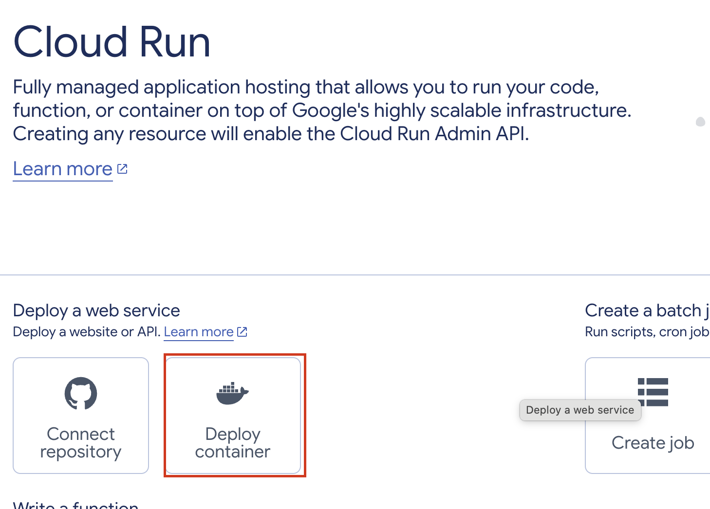

Pour déployer votre application, vous aurez besoin de l'URI de l'image que vous voulez déployer. Vous pouvez la trouver dans l'Artifact Registry, [ici](https://console.cloud.google.com/artifacts). Cela devrait ressembler à ceci :

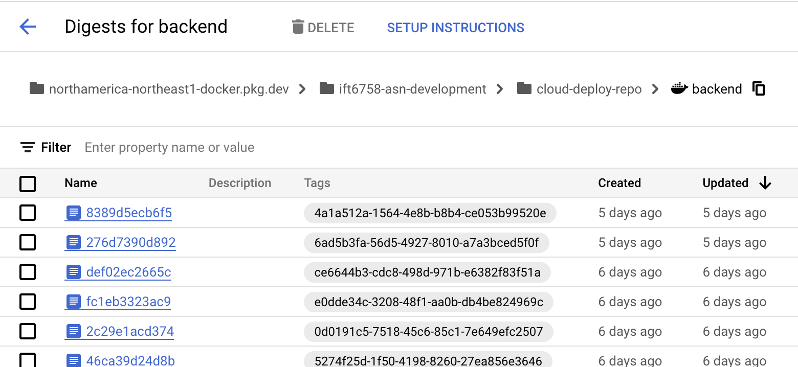

En cliquant sur les trois points à côté de l'image voulue, puis en sélectionnant "Show pull command", vous pouvez obtenir l'URI complète de l'image.

A. L'URI de l'image doit ensuite être entrée dans **Container Image URL**.

B. Assurez-vous que le **Service Name** est `nhl-streamlit-app` et que la **Region** est `us-central1`.

**Authentification et autorisation**

Notre application est déployée sur l'internet public. Nous allons donc créer des protections supplémentaires pour nous assurer que seuls les utilisateurs autorisés peuvent accéder à notre application. Cela se fait au moyen d'un "Identity Aware Proxy", qui vérifie votre adresse courriel par rapport à une allowlist.

C. Sous **Authentication**, assurez-vous que `Require Authentication` est sélectionné. `Identity and Access Management (IAM)` doit être **décoché** et `Identity Aware Proxy (IAP)` doit être **coché**.

D. Sous **Edit Policy**, vous pouvez ajouter les comptes courriel Google qui doivent avoir accès à votre application. Ajoutez les adresses courriel de vos coéquipiers et celle du compte de l'auxiliaire d'enseignement (à déterminer).

**Service Scaling**

E. Assurez-vous que `Minimum Number of Instances` est à 0 et que `Maximum Number of Instances` est à 1.

**Containers, Networking, Security**

F. Assurez-vous que le `Container Port` correspond au port Streamlit défini dans votre application.

G. Si vous n'avez pas donné de commande par défaut à votre Dockerfile, vous pouvez entrer la commande par défaut et ses arguments dans la section `Container Command` et `Container Arguments`.

> **IFT6758 :** votre service a un deuxième conteneur. Un service Cloud Run peut exécuter plus d'un conteneur : l'un reçoit les requêtes (ici, votre application Streamlit), et les autres, appelés [sidecars](https://cloud.google.com/run/docs/deploying#sidecars), s'exécutent à côté de lui. Cliquez sur `Add container` et entrez l'URI de votre image de prédiction. Assurez-vous que votre application de prédiction écoute sur un port différent du `Container Port` de l'étape F. Les conteneurs d'un même service se joignent à l'adresse `localhost`; dans l'onglet `Variables & Secrets` du conteneur Streamlit, donnez donc à la variable d'environnement qui contient l'url de votre service de modèle la valeur `http://localhost:PORT`. Faites l'étape H ci-dessous dans le conteneur de prédiction, puisque c'est lui qui télécharge les modèles.

H. Ensuite, nous voulons nous assurer que le secret de notre clé API Wandb est injecté dans l'application au runtime. Pour ce faire, il faut cliquer sur l'onglet `Variables & Secrets`. Sous `Secrets exposed as environment variables`, nous sélectionnons `Reference a Secret` et entrons les informations appropriées.

**Déployer**

Une fois ce qui précède fait, nous pouvons cliquer sur `Create` pour déployer l'application. Nous pourrons alors voir l'URL de notre service déployé.

En cliquant sur l'URL, nous devrons nous authentifier avec Google Cloud. Si notre adresse courriel fait partie de l'allowlist, nous devrions pouvoir voir l'application.

Nous pourrons aussi voir les logs, qui seront importants pour comprendre si notre service a été déployé correctement.

Bien que nous ayons fait cette section avec l'UI, elle peut aussi être faite de façon programmatique avec le CLI `gcloud`, comme nous l'avons fait avec Cloud Build. Une approche programmatique est souvent préférée à l'UI « point-and-click », afin de minimiser les erreurs et d'assurer la reproductibilité. Il est toutefois bon de savoir utiliser les deux approches.

Assurez-vous de soumettre l'URL de votre service dans le fichier `deliverables.yaml`.

#### Nettoyage des ressources

Nous fournirons des instructions supplémentaires sur Piazza pour vous permettre de nettoyer votre projet Google Cloud une fois la correction terminée.

**Évaluation**

* Votre fichier YAML Cloud Build et votre script de soumission de build construisent votre image avec Cloud Build et la poussent vers l'Artifact Registry, et votre `deliverables.yaml` contient l'identifiant de build et l'URL de votre service.

* Nous devons pouvoir ouvrir l'URL de votre service avec le compte de l'auxiliaire d'enseignement, et télécharger des modèles et envoyer un ping à des jeux comme à la partie 4.

* La clé API Wandb doit provenir du Secret Manager, **et non de votre image ou de votre dépôt**.

* **IFT6758 :** votre fichier Cloud Build construit et pousse les deux images, et l'application déployée obtient ses prédictions de votre application de prédiction, qui s'exécute dans le deuxième conteneur du même service.

### 6. BONUS : fonctionnalité supplémentaire de Streamlit (facultatif, 5%)

Si vous jetez un coup d'œil à la référence de l'API de Streamlit, vous verrez qu'il existe une myriade de composants pouvant être inclus dans l'application Web, ainsi que de nombreuses façons d'intégrer de l'interactivité à l'application Web; les exigences que nous avons publiées ne font qu'effleurer la surface.

Inspirez-vous de tout ce que vous avez appris/construit en classe jusqu'à présent et ajoutez des fonctionnalités/données/visualisations supplémentaires dans votre application Streamlit qui fourniraient des informations intéressantes aux téléspectateurs de hockey qui utilisent votre application. Il peut s'agir de graphiques que vous avez dû créer pour les étapes précédentes, de statistiques globales d'équipe, de graphiques de tir, de comparaisons de résultats de modèles, etc. Soyez créatif!

Si vous visez le bonus, ajoutez un court paragraphe quelque part dans votre application Web en utilisant st.write décrivant la fonctionnalité que vous avez ajoutée et comment vous l'avez incluse. Cette section sera jugée en fonction de la créativité, de l'utilité et du défi technique.

## Et voila!

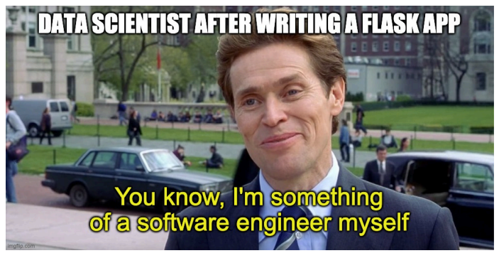

Merci d'avoir traversé ce voyage de projet! Je sais que c'était beaucoup de travail, mais j'espère que vous l'avez trouvé amusant, intéressant et enrichissant. J'espère que vous avez tous appris quelque chose qui vous aidera dans la prochaine étape de votre carrière, qu'il s'agisse de chercher un emploi dans l'industrie ou de faire de la recherche. Bonne chance avec tout ce que votre avenir vous réserve!

## Évaluations de groupe

En plus de la notation décrite ci-dessus, pour chaque étape, il vous sera demandé d'évaluer dans quelle mesure vous pensez que chacun a contribué à cette étape, et de fournir une rétroaction constructive à vos coéquipiers, en fonction de leurs forces et de leurs pistes d'amélioration potentielles. Les étudiants qui ne contribuent pas beaucoup obtiendront probablement une note faible, et dans les cas extrêmes, ils pourraient être retirés du groupe et devoir compléter les projets individuellement. 

Pour une équipe de taille **N**, chaque membre de l'équipe disposera de **N x 20** points à répartir entre tous les membres de votre groupe (y compris vous-même). Vous attribuerez ensuite à chacun une note entre **10 et 40**, où **10** correspond à « la moitié de l'effort », et **40** correspond au « double de l'effort » (**vous ne pouvez pas attribuer de points en dehors de cette plage!**). Dans une situation idéale, tout le monde contribue également au projet et donc tout le monde attribue 20 points à chaque coéquipier. Cependant, dans le cas où certaines personnes ont moins contribué que d'autres, vous pourriez leur attribuer moins de points et donner ces points à ceux que vous pensez avoir le plus contribué. Les cas extrêmes entraîneront un suivi de l'équipe par un instructeur pour résoudre les difficultés potentielles. Cela pourrait inclure un audit de l'historique git dans vos dépôts. *Toute tentative de manipuler le système sera traitée manuellement et défavorablement!*

En plus de la note, vous devrez également **donner une brève rétroaction à vos pairs**, à la fois sur leurs forces et sur leurs pistes d'amélioration potentielles. Cette rétroaction sera donnée en privé et de manière anonyme à chaque étudiant. Vous pouvez donner votre avis selon plusieurs axes différents, tels que leur **travail d'équipe** (communication, fiabilité) et leur **travail technique** (à quel point ils ont contribué et la qualité de leur travail/code). Si vous attribuez une note inférieure à 20, vous devez fournir une rétroaction constructive sur les points qu'ils peuvent améliorer. 

### Comment les scores impactent votre note

* **x** est la note moyenne d'un étudiant (excluant sa propre note), plafonnée entre 10 (« la moitié de l'effort ») et 40 (« le double de l'effort »).  
* La note d'un étudiant sur l'étape sera multipliée par le facteur de pondération suivant[^2]:

**Facteur**(**x**) = 0.41667 + 0.0375**x** - 0.00041667**x**²

* Ce système a été adopté de [Brian Fraser (SFU)](https://opencoursehub.cs.sfu.ca/bfraser/grav-cms/cmpt276/project), qui est lui-même basé sur les [travaux de Bill Gardner](http://www.cs.ubc.ca/wccce/Program03/papers/Gardner-Group/Gardner-Group.htm).

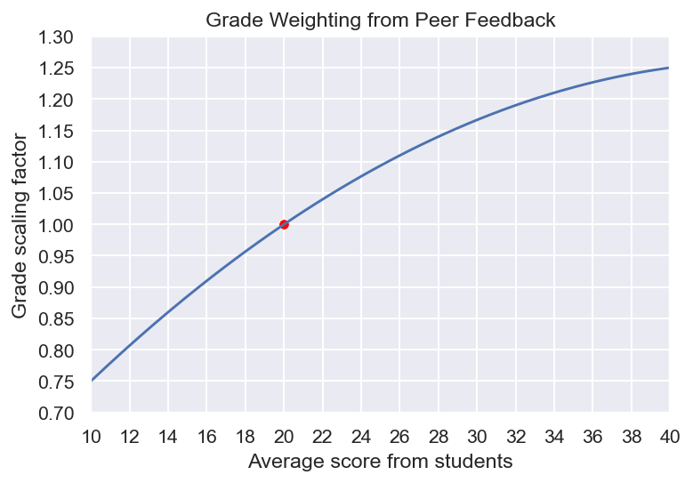

## Références utiles

* [IFT 6758 Hockey Primer](https://docs.google.com/document/d/1CP4dbReUdLMwtmnU8_lEQDawrh5LkbDuGDM9Sqza6ZA/edit?usp=sharing)  
* [Zmalski's NHL API Reference](https://github.com/Zmalski/NHL-API-Reference) - documentation incomplète de la **nouvelle API**  
* [dword4's NHL API Doc](https://gitlab.com/dword4/nhlapi/-/blob/master/new-api.md) - une autre référence incomplète pour la **nouvelle API**  
* [Wandb Python SDK](https://docs.coreweave.com/products/wandb/ref/python)  
  * [Télécharger et utiliser un artefact du registre](https://docs.coreweave.com/products/registry/download_use_artifact)  
* [Flask Tutorial](https://flask.palletsprojects.com/en/stable/tutorial/) (IFT6758)  
* [Full Stack Deep Learning (Conférence 11)](https://fullstackdeeplearning.com/spring2021/lecture-11/)  
* Docker  
  * [Dockerfile bonnes pratiques](https://docs.docker.com/develop/develop-images/dockerfile_best-practices/)  
* [Streamlit Guide de démarrage](https://docs.streamlit.io/library/get-started)  
* [Streamlit API Reference](https://docs.streamlit.io/library/api-reference)

[^1]:  Il y a quelques subtilités lorsqu'il s'agit de créer des conteneurs sur différentes architectures de processeur (par exemple x86 (la plupart Intel et AMD) et ARM).

[^2]:  *Les coefficients sont obtenus en ajustant la quadratique   y(x) = a\*x^2 + bx + c   aux points y(10) = 0.75, y(20) = 1.0, et y(40) = 1.25.*
